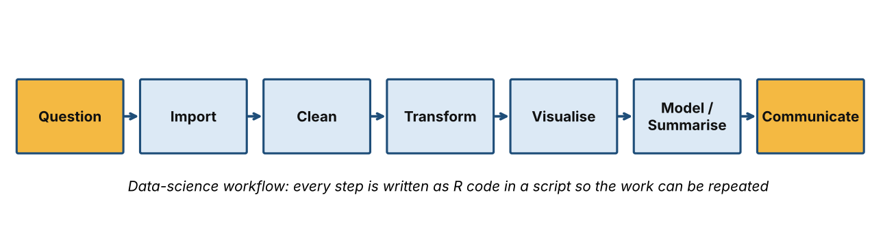
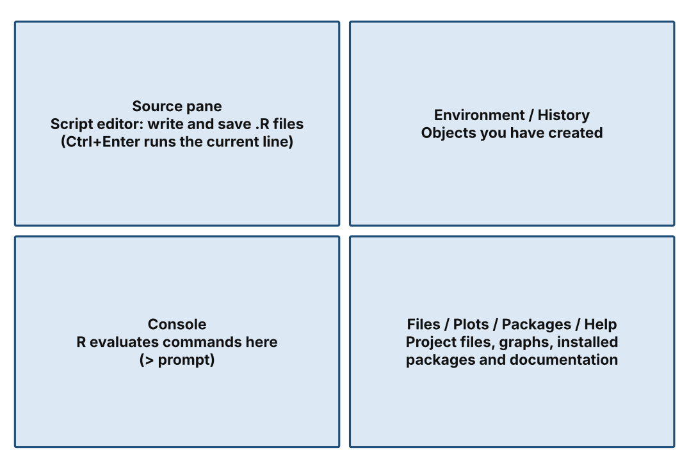
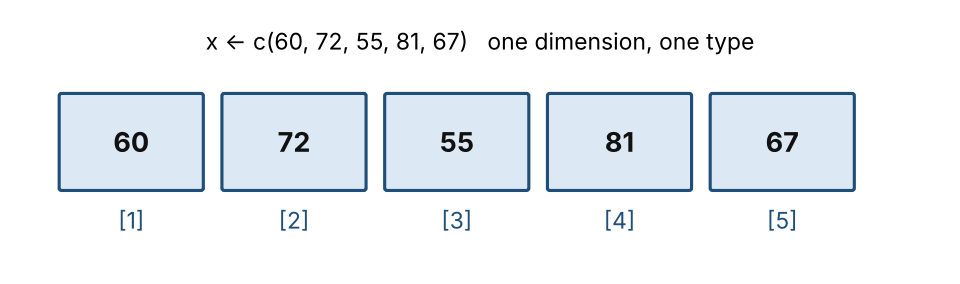
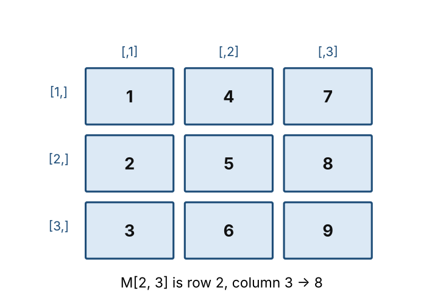
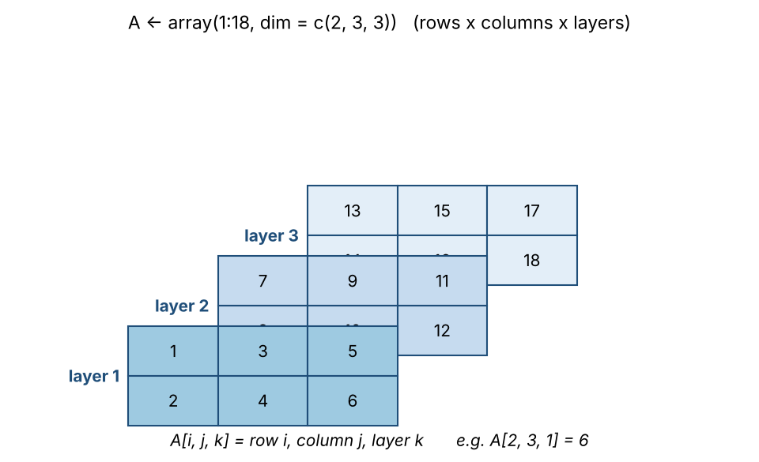

# DTS 211: INTRODUCTION TO R PROGRAMMING
## Consolidated Course Outline and Complete 12-Week Teaching Note

**Olabisi Onabanjo University**  
**Department of Computer Science | B.Sc. Data Science**

**Instructor:** Dr Sakinat Folorunso  
Team Lead, Artificial Intelligence Systems Research Group (ARISG)  
Olabisi Onabanjo University, Ago-Iwoye, Nigeria  
Email: sakinat.folorunso@oouagoiwoye.edu.ng

---

## How to use this master note

This document consolidates the approved course outline followed by the complete standard class notes for Weeks 1–12. The weekly notes are retained in their developed sequence so that lecture explanations, examples, mathematical expressions, R code, practical activities, assessments, schedules and references remain available in one place.

**Course delivery convention:** 30 Lecture Hours (LH) and 45 Practical Hours (PH) over 12 weeks. The developed weekly teaching notes allocate 2.5 lecture hours (150 minutes) and 3.75 practical hours (225 minutes) per week, for 6.25 contact hours weekly.

**Primary environment:** RStudio Desktop (on the student's own computer or a laboratory computer). Posit Cloud is an alternative only when local installation is impossible.  
**Student coding artefact:** a clearly named and commented `.R` script saved in the student's DTS 211 RStudio Project.

### Student-centred way of working with the code

**Start with Week 0** (platforms, installation, project set-up and the setup-check script `scripts/Week_00_DTS211_setup_check.R`). Week 0 is orientation before the semester and is not counted in the 30 LH + 45 PH.

Every weekly R script in the course code bundle (`scripts/Week_XX_DTS211_student.R`) follows the same learning cycle, adapted from the PRIMM approach to teaching programming:

1. **Predict** — before running a block, write down what you expect R to print.
2. **Run** — run the block (Ctrl+Enter / Cmd+Enter) and compare the output with your prediction.
3. **Investigate** — change one value, break the code on purpose, and explain what happened.
4. **Modify** — complete the `YOUR TURN` tasks at the end of each script.
5. **Make** — combine the week's skills in a small piece of your own work.

Lines that are *expected* to produce an error are wrapped in `try()` and labelled `EXPECTED ERROR`, so a script can always be run from top to bottom and any other error is a signal that something needs attention.

### Course project folder and datasets

Create one RStudio Project called `DTS211` and keep the following structure:

```text
DTS211/
├── 00_make_data.R      # run once: source("00_make_data.R")
├── data/               # practice datasets (created by 00_make_data.R)
├── output/             # files your code writes
└── scripts/            # Week_01 ... Week_12 student scripts
```

Running `source("00_make_data.R")` once creates every practice dataset used from Week 5 onward (`students.csv`, `students_raw.csv`, `survey.csv`, `observations.tsv`, `field_notes.txt`, `attendance.csv` and others). The Excel workbook `student_records.xlsx` is supplied ready-made in the `data/` folder.

### Package policy

Apart from short package examples (`ggplot2` as an installation illustration in Week 1, `readxl`/`writexl` in Week 5 and `readr` in Week 8), Weeks 1–5 rely on **base R**. From Week 6, `dplyr` and `tidyr` (and the native pipe `|>`, which needs R 4.1.0 or later) are introduced as supporting tools, and `ggplot2` follows in Week 7 after base graphics. Install a package once with the guarded pattern `if (!requireNamespace("pkg", quietly = TRUE)) install.packages("pkg")` and load it in each session with `library(pkg)`.

---

# PART I — APPROVED COURSE OUTLINE

COURSE OUTLINE GUIDELINES

OLABISI ONABANJO UNIVERSITY

P.M.B. 2002, AGO-IWOYE, OGUN STATE, NIGERIA

DEPARTMENT OF COMPUTER SCIENCE

FACULTY OF SCIENCE

COURSE OUTLINE

Name of Programme: B.Sc. Data Science

Course Code: DTS 211			Course Title: Introduction to R Programming

Credit Unit/Status: 3 units (30 LH + 45 PH) [to be confirmed]		Academic Session: ____________			Academic Semester: ____________

Pre-requisite: [to be confirmed by the Department]			Duration of lecture: 2.5 Hours (150 minutes) per week, plus a 3.75-hour (225-minute) practical

Coordinator’s name and contact including OOU email/phone No.: Dr Sakinat Folorunso, Team Lead, Artificial Intelligence Systems Research Group (ARISG), Olabisi Onabanjo University, Ago-Iwoye · sakinat.folorunso@oouagoiwoye.edu.ng

Name & email/phone. No. of other lecturer(s): ______________________________

Consultation Hours: ______________________________

COURSE DESCRIPTION

DTS 211 introduces students to R programming as a practical tool for data science, covering the R environment, programming fundamentals, data structures, data input and output, data cleaning, transformation, visualisation, control structures, functions, debugging and the development of simple data products. The course emphasises learning by doing: students write, execute, inspect and improve R code while working with progressively more realistic data problems. Students are introduced to R and RStudio/Posit Cloud, enabling them to work in a browser-based environment as well as a local installation. Core R objects and structures—including numbers, attributes, vectors, matrices/arrays, lists, factors, missing values and data frames—are developed through hands-on exercises. Students also learn to import and export data, read text from files and URL connections, manipulate dates and times, use vectorised operations, write functions and loops, and diagnose programming errors. The course culminates in a small reproducible R data product that integrates data acquisition, cleaning, analysis, visualisation and communication.

COURSE LEARNING OUTCOMES/OBJECTIVES

By the end of the course, students should be able to:

• Explain the history, purpose and applications of R programming in data science.

• Navigate and use the R/RStudio/Posit programming environment.

• Create, evaluate and manipulate R objects and identify their data types and attributes.

• Use vectors, matrices, arrays, lists, factors and data frames appropriately.

• Import data into R and export results to external files.

• Identify, clean and transform common data-quality problems, including missing values.

• Display and visualise data using appropriate R tools and interpret basic plots.

• Read lines from text files and retrieve information from URL connections.

• Work with dates and times and perform vectorised operations.

• Use conditional structures, functions and loops to solve programming problems.

• Apply basic R coding standards, debugging techniques and profiling approaches.

• Create a simple reproducible data product using R.

ASSESSMENT METHODS

• Continuous assessment: practical class tests, individual take-home coding assignments, group data exercises and project work – 30%.

• End of Semester Examination – 70%.

• Practical competence, code execution, debugging and interpretation of results will be embedded in the continuous assessment and examination.

PROPOSED ASSESSMENT MAP (for Departmental approval)

• Continuous assessment (30 marks): three practical tests in Weeks 4, 8 and 10 at 6 marks each (18 marks) plus the Week 12 mini data product, marked with the Week 12 rubric (20 marks) and scaled to 12 marks. The weekly 20-mark assignments in the weekly notes are formative and feed back to students; they are not added to the 30 marks unless the Department so decides.

• End-of-semester examination (70 marks), computer-based where facilities allow: Section A, reading and predicting code output (20 marks); Section B, writing R code to solve data problems (30 marks); Section C, debugging and cleaning a supplied dataset (20 marks).

INSTRUCTIONAL METHODS/STRATEGIES

Problem-Based Learning; Guided Discovery; Hands-on Practical Programming; Collaborative Learning; Peer Programming; Demonstration and Guided Practice; Project-Based Learning; Data-Driven Problem Solving; Reflective Learning; Continuous Practical Assessment.

COURSE CONTENT: WEEKLY LESSON PLAN

The course is delivered through 30 Lecture Hours (LH) and 45 Practical Hours (PH) over 12 weeks. Each week combines a focused lecture component with an extended hands-on programming component. Students are expected to write and execute code during practical sessions rather than observe demonstrations only.

WEEKLY CONTACT-HOUR SUMMARY

RECOMMENDED R PLATFORM

Primary platform: RStudio Desktop with a current version of R (4.3 or later recommended), installed on the student's computer or a departmental laboratory computer. Posit Cloud (browser-based RStudio) is an alternative only for students who cannot install software locally; it needs a reliable internet connection. The same scripts run in both environments, so students develop transferable R programming skills.

RECOMMENDED TEXTBOOKS AND READING MATERIALS

• R Core Team. R: A Language and Environment for Statistical Computing. R Foundation for Statistical Computing.

• Wickham, H., Çetinkaya-Rundel, M., & Grolemund, G. R for Data Science (2nd ed.). O’Reilly Media.

• R and Posit documentation and R package documentation for practical reference.

• Instructor-provided datasets, practical worksheets and coding exercises.

COURSE REGULATIONS

• Students are expected to attend and participate actively in all lecture and practical sessions.

• Students must maintain punctuality and bring a functional computing device where required.

• All submitted code must be the student's own work unless collaboration is explicitly authorised.

• Plagiarism, unauthorised copying of code, fabrication of results and academic dishonesty are prohibited.

• Where AI coding assistants are used, students must be able to explain and reproduce the submitted code and comply with the lecturer's stated assessment rules.

• Students should save and organise their R scripts, data files and project outputs to support reproducibility.

• Respect for data privacy, licensing, attribution and responsible data use is required when working with external datasets.

Name/Signature_______________________________    Date________________________________


**Table 1: Weekly lesson plan**

| Week | LH – Lecture Hour | PH – Practical Hour | Student Output / Assessment |
|---|---|---|---|
| Wk. 1; Introduction to R Programming | History and overview of R; applications of R in data science; installation of R and RStudio; introduction to R and the RStudio/Posit environment; R interface including Console, Script Editor, Environment, Files, Plots and Packages. | Setting up the R environment using RStudio Desktop (Posit Cloud as a fallback); creating an R project; writing and executing R commands; creating scripts and comments; installing/loading packages; using R help; first R programming exercises. | R environment set up; first R script |
| Wk. 2; Evaluation and R Objects | Evaluation in R; assignment; R objects; names; numbers; attributes; data types; structures; class(), typeof(), str(); basic computations. | Creating numeric, character and logical objects; assigning and evaluating values; inspecting objects; changing values; performing computations; identifying data types and attributes; basic programming exercises. | Object inspection and computation exercises |
| Wk. 3; Vectors, Matrices and Arrays | Vectors; vector creation and indexing; vectorised operations; matrices; arrays; dimensions; names and attributes; operations on vectors and matrices. | Creating vectors; selecting and modifying elements; arithmetic and logical operations; creating matrices and arrays; indexing rows/columns; applying vectorised operations; solving simple data problems. | Vector/matrix/array programming exercises |
| Wk. 4; Lists, Factors, Missing Values and Data Frames | Lists; factors; levels; categorical data; missing values; NA, NaN and NULL; identifying and handling missing values; structures and data frames. | Creating lists and factors; examining factor levels; creating data frames; identifying and counting missing observations; handling missing values; selecting and modifying data-frame elements. | Missing-value/data-structure exercise; First CA |
| Wk. 5; Getting Data into and out of R | Data files and sources; reading and writing data; CSV and text files; importing and exporting datasets; data organisation and preparation for analysis. | Reading CSV/text data into R; inspecting imported datasets; writing datasets to files; importing/exporting data; checking data types and structures; practical data import/export exercises. | Imported and exported datasets |
| Wk. 6; Cleaning and Transforming Data | Principles of data cleaning; identifying errors and inconsistencies; transforming variables; selecting observations and variables; restructuring data; preparing data for analysis; introduction to dplyr, tidyr and the native pipe operator as supporting tools. | Cleaning a real-world dataset; handling missing values; identifying duplicates; renaming variables; filtering observations; transforming variables; creating new variables; producing an analysis-ready dataset. | Cleaned and transformed dataset |
| Wk. 7; Displaying and Plotting Data | Exploring data; displaying data; basic statistical summaries; graphical representation; principles of effective data visualisation; base R graphics, then an introduction to ggplot2. | Creating bar charts, histograms, boxplots, scatterplots and line plots; labelling plots; interpreting visualisations; using plots to communicate findings from a dataset. | Three meaningful data visualisations |
| Wk. 8; Reading Text and External Data; Dates and Times | Reading lines of a text file; reading from a URL connection; connections in R; working with text data; dates and times; date representation and manipulation. | Using readLines(); reading text from files; reading data from a URL; extracting information from text; converting dates; performing date calculations; analysing simple time-based data. | Text/URL/date-time exercise; Second CA |
| Wk. 9; Control Structures and Vectorised Operations | Vectorised operations; conditional execution; if, else, ifelse(); logical and relational operators; decision-making in R; for, while and repeat loops; break and next; comparison of vectorised operations and traditional control structures. | Building decision-making programs; grade classification; eligibility checks; filtering based on conditions; logical operators; applying if, if...else and vectorised conditional operations to datasets; writing for and while loops. | Decision-making program |
| Wk. 10; Functions, Scoping Rules and Looping | Creating functions; arguments; return values; default arguments; input validation; local and global environments; lexical scoping; combining functions with the loops introduced in Week 9. | Writing user-defined functions; developing reusable R programs; applying functions to data; calling functions inside loops; comparing loops with vectorised operations; solving repetitive data-processing problems. | Functions/loops exercises; Third CA |
| Wk. 11; Coding Standards, Debugging and Profiling R Code | R coding standards; readable and maintainable code; comments and documentation; syntax, runtime and logical errors; debugging strategies; error messages; profiling R code and identifying inefficient code. | Diagnosing deliberately broken R programs; interpreting error messages; locating and correcting errors; applying debugging techniques; improving code structure; identifying inefficient code; basic profiling and performance comparison. | Debugged and improved R program |
| Wk. 12; Creating Data Products Using R | Reproducible analysis; organising R projects; combining data, code, analysis and visualisation; introduction to R Markdown/Quarto; reports and simple data products; review of major course concepts. | Developing a small R data product from a real dataset involving data import, cleaning, transformation, computation, visualisation and interpretation; presenting code and findings; practical revision and examination preparation. | Mini R data product; practical revision |

**Table 2: Weekly contact hours**

| Week | LH | PH | Total Contact Hours |
|---|---|---|---|
| 1 | 2.5 | 3.75 | 6.25 |
| 2 | 2.5 | 3.75 | 6.25 |
| 3 | 2.5 | 3.75 | 6.25 |
| 4 | 2.5 | 3.75 | 6.25 |
| 5 | 2.5 | 3.75 | 6.25 |
| 6 | 2.5 | 3.75 | 6.25 |
| 7 | 2.5 | 3.75 | 6.25 |
| 8 | 2.5 | 3.75 | 6.25 |
| 9 | 2.5 | 3.75 | 6.25 |
| 10 | 2.5 | 3.75 | 6.25 |
| 11 | 2.5 | 3.75 | 6.25 |
| 12 | 2.5 | 3.75 | 6.25 |
| TOTAL | 30 | 45 | 75 |

---

# PART II — COMPLETE WEEKLY TEACHING NOTES

# WEEK 0

**Instructor:** Dr Sakinat Folorunso, Team Lead, Artificial Intelligence Systems Research Group (ARISG), Olabisi Onabanjo University, Ago-Iwoye · sakinat.folorunso@oouagoiwoye.edu.ng

# DTS 211: Introduction to R Programming
## Week 0 — Getting Ready: Platforms, Installation and Your First Check

**Programme:** Department of Computer Science, Olabisi Onabanjo University  
**Course:** DTS 211 — Introduction to R Programming  
**Timing:** before Week 1 (a 60–90 minute supervised laboratory session or guided self-study). Week 0 is orientation; it is **not** counted in the 30 LH + 45 PH of the 12 teaching weeks.  
**Primary environment:** RStudio Desktop (Posit Cloud is the fallback)  
**Student script:** `scripts/Week_00_DTS211_setup_check.R`

---

## 1. Learning outcomes

By the end of Week 0, every student should be able to:

1. Distinguish R, RStudio Desktop, Posit Cloud and an RStudio Project.
2. Install R and RStudio Desktop on their own computer, or open a working Posit Cloud project.
3. Open the `DTS211` RStudio Project and confirm the working directory.
4. Run the setup-check script and interpret its PASS / FIX report.
5. Install the packages used later in the course.
6. Find help when something fails (error message, `getwd()`, `sessionInfo()`, ask early).

## 2. Four names, four jobs

| Name | What it is | Analogy |
|---|---|---|
| **R** | The programming language and the engine that runs your code | The language and the engine |
| **RStudio Desktop** | A free workspace (IDE) for writing and running R code on *your* computer | A well-organised desk |
| **Posit Cloud** | RStudio running in a web browser on Posit's computers | Renting the same desk online |
| **RStudio Project** (`.Rproj`) | A folder that RStudio treats as one piece of work and sets as the working directory | A labelled file box |

R must be installed **before** RStudio Desktop, because RStudio only provides the workspace.

## 3. Which route should I use?

| Question | RStudio Desktop (primary) | Posit Cloud (fallback) |
|---|---|---|
| Works offline after setup? | Yes | No: needs internet throughout |
| Needs installation? | Yes (R + RStudio, about 1 GB of disk space) | No: a modern browser is enough |
| Speed on a weak computer | Depends on your computer | Depends on your internet; free plans have usage limits |
| Your files live… | On your computer (back them up) | In the cloud project |
| Best for | Everyday course work | Students who cannot install software |

**Rule for DTS 211:** use RStudio Desktop wherever you can. Use Posit Cloud only if installation is impossible, and tell your instructor so that your laboratory arrangements can be planned.

## 4. Route A: install R and RStudio Desktop

Do the steps **in this order**. Check your computer's type first (Windows, macOS Intel, macOS Apple silicon, or Linux).

### 4.1 Install R

1. Go to https://cran.r-project.org/ and choose your operating system.
2. **Windows:** choose *base*, download the installer, run it and accept the default options. Rtools is **not** needed for this course.
3. **macOS:** download the `.pkg` that matches your chip (Apple silicon or Intel), open it and follow the prompts.
4. **Linux (Ubuntu/Debian):** `sudo apt install r-base` works, but the packaged version can be old. For R 4.3 or later, follow the CRAN instructions for your distribution.
5. Use **R 4.3 or later** if you can. The course needs at least R 4.1.0 (native pipe `|>`), and Week 9 behaviour of `&&` is the R 4.3.0 behaviour.

### 4.2 Install RStudio Desktop

1. Go to https://posit.co/download/rstudio-desktop/ and download the free **RStudio Desktop** installer for your system.
2. Run the installer with default options and open RStudio.
3. RStudio should find R automatically. If it reports that R cannot be found, install R first (section 4.1) and restart RStudio.

### 4.3 Install on a shared or laboratory computer

- Ask the laboratory technician whether R and RStudio are installed. If they are, you only need your own project folder.
- Save your work on a USB drive or cloud storage you control, not only on the lab machine.

## 5. Route B: Posit Cloud

1. Go to https://posit.cloud/ and create a free account (or sign in).
2. Choose **New Project > New RStudio Project**.
3. In the project's settings, choose **R 4.3 or later** if the option is offered.
4. Get the course files into the project in **one** of two ways:
   - **Upload:** in the **Files** pane, click **Upload**, select the course ZIP (`DTS211_Student_Project.zip`, or the ZIP downloaded from the course GitHub repository) and confirm. RStudio normally unzips it automatically. If it does not, upload the files one folder at a time.
   - **From GitHub:** instead of step 2, choose **New Project > New Project from Git Repository** and paste the course repository address given by your instructor.
5. Open the course folder in the Files pane and click `DTS211.Rproj`.

Things that differ on Posit Cloud: the first package installation is slower, the server clock may be set to UTC (which matters in Week 8), and free accounts have usage limits. Check Posit's current plan limits before you rely on it.

## 6. Set up the DTS 211 project (both routes)

1. Get the course files: on the course GitHub page choose **Code > Download ZIP** (or use the ZIP your instructor gives you), then unzip it to a short, simple path such as `Documents/DTS211` (avoid very long paths, and avoid folders with unusual characters in their names).
2. Double-click `DTS211.Rproj`. RStudio opens with the project folder as the working directory.
3. In the Console type `getwd()`. The path must end in the name of the unzipped course folder.
4. Run `source("00_make_data.R")` once. It creates `data/` and `output/` and writes every practice dataset.

## 7. Run the setup check

Open `scripts/Week_00_DTS211_setup_check.R` and run it from top to bottom (**Source**, or one line at a time). It checks, and prints **PASS** or **FIX** for:

- your R version;
- the project folder and the `data/` and `output/` folders;
- the ability to write and read a file;
- the ability to make and save a plot;
- text encoding (UTF-8);
- the packages used later in the course (it installs missing ones if you set `install_missing <- TRUE`).

Copy the final report into your first script as a comment and keep it. If any line says **FIX**, use the troubleshooting table before Week 1.

## 8. Troubleshooting

| Symptom | Likely cause | What to try |
|---|---|---|
| RStudio says it cannot find R | R is not installed, or was installed after RStudio | Install R, then restart RStudio |
| `getwd()` shows the wrong folder | You opened the `.R` file, not the project | Close RStudio; double-click `DTS211.Rproj` |
| `cannot open file 'data/...'` | `00_make_data.R` has not been run, or wrong working directory | Check `getwd()`, then `source("00_make_data.R")` |
| `package 'xyz' is not available` or installation fails | No internet, firewall, or an old R version | Check connection; update R; try another network; ask for the lab copy |
| Installation fails with a permission or path error | Folder path contains unusual characters, a very long path, or a synchronised (for example OneDrive) folder | Move the project to a short, simple local path |
| Strange characters in output, or the UTF-8 check says FIX | Encoding is not UTF-8 | On Windows use R 4.2 or later; in RStudio set Tools > Global Options > Code > Saving > Default text encoding: UTF-8 |
| Posit Cloud upload did not unzip | Upload method | Upload files individually or use the GitHub link |
| Script stops at the first line | Console is still running something | Press Esc in the Console, then run again |

Always include in any help request: your operating system, the output of `R.version.string`, the exact error message, and what you had just run.

## 9. Low-bandwidth and laboratory plan (for the instructor)

- Place the R and RStudio installers, and a copy of the project zip, on a laboratory server or USB drives before the session.
- Use a supervised session in the computer laboratory so that package installation happens once, on the departmental connection.
- For students without a personal computer, schedule laboratory access and tell them where to save their work.
- Do not assume that every student can use Posit Cloud: it needs a stable connection for the whole session.

## 10. Week 0 checklist (exit ticket)

Students submit a screenshot or pasted text showing:

- [ ] `R.version.string` (R 4.3 or later preferred)
- [ ] `getwd()` ending in the project folder name
- [ ] the final **READY** report from the setup-check script
- [ ] one sentence: *Which route did you use (Desktop or Posit Cloud), and what was the hardest step?*

## 11. Instructor notes

- Run the setup check yourself on the exact laboratory image before the session.
- Pair students who finish early with students who are stuck (peer support is part of the course method).
- Record who is on Posit Cloud so that Week 8 time-zone behaviour and slower installs can be anticipated.
- Keep Week 0 short: the goal is a working environment, not an R lecture.

---


---

# WEEK 1

**Instructor:** Dr Sakinat Folorunso, Team Lead, Artificial Intelligence Systems Research Group (ARISG), Olabisi Onabanjo University, Ago-Iwoye · sakinat.folorunso@oouagoiwoye.edu.ng

# DTS 211: Introduction to R Programming
# Week 1 Standard Class Note — Understanding R and the RStudio/Posit Environment

**Olabisi Onabanjo University | Department of Computer Science**  
**Lecture Hours:** 2.5 | **Practical Hours:** 3.75 | **Total:** 6.25 hours

## Central question

**How does a data scientist move from a real-world data problem to a computer environment in which the problem can be explored, analysed and communicated?**

## 1. Purpose and scope of Week 1

Week 1 establishes the intellectual and practical foundation for learning R. Students first need to understand what R is, why it became important in statistical computing and data science, what kinds of problems it can address, and how the RStudio/Posit environment supports computational work.

This is an orientation week, not a week for teaching programming mechanics in depth. The focus is on the history and applications of R, access to the software, the relationship between R and RStudio, the organisation of a project, and the functions of the major interface components. Students will execute a few introductory commands to understand the environment, but detailed work on assignment, objects, data types and computations belongs to Week 2.

The aim is for every student to leave the class able to access an R environment, create a project and script, identify the main interface components, and describe how they support a reproducible data-analysis workflow.

### Learning outcomes

By the end of this lesson, students should be able to:

1. Explain what R is and outline its historical development.
2. Discuss the importance of R in statistical computing and data science.
3. Identify areas in which R is applied, with relevant examples.
4. Distinguish R, RStudio and Posit Cloud.
5. Install or access an R environment through an appropriate route.
6. Create and organise an RStudio Project.
7. Identify the Console, Script Editor/Source, Environment, Files, Plots and Packages panes.
8. Explain how the interface components interact in a typical workflow.
9. Create, save, reopen and execute a simple R script.
10. Locate documentation and use the R Help system to investigate functions.

## 2. Begin with a data problem

Imagine that the University has collected examination scores for 5,000 students. The Dean asks a data team to answer the following questions:

- What is the average score?
- What proportion of students passed?
- Which departments have the highest and lowest average scores?
- Are there unusual or missing observations?
- Can the results be communicated through a graph?
- Can another analyst reproduce the same results?

A spreadsheet may answer some of these questions. However, the task becomes more demanding when the analysis must be repeated, documented, extended to other departments or updated when new data arrive.

### 2.1 The mathematical idea behind the problem

If the scores are $x_1,x_2,\ldots,x_n$, the arithmetic mean is:

$$
\bar{x}=\frac{1}{n}\sum_{i=1}^{n}x_i
$$

For five illustrative scores:

$$
60,\;72,\;55,\;81,\;67
$$

$$
\bar{x}=\frac{60+72+55+81+67}{5}
=\frac{335}{5}=67
$$

If $k$ students satisfy a specified pass condition among $n$ students, the proportion is:

$$
p=\frac{k}{n}
$$

and the percentage is:

$$
P=\frac{k}{n}\times100\%
$$

The mathematics is straightforward. The data-science challenge is applying the reasoning accurately to thousands of observations, repeating it consistently, documenting the steps and communicating the findings.

### Think–Pair–Share

Before discussing R, consider:
1. Which parts of the task could be done manually?
2. Which tasks would become tedious if repeated for 5,000 students?
3. What could a computer do more consistently?
4. What evidence would another researcher need to reproduce the analysis?

## 3. What is R?

R is a programming language and software environment designed for statistical computing, data analysis and graphics. It allows users to express computational instructions, work with data, apply statistical methods and produce visual or numerical outputs.

R is not simply a calculator. It is an extensible environment in which a researcher can build a sequence of computational steps. These steps can be saved, reviewed, modified and rerun.

### 3.1 Why is R important?

R is particularly valuable because it combines:

- a language designed with statistical analysis in mind;
- a broad collection of statistical and computational methods;
- a graphics system for exploring and communicating data;
- packages that extend the core capabilities;
- scripts that preserve the steps taken during an analysis;
- an active international community.

### 3.2 R as part of a research workflow

A research problem rarely begins with a statistical test. Researchers first define a question, obtain data, inspect the data, prepare them, select an analytical method, interpret the result and communicate the evidence.

R can support many stages of this process:

1. **Question formulation:** translate a research question into measurable quantities.
2. **Data preparation:** import, inspect and organise observations.
3. **Exploratory analysis:** examine distributions, patterns and relationships.
4. **Statistical analysis:** apply appropriate descriptive and inferential methods.
5. **Modelling:** estimate relationships or build predictive models.
6. **Visualisation:** communicate patterns using plots and graphics.
7. **Reporting:** document methods, code and results for reproducibility.

## 4. A brief history of R

R has its roots in the S programming language, which was developed for statistical computing. R was developed by Ross Ihaka and Robert Gentleman at the University of Auckland, New Zealand. It subsequently grew into an open-source project supported by a broad international community.

The history matters because R emerged from a practical need: researchers needed a flexible environment for statistical analysis and graphical exploration. Its development illustrates how scientific software can grow through collaboration, open development and contributions from users across disciplines.

### 4.1 Historical development in context

| Year | Development | Significance |
|---|---|---|
| 1976 | The S language is begun at Bell Laboratories (John Chambers and colleagues) | An interactive language designed for statistical computing and graphics |
| early 1990s | Ross Ihaka and Robert Gentleman start R at the University of Auckland, New Zealand, influenced by S and Scheme | A new implementation that anyone could study and extend |
| 1995 | R is released under the GNU General Public Licence | Free and open-source software |
| 1997 | R Core Team formed; CRAN (Comprehensive R Archive Network) begins | A central, quality-controlled home for add-on packages |
| 2000 | R 1.0.0, the first stable release | R is ready for general use |
| 2003 | R Foundation for Statistical Computing established | A non-profit body supporting the project |
| 2011 | RStudio IDE first released | A friendlier workspace for writing and running R code |
| 2022 | RStudio, PBC renamed Posit | RStudio and Posit Cloud now sit under the Posit name |
| today | CRAN hosts well over 20,000 packages | Specialist tools for almost every field, including genomics, finance and language data |

Dates are given as milestones to place events in order; students are not expected to memorise exact years. Verify dates against the *About R* page at r-project.org when preparing assessment questions.

## 5. Applications of R in data science

R is used across many stages of data work. The examples below are illustrative; the choice of tool always depends on the research question, data characteristics and analytical requirements.

| Application | What R supports | Example question |
|---|---|---|
| Data preparation | Importing, inspecting and transforming data | Are there inconsistent or missing observations? |
| Exploratory data analysis | Summaries, distributions and relationships | What does the dataset look like? |
| Statistics | Descriptive and inferential analysis | Is there evidence of a difference between groups? |
| Visualisation | Charts and graphical exploration | What patterns can be communicated visually? |
| Machine learning | Modelling and predictive workflows | Can available observations support prediction? |
| Survey research | Summaries and analysis of responses | How do responses differ across groups? |
| Business analytics | Trends, performance and forecasting | How has performance changed over time? |
| Scientific research | Reproducible computational analysis | Can another researcher reproduce the result? |

### 5.1 Examples across disciplines

**Agriculture:** Researchers may examine rainfall, soil measurements, crop yields and fertiliser treatments. R can support summaries, statistical comparisons and visualisation.

**Public health:** Researchers may explore disease counts, geographical variation and temporal patterns. R can support data preparation, statistical modelling and visual communication.

**Education:** Researchers may analyse assessment scores, attendance, survey responses and learning outcomes.

**Business and economics:** Analysts may examine expenditure, sales, prices, customer behaviour and economic indicators.

**Humanities and cultural research:** Researchers may analyse survey data, text-derived measures, language resources and cultural datasets.

### Discussion

Choose one discipline represented in the class. Identify:
- a research question;
- the data that would be required;
- one numerical summary;
- one graph that might help communicate the findings.

## 6. R, RStudio and Posit Cloud: understanding the distinction

These terms are related but should not be used interchangeably.

| Name | What it is | What it does |
|---|---|---|
| R | Programming language and computing environment | Evaluates R instructions and performs computation |
| RStudio | Integrated Development Environment (IDE) | Provides an organised interface for writing code, running commands and managing work |
| Posit | Company developing tools for data science, including RStudio | Provides products and services around data science |
| Posit Cloud | Browser-based RStudio environment | Allows users to work with RStudio projects online |

A useful analogy is a language, a writing workspace and a way of accessing that workspace online. R is the language and computational engine; RStudio is the integrated workspace; Posit Cloud provides access to an RStudio environment through a browser.

### 6.1 Conceptual workflow



The purpose of the workflow is to move from a question to an analysis that can be inspected and communicated. The software environment supports the work; it does not replace sound research reasoning.

## 7. Installing or accessing R

Students may use either of two routes.

### Route A: RStudio Desktop

This route installs R and RStudio on the student's computer.

**Step 1 — Install R**
1. Visit https://cran.r-project.org/
2. Select the download option for the computer's operating system.
3. Follow the installation instructions.
4. Complete the installation.

**Step 2 — Install RStudio Desktop**
1. Visit https://posit.co/download/rstudio-desktop/
2. Select the free RStudio Desktop installer.
3. Install it after R has been installed.
4. Open RStudio.

**Step 3 — Verify access**
The RStudio interface should open and provide a Console in which commands can be entered.

### Route B: Posit Cloud

This route provides browser-based access and is useful where local installation is difficult or a student is using a shared computer.

1. Visit https://posit.cloud/
2. Create an account or sign in.
3. Create a new RStudio project.
4. Wait for the project environment to open.
5. Identify the Console and the other interface components.

Posit Cloud is an alternative way to access an RStudio environment; it is not a different programming language. The same introductory R commands can be used in both environments.

### 7.1 Choosing an environment

| Consideration | RStudio Desktop | Posit Cloud |
|---|---|---|
| Installation | Requires local installation of R and RStudio | Accessed through a browser |
| Internet | Can work offline after setup | Requires internet access |
| Computer configuration | Uses local computer resources | Uses cloud resources |
| Files | Stored locally unless synchronised | Stored in the cloud project |
| Best use | Regular local development | Browser-based access and teaching flexibility |

Students should choose one primary route for their coursework and understand that the course scripts are intended to work in both environments.

## 8. The RStudio Project concept

A project is an organised workspace for a particular body of work. It helps keep related scripts, data files and outputs together.

Without a project, students may save scripts in unrelated folders, lose track of data files or become uncertain about where results were written. A project gives the work a clear home.

### 8.1 Create the DTS 211 project

In RStudio Desktop:
1. Select **File → New Project**.
2. Choose **New Directory**.
3. Choose **New Project**.
4. Name it `DTS211_StudentName`.
5. Select an appropriate location.
6. Create the project.

In Posit Cloud:
1. Select **New Project**.
2. Choose an RStudio project.
3. Rename it clearly, for example `DTS211_StudentName`.

### 8.2 Recommended course organisation

```text
DTS211_StudentName/
│
├── DTS211_StudentName.Rproj
│
├── Week01/
│   └── Week1_Environment_Exploration.R
│
├── Week02/
│   └── My_Week2_Practical.R
│
├── Week03/
│   └── My_Week3_Practical.R
│
├── Data/
│
└── Outputs/
```

The exact folder structure can be extended as the course progresses. The key principle is consistency: keep related work together and use meaningful names.

## 9. Understanding the RStudio interface

RStudio brings several activities into one workspace. The panes are not simply different places to type. Each supports a different part of the workflow.



### 9.1 Console

The Console is where R instructions can be entered and evaluated interactively. It displays results, messages, warnings and errors.

**What students should understand:** The Console is useful for trying commands and receiving immediate feedback. However, commands typed only in the Console are not automatically saved as a reusable script.

### 9.2 Script Editor / Source

The Script Editor is where reusable code is written, edited and saved in an `.R` file.

A script is valuable because it preserves the instructions used in an analysis. A student can reopen it, edit it, run it again and share it with another person.

### 9.3 Environment

The Environment pane displays objects currently available in the active R session. At this introductory stage, students only need to recognise that it provides a view of the session's working state. The detailed study of objects begins in Week 2.

### 9.4 Files

The Files pane provides access to files and folders associated with the project. It helps students locate scripts, datasets and outputs.

### 9.5 Plots

The Plots pane displays graphical output produced by R. It allows students to inspect and navigate plots created during analysis.

### 9.6 Packages

Packages extend the capabilities of R. A package may provide functions, datasets, modelling methods or visualisation tools that are not part of the base installation.

Students should distinguish:
- **installing** a package: making it available in the R library;
- **loading** a package: making its functions available in the current session.

A first orientation to package installation and loading:

```r
# Install only if the package is missing, then load it
if (!requireNamespace("ggplot2", quietly = TRUE)) {
  install.packages("ggplot2")
}
library(ggplot2)
```

Package installation generally needs to be done once per R installation or environment, while loading is commonly required in each new R session before using the package's functions.

### 9.7 Help

R provides documentation for functions and packages. Students can use the Help pane or enter a question-mark command in the Console.

```r
?mean
help("mean")
```

The purpose in Week 1 is to become comfortable locating documentation, not to study the function `mean()` in depth.

## 10. From script to execution: first orientation

Create a new R script:
1. Select **File → New File → R Script**.
2. Save it as `Week1_Environment_Exploration.R`.
3. Type a simple expression:

```r
2 + 2
```

4. Run the current line using the Run control.
5. Observe where the result appears.

Try:

```r
10 * 5
100 / 4
```

These are orientation examples. Week 2 will formally explain expressions, evaluation, assignment and objects.

### 10.1 Comments

A comment is explanatory text in a script that R does not execute as an instruction. In R, comments begin with `#`.

```r
# My first DTS 211 script
# This line asks R to calculate 2 plus 2
2 + 2
```

Comments help programmers explain the purpose of code and make scripts easier to understand.

### 10.2 Your first commands: predict, run, explain

For each line below, write your prediction as a comment, run the line, and note whether you were right.

```r
getwd()                  # Which folder is R working in?
sqrt(16)                 # Predict the result
round(3.14159, 2)        # Predict the result
sum(1:10)                # What does 1:10 mean?
print("Hello, DTS 211")   # Text goes inside quotation marks
R.version.string         # Which version of R are you using?
```

Now practise the help system and the package workflow:

```r
?sum                    # Open the help page for sum()
help("round")            # Same idea, different style
if (!requireNamespace("ggplot2", quietly = TRUE)) install.packages("ggplot2")
library(ggplot2)         # Load the package for this session
sessionInfo()            # Record your R version and loaded packages
```

**Reflect:** which of these lines changed what is stored in R, and which only displayed something? Week 2 explains the difference.

## 11. Class activity: RStudio/Posit Environment Detective

Form groups of three. Each group explores the RStudio interface for ten minutes.

Choose one component and prepare a two-minute explanation addressing:
1. What is this component?
2. What does a beginner use it for?
3. What mistake might a beginner make when using it?

After the group presentations, the lecturer consolidates the explanations and corrects misconceptions.

## 12. Guided practical: your first R workspace

Each student should complete the following:

- Open RStudio Desktop or Posit Cloud.
- Create a project named `DTS211_StudentName`.
- Create a new R script.
- Save it as `Week1_Environment_Exploration.R`.
- Locate the Console.
- Locate the Script Editor.
- Locate the Environment.
- Locate the Files pane.
- Locate the Plots pane.
- Locate the Packages pane.
- Run the introductory arithmetic commands.
- Save the script.
- Close and reopen the project to confirm that the project and script can be found again.

**Evidence of completion:** An annotated screenshot identifying the six main interface components and the saved R script.

## 13. Class task: map a data workflow to the interface

A research team receives a student assessment dataset. They need to write analysis instructions, execute them, inspect the session, locate the dataset, view a graph and identify additional capabilities.

Complete the table:

| Research activity | RStudio component |
|---|---|
| Write and save reusable instructions | |
| Execute an instruction | |
| Inspect the current session | |
| Locate a data file | |
| View a graph | |
| Find or load additional capabilities | |
| Read documentation | |

Explain why each component is appropriate.

## 14. Group challenge: design a data-science workspace

Each group receives one scenario:
- student performance;
- hospital records;
- agricultural yield;
- survey responses;
- household expenditure.

Do not analyse the data yet. Instead, draw a workflow connecting:
1. the research question;
2. the R project;
3. the Script Editor;
4. the Console;
5. the Environment;
6. Files;
7. Plots;
8. Packages and Help.

Each group explains why the components are needed and how they work together.

## 15. Reflection

1. What did you believe R was before this class?
2. How would you now distinguish R, RStudio and Posit Cloud?
3. Which interface component is clearest to you?
4. Which component still needs practice?
5. What did you discover by exploring before receiving the lecturer's explanation?
6. What challenge did you encounter during installation or access?
7. How could an organised project improve your coursework?
8. What would you like to be able to do with R by the end of the course?

## 16. Week 1 assignment: My R Environment Portfolio

Prepare a short digital portfolio with three parts.

**Part A — Why R for Data Science?**
Write approximately one page explaining:
- the historical significance of R;
- at least four areas in which R is used;
- why a programming environment is useful when working with large datasets.

**Part B — Annotated environment**
Provide a screenshot of RStudio Desktop or Posit Cloud. Clearly label:
- Console;
- Script Editor/Source;
- Environment;
- Files;
- Plots;
- Packages.

Explain the purpose of each component in complete sentences.

**Part C — Mathematical reasoning**
Using scores 60, 72, 55, 81 and 67, calculate the arithmetic mean by hand:

$$
\bar{x}=\frac{\sum_{i=1}^{n}x_i}{n}
$$

Show every step. Explain why a data scientist would want a computer to perform this calculation when the dataset contains thousands or millions of observations.

## 17. Assignment assessment guide

| Criterion | Excellent | Developing | Needs attention |
|---|---|---|---|
| Understanding of R | Accurate explanation connected to data science | Generally correct but lacks depth | Major misconceptions |
| R/RStudio/Posit distinction | Relationship clearly explained | Partly clear | Tools confused |
| Interface identification | All six components identified and explained | Most identified | Several missing or confused |
| Mathematical reasoning | Formula and calculation correct | Minor errors | Substantially incorrect |
| Reflection | Specific evidence of learning and problem-solving | General reflection | Very brief or descriptive |

## 18. Exit ticket

1. Complete: R is __________________.
2. Complete: RStudio is __________________.
3. Complete: Posit Cloud is __________________.
4. Name the six interface components studied.
5. Where would you write reusable R code?
6. Where would you see a graph?
7. Calculate the mean of 10, 20, 30 and 40.
8. State one question you still have about R.

## 19. Week 1 synthesis

R is a computational environment for working with data. RStudio provides an integrated workspace for interacting with R, while Posit Cloud provides a browser-based route to that workspace. The Console, Script Editor, Environment, Files, Plots and Packages support different but connected parts of a data-science workflow.

The mathematical examples establish that data science combines conceptual reasoning with computation. A formula may be simple, but applying it consistently to large datasets, documenting the steps and communicating results is a computational task.

**Week 1 take-home message:** Do not aim merely to memorise interface labels. Understand the workflow: begin with a data question, organise a project, write and execute instructions, inspect the working environment, manage files and communicate results.

## 20. Lecturer's teaching notes

Avoid beginning with a long history lecture or a screen-by-screen demonstration. Start with the 5,000-student problem. Let students discuss what they would do manually and what they would ask a computer to do.

Use the history of R to explain why statistical programming languages matter. Treat installation as a hands-on activity with peer support. During the interface lesson, allow students to explore before giving the formal explanation.

Keep Week 1 within its intended scope. Introduce the environment and the workflow, but reserve detailed treatment of evaluation, assignment, objects, names, data types and object inspection for Week 2.

A useful teaching rhythm is: pose a question, allow individual thinking, discuss in pairs, explore the environment, test a simple command and consolidate the learning as a class.

## 21. Suggested learning resources

- R Project: https://www.r-project.org/
- The Comprehensive R Archive Network (CRAN): https://cran.r-project.org/
- RStudio Desktop: https://posit.co/download/rstudio-desktop/
- Posit Cloud: https://posit.cloud/
- An Introduction to R: https://cran.r-project.org/doc/manuals/r-release/R-intro.html
- RStudio IDE documentation: https://docs.posit.co/ide/user/


---

# WEEK 2

**Instructor:** Dr Sakinat Folorunso, Team Lead, Artificial Intelligence Systems Research Group (ARISG), Olabisi Onabanjo University, Ago-Iwoye · sakinat.folorunso@oouagoiwoye.edu.ng

# DTS 211: Introduction to R Programming
# Week 2 Standard Class Note — Evaluation in R and R Objects

**Olabisi Onabanjo University | Department of Computer Science**  
**Lecture focus:** Evaluation in R; assignment; R objects; names; numbers; attributes; data types; structures; `class()`, `typeof()`, `str()`; basic computations.  
**Practical focus:** Creating numeric, character and logical objects; assigning and evaluating values; inspecting objects; changing values; performing computations; identifying data types and attributes; basic programming exercises.

## 1. Introduction: from the R environment to programming instructions

In Week 1, we explored what R is, why it is used in data science, and how to navigate RStudio Desktop or Posit Cloud. We created a project, located the main interface components and ran a few introductory commands.

This week we move from the environment to the fundamental behaviour of the language. When a programmer enters an instruction, R interprets and evaluates it. An expression may produce a value. That value may be displayed, assigned to an object, or used in another expression.

Understanding this process is essential. Later work with vectors, matrices, lists, data frames, functions and statistical methods depends on students understanding how R handles values and objects.

**Guiding question:** How does R evaluate instructions, represent information and store results for later use?

### Learning outcomes

By the end of this lesson, students should be able to:

1. Explain evaluation in R.
2. Distinguish an expression, its evaluation and its resulting value.
3. Explain and use the assignment operator `<-`.
4. Define an R object at an introductory level.
5. Create, name and reassign objects.
6. Apply naming conventions and recognise case sensitivity.
7. Create numeric, character and logical objects.
8. Distinguish values that look similar but have different types.
9. Explain the difference between class and underlying storage type.
10. Inspect objects using `class()`, `typeof()` and `str()`.
11. Explain and inspect attributes using `attributes()` and `attr()`.
12. Perform basic computations using stored values.
13. Identify and correct common beginner errors.

## 2. Opening problem: storing student assessment results

Imagine a student has the following assessment results:

| Assessment | Score |
|---|---:|
| Test 1 | 68 |
| Test 2 | 74 |
| Assignment | 82 |

The lecturer wants to calculate the total and average, determine whether the student has met a pass threshold of 50, and later update the calculations if a score changes.

The first step is to represent the information in R:

```r
test1 <- 68
test2 <- 74
assignment <- 82
```

The object names provide labels for the values. We can ask R to display each value:

```r
test1
test2
assignment
```

We can also use the stored values in a calculation:

```r
total <- test1 + test2 + assignment
average <- total / 3

total
average
```

The total is:

$$
T=68+74+82=224
$$

The average is:

$$
\bar{x}=\frac{68+74+82}{3}
=\frac{224}{3}\approx74.67
$$

The important point is that R can retrieve stored values, evaluate an expression using them and assign the result to another object.

### Think–Predict–Run–Inspect–Explain

Before running each command:
1. Predict what R will do.
2. Run the command.
3. Inspect the result.
4. Explain why the result appeared.
5. If appropriate, change one value and repeat the calculation.

## 3. Evaluation in R

### 3.1 What is an expression?

An expression is a valid piece of R code that can be evaluated to produce a result.

Examples:

```r
5 + 3
10 * 4
20 / 5
2^3
```

R evaluates these expressions and produces:

| Expression | Result |
|---|---:|
| `5 + 3` | 8 |
| `10 * 4` | 40 |
| `20 / 5` | 4 |
| `2^3` | 8 |

Evaluation is the process through which R interprets an expression according to the language's rules and determines its result.

### 3.2 Expression, evaluation and result

Consider:

```r
5 + 3
```

- Expression: `5 + 3`
- Evaluation: R performs the addition.
- Result: `8`

A useful conceptual model is:

```text
R expression
     |
     v
R evaluates the expression
     |
     v
A result is produced
     |
     v
The result may be displayed,
assigned or used again
```

Not every result is automatically stored under a name. A result can simply be displayed in the Console.

### 3.3 Predicting results

Predict before running:

```r
12 + 8
15 - 6
7 * 3
18 / 2
3^2
(4 + 2) * 3
```

Record your predictions and compare them with the output.

### 3.4 Arithmetic operators

| Operator | Meaning | Example | Result |
|---|---|---|---:|
| `+` | Addition | `5 + 3` | 8 |
| `-` | Subtraction | `5 - 3` | 2 |
| `*` | Multiplication | `5 * 3` | 15 |
| `/` | Division | `6 / 3` | 2 |
| `^` | Exponentiation | `2^3` | 8 |
| `%%` | Remainder | `7 %% 3` | 1 |
| `%/%` | Integer division | `7 %/% 3` | 2 |

R can calculate the remainder and integer quotient:

```r
7 %% 3
7 %/% 3
```

Since $7=2\times3+1$, the integer quotient is 2 and the remainder is 1.

### 3.5 Order of operations

R follows mathematical operator precedence. Multiplication and division are evaluated before addition and subtraction unless parentheses specify another order.

```r
2 + 3 * 4
(2 + 3) * 4
```

The first expression is:

$$
2+(3\times4)=14
$$

The second is:

$$
(2+3)\times4=20
$$

Parentheses make the intended order explicit and improve readability.

### 3.6 Expressions using existing values

```r
test1 <- 68
test2 <- 74

test1 + test2
```

R retrieves the values associated with the names, adds them and displays the result. This is a simple example of using stored information in an expression.

## 4. Assignment and R objects

### 4.1 What is assignment?

Assignment associates a value with an object name. In this course, the standard assignment operator is `<-`.

```r
score <- 75
```

Read this as: “Assign the value 75 to the object named `score`.”

The arrow points towards the name receiving the value.

```r
score
```

R displays the value associated with `score`.

Although R also supports `=`, we will use `<-` consistently for assignment in this course.

### 4.2 What is an R object?

At this introductory level, an R object is an entity that stores or represents information which R can inspect, evaluate, use in computations or modify through assignment. An object is not necessarily a single value. It may represent one value, a collection of values or a more complex structure with additional information attached. In Week 2, attention is restricted to simple individual objects so that students understand the basic principles before studying collections in Week 3 and more complex structures in Week 4.

Examples:

```r
age <- 21
student_name <- "Amina"
registered <- TRUE
```

The objects represent different kinds of information:
- `age` represents a numerical quantity;
- `student_name` represents text;
- `registered` represents a logical status.

Objects are fundamental because they allow a program to refer to information by meaningful names rather than repeatedly typing raw values.

### 4.3 Assignment versus displaying a calculation

Run:

```r
score <- 75
score + 5
score
```

The calculation `score + 5` produces 80. However, the stored value associated with `score` remains 75.

Why? Because the expression was evaluated and displayed, but its result was not assigned back to `score`.

To update the object:

```r
score <- score + 5
score
```

Now the value is 80.

The operation on the right-hand side is evaluated first. The resulting value is then assigned to the object on the left-hand side.

### 4.4 Reassignment

```r
score <- 75
score <- 82
score
```

The second assignment replaces the value associated with `score`. The final value is 82.

Reassignment is common when values are updated as new information becomes available.

### 4.5 A useful distinction

| Code | What happens? |
|---|---|
| `score + 5` | Calculates and displays a result |
| `new_score <- score + 5` | Calculates and stores the result in a new object |
| `score <- score + 5` | Calculates and replaces the value associated with `score` |

Students should be able to explain this distinction without relying on memorisation.

## 5. Naming objects

### 5.1 Why names matter

Object names make code readable. A name such as `average_score` communicates more than a name such as `x`.

```r
average_score <- 74.67
student_name <- "Amina"
registration_status <- TRUE
```

Good names help the programmer, lecturer and future reader understand the purpose of an object.

### 5.2 Naming conventions and rules

- Use descriptive names.
- Use underscores to separate words, for example `student_score`.
- Avoid spaces in ordinary object names.
- Names are case-sensitive.
- A name should not begin with a number.
- Avoid reserved words and confusing names.
- Be consistent throughout a script.

### 5.3 Case sensitivity

```r
student_score <- 75
Student_score <- 80

student_score
Student_score
```

These are two different object names. R distinguishes uppercase and lowercase letters.

### 5.4 Meaningful versus unclear names

| Less informative | More informative |
|---|---|
| `x` | `student_age` |
| `a` | `test_score` |
| `v1` | `average_score` |
| `flag` | `registration_status` |

Short names can be appropriate in mathematical examples, but descriptive names are preferable in larger programs.

## 6. Numeric objects and numbers in R

### 6.1 Numeric values

R supports numerical values for calculations. Ordinary numeric literals such as `25` are commonly stored as double-precision values.

```r
score <- 75
height <- 1.72
temperature <- 28.5
```

### 6.2 Integer and double values

R distinguishes integer and double storage.

```r
whole_number <- 25L
decimal_number <- 25.0

typeof(whole_number)
typeof(decimal_number)
```

The `L` suffix creates an integer literal. A value such as `25.0` is stored as a double.

The printed values may look similar, but their underlying storage types differ.

### 6.3 Basic computations with stored values

```r
test1 <- 68
test2 <- 74
assignment <- 82

total <- test1 + test2 + assignment
average <- total / 3

total
average
```

Mathematically:

$$
T=x_1+x_2+x_3
$$

$$
\bar{x}=\frac{T}{3}
$$

### 6.4 Numerical precision

Computers represent many decimal numbers using finite binary precision. As a result, some decimal calculations may display small floating-point differences.

For example:

```r
0.1 + 0.2
```

The displayed result may not be exactly the decimal representation one expects. This is a property of floating-point representation, not necessarily an error in the student's arithmetic.

For introductory work, students should understand that computer numerical representation has precision limits. Avoid comparing floating-point calculations as though every decimal result must be represented exactly.

### Short precision investigation

Run:

```r
result <- 0.1 + 0.2
result
result == 0.3
```

Discuss:
1. Why might the displayed value differ slightly from the decimal value expected?
2. Why might an exact equality test return `FALSE`?
3. Why is it important to understand representation when working with financial, scientific or measurement data?

For this introductory course, students should recognise the issue rather than attempt to solve every numerical precision problem. In later computational work, approximate comparisons can be made using a tolerance, for example:

```r
abs((0.1 + 0.2) - 0.3) < 1e-10
```

The expression checks whether the difference is smaller than a very small tolerance. It is a more appropriate approach for many floating-point comparisons than requiring exact equality.

## 7. Character objects

### 7.1 What is character data?

Character objects store text, such as names, course codes, locations and labels.

```r
student_name <- "Amina"
course_code <- "DTS 211"
department <- "Computer Science"
```

Text is enclosed in quotation marks. Single and double quotation marks can both be used.

### 7.2 Why quotation marks matter

Compare:

```r
student_name <- "Amina"
```

with:

```r
student_name <- Amina
```

The first assigns the character string `"Amina"`. In the second, R interprets `Amina` as an object name. If such an object does not exist, R reports an error.

### 7.3 A number stored as text

```r
number_a <- 25
number_b <- "25"
```

The values may look similar when printed, but they are different types. The first is numeric; the second is character data.

This matters because arithmetic operations require suitable numerical values.

```r
number_a + 5
```

The character object `number_b` should not be treated as if it were already numeric. Conversion, when appropriate, is a separate operation and should be deliberate.

## 8. Logical objects and comparison expressions

### 8.1 Logical values

Logical values represent one of two states:

- `TRUE`
- `FALSE`

```r
registered <- TRUE
submitted_assignment <- FALSE
```

Logical information is useful for representing conditions, decisions and status indicators.

### 8.2 Comparison operators

| Operator | Meaning | Example |
|---|---|---|
| `>` | Greater than | `score > 50` |
| `<` | Less than | `score < 50` |
| `>=` | Greater than or equal to | `score >= 50` |
| `<=` | Less than or equal to | `score <= 50` |
| `==` | Equal to | `score == 50` |
| `!=` | Not equal to | `score != 50` |

Example:

```r
score <- 72
score >= 50
```

The expression evaluates to `TRUE`.

We can assign the logical result:

```r
passed <- score >= 50
passed
```

### 8.3 Updating the condition

```r
score <- 42
passed <- score >= 50
passed
```

The result is now `FALSE`.

This demonstrates:

$$
\text{Expression}\rightarrow\text{Evaluation}\rightarrow
\text{Result}\rightarrow\text{Assignment}
$$

The logical object stores the result of the comparison at the time the assignment is evaluated. If the original score changes later, the logical object is not automatically recalculated; the comparison must be evaluated and assigned again.

## 9. Inspecting objects: class(), typeof() and str()

A programmer should not guess what an object contains. R provides functions for inspecting its properties and structure.

### 9.1 `class()`: how R classifies an object

The function `class()` reports the object's class.

```r
score <- 75
student_name <- "Amina"
registered <- TRUE

class(score)
class(student_name)
class(registered)
```

For the simple objects in this lesson, the class gives a useful high-level description.

### 9.2 `typeof()`: underlying storage type

The function `typeof()` reports the underlying storage type used by R.

```r
typeof(score)
typeof(student_name)
typeof(registered)
```

Typical results include:
- `"double"` for ordinary numeric values;
- `"character"` for text;
- `"logical"` for logical values;
- `"integer"` for integer values.

### 9.3 `str()`: compact structure inspection

The function `str()` displays a compact description of an object's structure.

```r
str(score)
str(student_name)
str(registered)
```

It is particularly useful when objects become more complex. Later, it will help students inspect vectors, lists and data frames.

### 9.4 Comparing the functions

| Function | Main question |
|---|---|
| `class(x)` | How does R classify this object? |
| `typeof(x)` | What is the underlying storage type? |
| `str(x)` | What is the object's structure? |

These functions are related but not interchangeable. Together they provide a more complete picture.

### 9.4A A direct comparison of class and storage type

Run the following commands and complete the table from the output:

```r
class(25)
typeof(25)

class(25L)
typeof(25L)

class("25")
typeof("25")

class(TRUE)
typeof(TRUE)

class(25.0)
typeof(25.0)
```

| Expression | Expected `class()` result | Expected `typeof()` result |
|---|---|---|
| `25` | `"numeric"` | `"double"` |
| `25L` | `"integer"` | `"integer"` |
| `"25"` | `"character"` | `"character"` |
| `TRUE` | `"logical"` | `"logical"` |
| `25.0` | `"numeric"` | `"double"` |

The key distinction is that `class()` reports the class through which R describes or treats an object, while `typeof()` reports its underlying storage type. For example, ordinary numeric values have class `"numeric"` but are commonly stored as `"double"`.

Students should not infer storage type from how a value is printed. The inspection functions provide evidence about how R represents the object.

### 9.5 Worked inspection example

```r
a <- 25
b <- "25"
c <- TRUE
d <- 25L
e <- 25.0

class(a); typeof(a); str(a)
class(b); typeof(b); str(b)
class(c); typeof(c); str(c)
class(d); typeof(d); str(d)
class(e); typeof(e); str(e)
```

**Interpretation:** The printed appearance of a value is not sufficient to determine its data type. Inspection functions reveal how R represents it.

## 10. Attributes: metadata attached to objects

### 10.1 What is an attribute?

An attribute is additional information attached to an R object. It describes some aspect of the object without necessarily changing the underlying value.

Examples of attributes encountered in R include:
- names;
- dimensions;
- class information;
- other descriptive metadata.

### 10.2 Inspecting attributes

```r
score <- 75
attributes(score)
```

A simple numeric object will usually have no attributes, so R returns `NULL`.

### 10.3 Adding a descriptive attribute

```r
attr(score, "description") <- "A student's assessment score"

attributes(score)
attr(score, "description")
str(score)
```

The numeric value remains 75. The added attribute stores descriptive information.

### 10.4 `attributes()` and `attr()`

- `attributes(x)` inspects the collection of attributes attached to an object.
- `attr(x, "name")` retrieves or assigns a particular attribute.

Example:

```r
attr(score, "source") <- "Programming test"
attr(score, "description")
attr(score, "source")
attributes(score)
```

**Important distinction:** Attributes are metadata. They should not be confused with the main data value itself.

## 11. Basic object structures: preparing for later weeks

R objects differ in both their values and their structures. In Week 2, students work with simple individual objects. The next weeks extend this understanding to collections and more complex structures.

For now:

```r
score <- 75
student_name <- "Amina"
registered <- TRUE

str(score)
str(student_name)
str(registered)
```

The function `str()` provides a compact way to investigate the structure. The detailed study of vectors, matrices and arrays follows in Week 3; lists, factors and data frames follow in Week 4.

## 11A. Suggested teaching allocation

The approved contact allocation is 2.5 lecture hours and 3.75 practical hours.

### Lecture allocation: 150 minutes

| Teaching activity | Suggested time |
|---|---:|
| Opening student-record problem and recap | 10 min |
| Expressions, evaluation and arithmetic | 25 min |
| Assignment and object concept | 25 min |
| Naming conventions and numeric values | 20 min |
| Character and logical objects | 20 min |
| Object inspection: `class()`, `typeof()` and `str()` | 25 min |
| Attributes, synthesis and questions | 25 min |
| **Total** | **150 min** |

### Practical allocation: 225 minutes

| Practical activity | Suggested time |
|---|---:|
| Create and name simple objects | 25 min |
| Evaluate arithmetic expressions and predict outputs | 30 min |
| Assignment, reassignment and dependent calculations | 35 min |
| Numeric, character and logical object investigation | 30 min |
| Inspect with `class()`, `typeof()` and `str()` | 35 min |
| Attributes exercise | 20 min |
| Object Detective and debugging | 30 min |
| Reflection and save/submit script | 20 min |
| **Total** | **225 min** |

The time allocations are teaching guidance. The lecturer can redistribute time based on students' prior programming experience, but should preserve enough practical time for students to predict, run, inspect and explain their code.

---

## 12. Guided practical: constructing and investigating a student record

### Scenario

Create a simple student record containing a name, age, three assessment scores and registration status.

### Step 1 — Create the objects

```r
student_name <- "Amina"
age <- 21
test1 <- 68
test2 <- 74
assignment <- 82
registered <- TRUE
```

### Step 2 — Inspect the values

```r
student_name
age
test1
test2
assignment
registered
```

### Step 3 — Calculate the total and average

$$
T=x_1+x_2+x_3
$$

$$
\bar{x}=\frac{x_1+x_2+x_3}{3}
$$

```r
total <- test1 + test2 + assignment
average <- total / 3

total
average
```

### Step 4 — Evaluate the pass condition

For this exercise, use 50 as the illustrative threshold.

```r
passed <- average >= 50
passed
```

### Step 5 — Inspect selected objects

```r
class(student_name)
typeof(student_name)
str(student_name)

class(age)
typeof(age)
str(age)

class(average)
typeof(average)
str(average)

class(registered)
typeof(registered)
str(registered)

class(passed)
typeof(passed)
str(passed)
```

### Step 6 — Reassign one score

```r
test2 <- 90
```

Recalculate the dependent results:

```r
total <- test1 + test2 + assignment
average <- total / 3
passed <- average >= 50

total
average
passed
```

### Interpretation questions

1. Which object was directly changed?
2. Which results changed after the reassignment?
3. Why did R not automatically update `total` and `average`?
4. Which functions helped you investigate the objects?
5. How would you explain the difference between the value and its attribute?

## 13. Activity: Object Detective

Run:

```r
a <- 25
b <- "25"
c <- TRUE
d <- 25L
e <- 25.0
```

Investigate each object with `class()`, `typeof()` and `str()`.

Complete:

| Object | Value as written | Class | Type | Observation |
|---|---|---|---|---|
| `a` | `25` | | | |
| `b` | `"25"` | | | |
| `c` | `TRUE` | | | |
| `d` | `25L` | | | |
| `e` | `25.0` | | | |

Questions:
1. Why are `a` and `b` different kinds of values?
2. What does the `L` suffix indicate?
3. Why do `a` and `e` look similar?
4. What does `typeof()` reveal that printing alone does not?
5. Why should programmers inspect unfamiliar objects before using them?

## 14. Common errors and debugging

### Error 1 — Object not found

```r
student_score
```

If the object has not been created in the current session, R reports that it cannot find it.

**Check:** Was the assignment line run? Is the name spelt correctly? Is the capitalisation identical?

### Error 2 — Text without quotation marks

```r
student_name <- Amina
```

R interprets `Amina` as an object name, not as text.

**Correction:**

```r
student_name <- "Amina"
```

### Error 3 — Calculation does not update the object

```r
score <- 75
score + 5
score
```

The result of the calculation is displayed, but `score` remains 75.

**Correction when updating is intended:**

```r
score <- score + 5
```

### Error 4 — Inconsistent capitalisation

```r
student_score <- 75
Student_score
```

The second name is not the same as the first. R is case-sensitive.

### Error 5 — Confusing character and numeric values

```r
number <- "25"
number + 5
```

The value is character data, not a numeric quantity. Do not assume that a value that looks like a number is stored numerically.

### A systematic debugging routine

1. Read the error message.
2. Check spelling and capitalisation.
3. Confirm that the assignment has been executed.
4. Inspect the object with `class()`, `typeof()` and `str()`.
5. Run a small section of the script at a time.
6. Distinguish between a calculation and an assignment.

## 15. Independent challenge: a student record

Create a script that:

1. Stores a student's name as character data.
2. Stores age as a numeric value.
3. Stores three assessment scores as numeric values.
4. Stores registration status as a logical value.
5. Calculates total and average score.
6. Creates a logical object indicating whether the average is at least 50.
7. Inspects the name, age, average, registration status and pass result using `class()`, `typeof()` and `str()`.
8. Changes one assessment score and updates the calculations.
9. Attaches a descriptive attribute to the average object.
10. Writes three sentences explaining evaluation, assignment and object inspection.

Use meaningful object names and comments to explain your code.

## 16. Week 2 assignment

**Title: Creating and Investigating R Objects**

Create an R script named `My_Week2_Assignment.R`.

Your script must:

- create at least one numeric, one character and one logical object;
- demonstrate assignment and reassignment;
- evaluate at least five arithmetic expressions;
- use stored objects in at least three computations;
- inspect selected objects with `class()`, `typeof()` and `str()`;
- use `attributes()` to inspect an object;
- attach at least one descriptive attribute;
- include comments explaining each major section;
- finish with short written answers to:
  1. What is evaluation in R?
  2. What is an R object?
  3. How are `class()`, `typeof()` and `str()` different?
  4. Why is assignment different from displaying a calculation?

### Suggested 20-mark assessment rubric

| Criterion | Evidence expected | Marks |
|---|---|---:|
| Object creation and naming | Correct numeric, character and logical objects with meaningful names | 4 |
| Evaluation and assignment | Correct expressions, assignment and reassignment, with explanation | 4 |
| Basic computation | Correct calculations using stored objects | 3 |
| Object inspection | Appropriate use and interpretation of `class()`, `typeof()` and `str()` | 4 |
| Attributes | Correct inspection and addition of a descriptive attribute | 2 |
| Code quality and explanation | Readable script, useful comments and accurate written responses | 3 |
| **Total** | | **20** |

The lecturer should assess both the executable script and the student's ability to explain the output. A script that runs without the student understanding what it does should not receive full credit.

---

## 17. Reflection and exit ticket

Answer without looking at the examples:

1. What does it mean for R to evaluate an expression?
2. What does `<-` do?
3. What is the difference between calculating a result and assigning it?
4. Why are meaningful object names useful?
5. What is the difference between `class()` and `typeof()`?
6. What does `str()` help you inspect?
7. What is an attribute?
8. How can you investigate an object whose type you do not know?
9. Why does changing an input object not automatically update a previously assigned result?

### Exit-ticket code

Predict the output before running:

```r
score <- 70
new_score <- score + 10

new_score
score

score <- 40
new_score
```

Explain why `new_score` does not change automatically when `score` is reassigned.

## 18. Week 2 summary

R evaluates expressions and produces results. Assignment associates values with object names so that information can be reused. Students have practised numeric, character and logical objects, meaningful naming, reassignment and basic computations.

The principal functions introduced are:

- `class()` — examines an object's class;
- `typeof()` — examines its underlying storage type;
- `str()` — provides a compact view of its structure;
- `attributes()` — inspects attributes attached to an object;
- `attr()` — retrieves or assigns a particular attribute.

**Core takeaway:** Understand what R is evaluating, store useful results with meaningful names, and inspect objects rather than guessing what they contain.

Week 3 builds on these foundations by examining how R organises multiple values in vectors, matrices and arrays.

## 19. Suggested references

- R Project for Statistical Computing: https://www.r-project.org/
- An Introduction to R: https://cran.r-project.org/doc/manuals/r-release/R-intro.html
- R documentation for assignment: https://stat.ethz.ch/R-manual/R-devel/library/base/html/assignOps.html
- R documentation for `class()`: https://stat.ethz.ch/R-manual/R-devel/library/base/html/class.html
- R documentation for `typeof()`: https://stat.ethz.ch/R-manual/R-devel/library/base/html/typeof.html
- R documentation for `str()`: https://stat.ethz.ch/R-manual/R-devel/library/utils/html/str.html
- R documentation for `attributes()`: https://stat.ethz.ch/R-manual/R-devel/library/base/html/attributes.html


---

# WEEK 3

**Instructor:** Dr Sakinat Folorunso, Team Lead, Artificial Intelligence Systems Research Group (ARISG), Olabisi Onabanjo University, Ago-Iwoye · sakinat.folorunso@oouagoiwoye.edu.ng

# DTS 211: Introduction to R Programming
# Week 3 — Vectors, Matrices and Arrays
**Olabisi Onabanjo University | Department of Computer Science**

**Lecture theme:** Organising, accessing and computing with collections of values in R  
**Laboratory theme:** Creating and manipulating vectors, matrices and multidimensional arrays  
**Suggested contact allocation:** 2.5 lecture hours + 3.75 practical hours (adapt to the approved course timetable)

---

## 1. Why data structures matter

Programming becomes useful when it can represent more than one isolated value. Consider a lecturer recording the scores of 300 students in three assessments. Creating one object for every score would produce 900 separate objects. This would be difficult to inspect, update, compare and analyse.

A data structure provides an organised way to store related values. R's basic structures are especially important because statistical computing frequently involves collections of observations, variables and measurements.

This week develops three structures:

1. **Vector:** a one-dimensional sequence of elements.
2. **Matrix:** a two-dimensional arrangement of elements in rows and columns.
3. **Array:** a multidimensional arrangement of elements.

The central idea is that a data structure is not merely a container. Its organisation determines how values are selected, how dimensions are interpreted and which operations can be applied.

**Guiding question:** How can R represent and process collections of values accurately and efficiently?

### Learning outcomes

By the end of the week, students should be able to:

- distinguish vectors, matrices and arrays;
- create numeric, integer, character and logical vectors;
- generate sequences and repeated patterns;
- explain atomic-vector homogeneity and type coercion;
- use positional, negative, logical and named indexing;
- modify and extend vectors;
- explain vectorised computation and recycling;
- construct matrices and arrays and interpret their dimensions;
- select individual elements, rows, columns and array slices;
- distinguish element-wise matrix operations from matrix multiplication;
- use summary functions to analyse vectors and matrices;
- inspect objects using `class()`, `typeof()`, `length()`, `dim()` and `str()`.

---

## 2. From individual values to collections: an academic example

Suppose five students obtain these scores in a programming test:

| Student | Score |
|---|---:|
| Amina | 60 |
| Bola | 72 |
| Chidi | 55 |
| Dayo | 81 |
| Efe | 67 |

### 2.1 The individual-object approach

```r
score_amina <- 60
score_bola  <- 72
score_chidi <- 55
score_dayo  <- 81
score_efe   <- 67
```

This approach is understandable for five observations, but it does not scale. If the class has 500 students, individual object creation becomes cumbersome. A collection structure is more appropriate.

### 2.2 Representing the observations as a vector

```r
scores <- c(60, 72, 55, 81, 67)
```

The function `c()` means *combine*. It combines the supplied values into a vector.



The vector can be represented mathematically as:

$$
\mathbf{x} =
\begin{bmatrix}
60 & 72 & 55 & 81 & 67
\end{bmatrix}
$$

The number of observations is:

$$
n = 5
$$

The mean score is:

$$
\bar{x} = \frac{1}{n}\sum_{i=1}^{n}x_i
$$

Substituting the values:

$$
\bar{x} = \frac{60+72+55+81+67}{5}
= \frac{335}{5} = 67
$$

In R:

```r
mean(scores)
```

Other useful summaries:

```r
length(scores)  # number of elements
sum(scores)     # total
min(scores)     # smallest value
max(scores)     # largest value
range(scores)   # minimum and maximum
summary(scores) # descriptive summary
```

**Interpretation:** R can apply a single function to the whole collection. This is one reason vectors are foundational to statistical programming.

---

## 3. Vectors: the fundamental one-dimensional structure

### 3.1 Definition and characteristics

A vector is a one-dimensional data structure containing elements arranged in a sequence. In this lesson, we focus on **atomic vectors**. An atomic vector stores elements of one underlying type. If values of different types are combined, R coerces them to a common type.

A vector has:
- a length: the number of elements;
- a type: the underlying storage type;
- a class: how R classifies the object;
- optionally, attributes such as names.

For an ordinary vector $\mathbf{x}$ of length $n$:

$$
\mathbf{x} = (x_1,x_2,\ldots,x_n)
$$

where $x_i$ is the element at position $i$, and:

$$
\operatorname{length}(\mathbf{x}) = n
$$

### 3.2 Common atomic vector types

| Type | Example | Meaning |
|---|---|---|
| Logical | `c(TRUE, FALSE, TRUE)` | Truth values |
| Integer | `c(2L, 4L, 6L)` | Whole-number values stored as integers |
| Double/numeric | `c(2.5, 4, 6.75)` | Numeric values stored as double precision |
| Character | `c("R", "Python")` | Text |
| Complex | `c(2+3i, 4-1i)` | Complex numbers |
| Raw | `charToRaw("R")` | Raw bytes |

R commonly displays ordinary numeric literals as doubles:

```r
a <- 5
b <- 5L

typeof(a)
typeof(b)

class(a)
class(b)
```

`5` is normally stored as a double, while `5L` explicitly creates an integer literal.

### 3.3 Creating vectors with `c()`

```r
marks <- c(60, 72, 55, 81, 67)
names <- c("Amina", "Bola", "Chidi", "Dayo", "Efe")
attendance <- c(TRUE, TRUE, FALSE, TRUE, TRUE)
```

Inspect each object:

```r
class(marks)
typeof(marks)
str(marks)

class(names)
typeof(names)
str(names)

class(attendance)
typeof(attendance)
str(attendance)
```

### 3.4 Type coercion

Atomic vectors are homogeneous. When different types are combined, R converts the values to a common type. This process is called **coercion**.

For the common atomic types, a simplified coercion direction is:

$$
\text{logical} \rightarrow \text{integer} \rightarrow
\text{double} \rightarrow \text{complex} \rightarrow \text{character}
$$

For example:

```r
v1 <- c(TRUE, FALSE, TRUE)
typeof(v1)

v2 <- c(1L, 2L, 3.5)
typeof(v2)

v3 <- c(10, 20, "thirty")
v3
typeof(v3)
```

In `v3`, the numeric values become character strings because the vector must have one common type.

**Important:** Coercion can change how data behave. A vector that looks numeric may actually be character data. Always inspect unfamiliar objects using `typeof()` and `str()`.

### 3.5 Generating sequences with `:`

The colon operator creates an integer sequence with a step of one:

```r
1:5
10:1
```

The `seq()` function offers more control:

```r
seq(from = 0, to = 20, by = 5)
seq(from = 0, to = 1, length.out = 6)
```

For `seq(from, to, by)`, the generated values follow:

$$
x_k = a + (k-1)d
$$

where $a$ is the starting value, $d$ is the step size and $k$ is the sequence position.

For example, `seq(2, 10, by = 2)` gives:

$$
2,\;4,\;6,\;8,\;10
$$

### 3.6 Repeating values with `rep()`

```r
rep(5, times = 4)
rep(c("A", "B"), times = 3)
rep(1:3, each = 2)
```

Compare:

```r
rep(1:3, times = 2) # 1 2 3 1 2 3
rep(1:3, each = 2)  # 1 1 2 2 3 3
```

- `times` repeats the input pattern.
- `each` repeats each element.

These functions are useful for creating test data, simulation inputs and repeated experimental conditions.

### 3.7 Naming vector elements

Names provide labels for values:

```r
scores <- c(60, 72, 55, 81, 67)
names(scores) <- c("Amina", "Bola", "Chidi", "Dayo", "Efe")

scores
names(scores)
```

A named vector can also be created directly:

```r
scores <- c(
  Amina = 60,
  Bola = 72,
  Chidi = 55,
  Dayo = 81,
  Efe = 67
)
```

Names improve readability but do not change the underlying fact that this is a one-dimensional vector.

---

## 4. Indexing and subsetting vectors

### 4.1 What is indexing?

Indexing is the process of retrieving one or more elements from a data structure. R uses **one-based indexing**: the first element is at position 1.

For:

```r
x <- c(60, 72, 55, 81, 67)
```

| Position | 1 | 2 | 3 | 4 | 5 |
|---|---:|---:|---:|---:|---:|
| Value | 60 | 72 | 55 | 81 | 67 |

The general form is:

```r
# Pattern only (not a command): replace 'index' with real positions
# x[index]
```

### 4.2 Positive indexing

```r
x[1]       # first element
x[3]       # third element
x[1:3]     # first three elements
x[c(1, 3, 5)] # selected positions
```

### 4.3 Negative indexing

Negative positions exclude elements:

```r
x[-1]        # all except first
x[-c(2, 4)]  # all except second and fourth
```

Do not combine positive and negative indices in the same ordinary extraction expression.

### 4.4 Logical indexing

A logical condition can be used to select values:

```r
x >= 70
x[x >= 70]
x[x < 60]
```

The expression `x >= 70` produces a logical vector:

$$
( FALSE,\; TRUE,\; FALSE,\; TRUE,\; FALSE )
$$

The subset operation keeps positions where the logical value is `TRUE`.

Compound conditions use:
- `&` for element-wise AND;
- `|` for element-wise OR;
- `!` for NOT.

```r
x[x >= 60 & x <= 75]
x[x < 60 | x > 80]
```

### 4.5 Named indexing

```r
scores <- c(Amina = 60, Bola = 72, Chidi = 55, Dayo = 81, Efe = 67)

scores["Dayo"]
scores[c("Amina", "Efe")]
```

### 4.6 Modifying and extending vectors

```r
x <- c(60, 72, 55, 81, 67)

x[3] <- 65
x[c(1, 5)] <- c(70, 75)
x[6] <- 88

x
```

Assignment to an index changes the value at that position. Assigning beyond the current length extends the vector.

### 4.7 The extraction operator `[` and related operators

For this course, the main extraction form is `x[i]`. R also has `[[` and `$`, which are particularly important for lists and data frames in Week 4. Do not treat these operators as interchangeable; their behaviour depends on the structure being accessed.

---

## 5. Vectorised computation

### 5.1 Meaning of vectorisation

Vectorisation means applying an operation to all elements of a vector through one expression. Instead of writing separate instructions for each observation, R performs the operation across the collection.

For:

$$
\mathbf{x}=(x_1,x_2,\ldots,x_n)
$$

adding a constant $c$ produces:

$$
\mathbf{y}=\mathbf{x}+c
=(x_1+c,x_2+c,\ldots,x_n+c)
$$

In R:

```r
scores <- c(60, 72, 55, 81, 67)
scores + 5
```

The output is `65 77 60 86 72`.

### 5.2 Arithmetic operations

```r
scores + 5
scores - 5
scores * 2
scores / 2
scores^2
```

### 5.3 Element-wise operations between vectors

Let:

$$
\mathbf{a}=(a_1,a_2,\ldots,a_n),\quad
\mathbf{b}=(b_1,b_2,\ldots,b_n)
$$

Then:

$$
\mathbf{a}+\mathbf{b}
=(a_1+b_1,a_2+b_2,\ldots,a_n+b_n)
$$

Example:

```r
test1 <- c(60, 70, 80, 90)
test2 <- c(65, 75, 78, 85)

test1 + test2
(test1 + test2) / 2
```

The values are paired by position. Therefore, equal lengths are generally expected when two vectors represent corresponding observations.

### 5.4 Recycling rule

When vectors have different lengths, R may recycle elements of the shorter vector.

```r
c(10, 20, 30, 40) + c(1, 2)
```

The shorter vector is repeated as:

$$
(1,2,1,2)
$$

so the result is:

$$
(11,22,31,42)
$$

If the longer vector's length is not a multiple of the shorter vector's length, R may issue a warning:

```r
c(10, 20, 30, 40, 50) + c(1, 2)
```

**Programming caution:** Recycling is a language feature, not a guarantee that the calculation makes sense. If vectors represent paired student records, measurements or observations, verify that their lengths and ordering match.

### 5.5 Comparisons and logical results

```r
scores >= 70
scores == 60
scores != 55
```

Comparison operators include `>`, `<`, `>=`, `<=`, `==` and `!=`. Their results are logical vectors.

### 5.6 Summary functions

For numerical data:

```r
length(scores)
sum(scores)
mean(scores)
median(scores)
min(scores)
max(scores)
range(scores)
var(scores)
sd(scores)
summary(scores)
```

The sample mean is:

$$
\bar{x}=\frac{1}{n}\sum_{i=1}^{n}x_i
$$

The sample variance is:

$$
s^2=\frac{1}{n-1}\sum_{i=1}^{n}(x_i-\bar{x})^2
$$

The sample standard deviation is:

$$
s=\sqrt{s^2}
$$

In R:

```r
mean(scores)
var(scores)
sd(scores)
```

These statistics summarise centre and spread. Students should recognise that `var()` and `sd()` use the sample variance convention with denominator $n-1$.

---

## 6. Missing values: an introductory connection

R represents a missing observation with `NA`.

```r
scores <- c(60, 72, NA, 81, 67)
is.na(scores)
```

Many summary functions propagate missingness unless instructed otherwise:

```r
mean(scores)
sum(scores)
```

The argument `na.rm = TRUE` removes missing values for that calculation:

```r
mean(scores, na.rm = TRUE)
sum(scores, na.rm = TRUE)
```

This does not alter the original vector. It tells the function to omit missing values while calculating. Systematic treatment of missing data will be addressed in the later topic on missing values and data cleaning.

---

## 7. Matrices: two-dimensional data organisation

### 7.1 Definition

A matrix is a two-dimensional arrangement of elements organised into rows and columns. In R, a matrix is an atomic vector with a `dim` attribute.

For a matrix $A$ with $m$ rows and $n$ columns:

$$
A \in \mathbb{R}^{m\times n}
$$

when its entries are real numbers. The number of elements is:

$$
\operatorname{length}(A)=m\times n
$$

A matrix is suitable when each row and column has a consistent interpretation.

Example: rows represent students and columns represent assessment components.



### 7.2 Creating a matrix

```r
M <- matrix(
  data = 1:12,
  nrow = 3,
  ncol = 4
)

M
```

The main arguments are:
- `data`: values to place in the matrix;
- `nrow`: number of rows;
- `ncol`: number of columns;
- `byrow`: whether values are filled across rows;
- `dimnames`: optional names for dimensions.

### 7.3 Column-wise and row-wise filling

By default, R fills matrices column by column:

```r
matrix(1:12, nrow = 3, ncol = 4)
```

To fill by rows:

```r
matrix(1:12, nrow = 3, ncol = 4, byrow = TRUE)
```

This distinction is important. The same values and dimensions can produce different arrangements depending on `byrow`.

### 7.4 Dimensions and matrix attributes

```r
dim(M)
nrow(M)
ncol(M)
length(M)
class(M)
typeof(M)
str(M)
```

For a matrix with $m$ rows and $n$ columns:

$$
\dim(M)=(m,n), \qquad \operatorname{length}(M)=mn
$$

A 3-by-4 matrix contains 12 elements.

### 7.5 Naming rows and columns

```r
student_scores <- matrix(
  c(60, 70, 80,
    65, 75, 85,
    55, 68, 78),
  nrow = 3,
  byrow = TRUE
)

rownames(student_scores) <- c("Amina", "Bola", "Chidi")
colnames(student_scores) <- c("Test 1", "Test 2", "Assignment")

student_scores
```

Names can also be supplied through `dimnames`:

```r
student_scores <- matrix(
  c(60, 70, 80, 65, 75, 85, 55, 68, 78),
  nrow = 3,
  byrow = TRUE,
  dimnames = list(
    c("Amina", "Bola", "Chidi"),
    c("Test 1", "Test 2", "Assignment")
  )
)
```

---

## 8. Matrix indexing and subsetting

### 8.1 Two-dimensional indexing

The general form is:

```r
# Pattern only (not a command): replace 'row' and 'column' with real positions
# M[row, column]
```

The first position refers to the row; the second refers to the column.

```r
M[2, 3]   # element in row 2, column 3
M[1, ]    # all columns in row 1
M[, 2]    # all rows in column 2
M[1:2, 2:3]
```

The comma separates row and column indices. Leaving one side blank means select all positions in that dimension.

### 8.2 Selecting with names

```r
student_scores["Amina", "Test 1"]
student_scores["Bola", ]
student_scores[, "Assignment"]
```

Named selection can make code easier to read and less dependent on the physical order of rows or columns.

### 8.3 Preserving dimensions with `drop = FALSE`

A single row or column may be simplified to a vector:

```r
student_scores[, 2]
```

To preserve a two-dimensional matrix result:

```r
student_scores[, 2, drop = FALSE]
```

This matters when a downstream operation expects a matrix rather than a vector.

### 8.4 Updating matrix values

```r
student_scores[1, 1] <- 68
student_scores["Bola", "Assignment"] <- 88
student_scores
```

The same subsetting syntax can be used on the left-hand side of an assignment to replace values.

---

## 9. Matrix computations and mathematical interpretation

### 9.1 Element-wise arithmetic

When matrices have compatible dimensions, arithmetic operators generally act on corresponding positions:

```r
A <- matrix(1:6, nrow = 2)
B <- matrix(6:1, nrow = 2)

A + B
A - B
A * B
A / B
```

For element-wise multiplication:

$$
(A\odot B)_{ij}=A_{ij}B_{ij}
$$

The symbol $\odot$ denotes the Hadamard or element-wise product.

### 9.2 Scalar operations

```r
A + 10
A * 2
```

Adding a scalar $c$ adds it to every matrix element:

$$
(A+c)_{ij}=A_{ij}+c
$$

### 9.3 Matrix multiplication

Matrix multiplication is a different operation. If:

$$
A\in\mathbb{R}^{m\times n}
\quad \text{and} \quad
B\in\mathbb{R}^{n\times p}
$$

then the product $AB$ is defined and has dimensions:

$$
AB\in\mathbb{R}^{m\times p}
$$

Each element is calculated as:

$$
(AB)_{ij}=\sum_{k=1}^{n}A_{ik}B_{kj}
$$

In R, use `%*%`:

```r
A <- matrix(c(1, 2, 3, 4), nrow = 2)
B <- matrix(c(5, 6, 7, 8), nrow = 2)

A * B   # element-wise multiplication
A %*% B # matrix multiplication
```

For `%*%`, the number of columns in the left matrix must equal the number of rows in the right matrix. If not, R reports a non-conformable arguments error.

### 9.4 Row and column summaries

```r
rowSums(student_scores)
colSums(student_scores)

rowMeans(student_scores)
colMeans(student_scores)
```

Interpretation:
- `rowMeans()` calculates a mean for each row. If rows represent students, it calculates each student's mean across the listed assessments.
- `colMeans()` calculates a mean for each column. If columns represent assessments, it calculates the mean score for each assessment.

For row $i$, the mean is:

$$
\bar{x}_{i\cdot}=\frac{1}{n}\sum_{j=1}^{n}x_{ij}
$$

For column $j$, the mean is:

$$
\bar{x}_{\cdot j}=\frac{1}{m}\sum_{i=1}^{m}x_{ij}
$$

---

## 10. Arrays: representing more than two dimensions

### 10.1 Definition

An array is a data structure that stores values across one or more dimensions. A matrix is a special case of an array with exactly two dimensions.

A three-dimensional array can represent measurements across three indexing dimensions. For example:

- dimension 1: students;
- dimension 2: assessments;
- dimension 3: semesters.



### 10.2 Creating a three-dimensional array

```r
score_array <- array(
  data = 1:12,
  dim = c(3, 2, 2)
)

score_array
```

The dimension vector `c(3, 2, 2)` means:
- 3 positions in the first dimension;
- 2 positions in the second dimension;
- 2 positions in the third dimension.

The total number of values is:

$$
3\times2\times2=12
$$

In general, for dimensions $d_1,d_2,\ldots,d_k$:

$$
\operatorname{length}(A)=\prod_{i=1}^{k}d_i
$$

### 10.3 Array indexing

For a three-dimensional array:

```r
# Pattern only (not a command): replace i, j and k with real positions
# A[i, j, k]
```

where each index selects a position in one dimension.

```r
score_array[1, 1, 1]
score_array[2, 1, 2]
score_array[, , 1] # first layer
score_array[, , 2] # second layer
```

### 10.4 Naming array dimensions

```r
score_array <- array(
  data = 1:12,
  dim = c(3, 2, 2),
  dimnames = list(
    Student = c("Amina", "Bola", "Chidi"),
    Assessment = c("Test", "Assignment"),
    Semester = c("First", "Second")
  )
)

score_array
```

Named dimensions make multidimensional data much easier to interpret.

### 10.5 Inspecting arrays

```r
dim(score_array)
length(score_array)
class(score_array)
typeof(score_array)
str(score_array)
```

Students should be able to explain why an array with dimensions `c(3, 2, 2)` contains 12 values.

---

## 11. Comparing vectors, matrices and arrays

| Property | Vector | Matrix | Array |
|---|---|---|---|
| Number of dimensions | 1 | 2 | 1 or more |
| Organisation | Sequence | Rows and columns | Multiple dimensions |
| Typical constructor | `c()` | `matrix()` | `array()` |
| Indexing | `x[i]` | `x[i, j]` | `x[i, j, k, ...]` |
| Dimension function | Usually no `dim` attribute | `dim()` | `dim()` |
| Example | One assessment's scores | Students × assessments | Students × assessments × semesters |

**Conceptual relationship:** A matrix is a two-dimensional array. A vector is a one-dimensional atomic structure. These are closely related R structures, but their dimensions determine how elements are interpreted and extracted.

---

## 12. Extended guided practical: student assessment analysis

### Scenario

A lecturer wants to compare five students across three assessment components: Test 1, Test 2 and Assignment. The task is to organise the data, calculate student averages, compare assessment performance and inspect the underlying structures.

### Step 1 — Create the data

```r
students <- c("Amina", "Bola", "Chidi", "Dayo", "Efe")

test1 <- c(60, 72, 55, 81, 67)
test2 <- c(65, 70, 60, 85, 75)
assignment <- c(70, 75, 65, 90, 80)
```

### Step 2 — Check consistency

```r
length(students)
length(test1)
length(test2)
length(assignment)
```

All four vectors should have the same length because each position refers to the same student.

### Step 3 — Calculate average scores

Assuming equal weighting for the three components:

$$
\text{Average}_i =
\frac{\text{Test1}_i+\text{Test2}_i+\text{Assignment}_i}{3}
$$

```r
average <- (test1 + test2 + assignment) / 3
average
```

### Step 4 — Classify pass status

For this exercise, use 50 as the illustrative pass threshold:

```r
passed <- average >= 50
passed
```

This is a logical vector, not a character description.

### Step 5 — Identify students with averages of at least 70

```r
students[average >= 70]
average[average >= 70]
```

The same logical condition selects corresponding positions from both vectors.

### Step 6 — Create the matrix

```r
student_scores <- cbind(
  Test1 = test1,
  Test2 = test2,
  Assignment = assignment
)

rownames(student_scores) <- students
student_scores
```

`cbind()` combines vectors as columns. This is an alternative to using `matrix()` and is particularly convenient when each input vector represents a variable.

### Step 7 — Calculate row and column summaries

```r
rowMeans(student_scores)
colMeans(student_scores)

rowSums(student_scores)
colSums(student_scores)
```

### Step 8 — Select and update values

```r
student_scores["Amina", "Test1"]

student_scores["Amina", "Test1"] <- 68

student_scores
```

### Step 9 — Inspect the matrix

```r
dim(student_scores)
nrow(student_scores)
ncol(student_scores)
length(student_scores)
str(student_scores)
```

### Step 10 — Create a semester array

Suppose a second semester's scores are also available:

```r
semester2 <- student_scores + 3

score_array <- array(
  data = c(as.vector(student_scores), as.vector(semester2)),
  dim = c(5, 3, 2),
  dimnames = list(
    Student = students,
    Assessment = c("Test1", "Test2", "Assignment"),
    Semester = c("Semester1", "Semester2")
  )
)

score_array
dim(score_array)
```

**Interpretation task:** Explain what each of the three dimensions represents. Select the Assignment scores for Semester 2:

```r
score_array[, "Assignment", "Semester2"]
```

---

## 13. Practical activity: Data Structure Detective

Run:

```r
v <- c(10, 20, 30, 40)
m <- matrix(1:12, nrow = 3, ncol = 4)
a <- array(1:24, dim = c(3, 4, 2))
```

For each object, investigate:

```r
class(v); typeof(v); length(v); dim(v); str(v)
class(m); typeof(m); length(m); dim(m); str(m)
class(a); typeof(a); length(a); dim(a); str(a)
```

Complete:

| Object | Class | Type | Length | Dimensions |
|---|---|---|---:|---|
| `v` |  |  |  |  |
| `m` |  |  |  |  |
| `a` |  |  |  |  |

Questions:
1. Why does `v` not normally display dimensions?
2. Why does `m` have 12 elements but dimensions 3 × 4?
3. What does the third dimension of `a` represent?
4. Which expression selects the second column of `m`?
5. Which expression selects the second layer of `a`?
6. What is the difference between `length(a)` and `dim(a)`?

---

## 14. Common errors, interpretation and debugging

### 14.1 Using zero as the first index

```r
x <- c(10, 20, 30)
x[0]
```

R uses one-based indexing. Use `x[1]` for the first element. `x[0]` returns an empty selection.

### 14.2 Selecting beyond the vector length

```r
x <- c(10, 20, 30)
x[5]
```

This returns `NA` because there is no fifth element.

### 14.3 Confusing row and column order

```r
M[2, 1]
```

This means row 2, column 1—not row 1, column 2.

### 14.4 Assuming matrices fill by row

```r
matrix(1:6, nrow = 2, ncol = 3)
```

The default is column-wise filling. Use `byrow = TRUE` when row-wise filling is intended.

### 14.5 Confusing `*` and `%*%`

`*` is element-wise multiplication. `%*%` is matrix multiplication and requires conformable dimensions.

### 14.6 Unintended recycling

Unequal vector lengths can lead to recycled values. Check lengths before performing paired calculations.

### A systematic debugging checklist

When an output is unexpected:

1. Print the object.
2. Check `class()` and `typeof()`.
3. Check `length()`.
4. Check `dim()` where applicable.
5. Use `str()` to inspect the internal structure.
6. Check the index positions and their order.
7. Verify that vectors or matrix dimensions are compatible with the intended calculation.

---

## 15. Independent challenge: academic performance dataset

Create an R script that completes all tasks below.

1. Create a character vector of at least six student names.
2. Create numeric vectors for Test 1, Test 2 and Assignment.
3. Check that the vectors have matching lengths.
4. Calculate each student's average using vectorised operations.
5. Create a logical vector for pass status using a threshold of 50.
6. Select students with averages of at least 70 using logical indexing.
7. Select the second and fifth students' scores.
8. Create a matrix containing the three assessment variables.
9. Add meaningful row names and column names.
10. Calculate student means with `rowMeans()`.
11. Calculate assessment means with `colMeans()`.
12. Update one score and display the revised matrix.
13. Create a three-dimensional array representing at least two semesters.
14. Inspect the objects using `class()`, `typeof()`, `length()`, `dim()` and `str()`.
15. Add comments and a short interpretation of the results.

Use meaningful object names. Ensure the values at corresponding positions refer to the same student.

---

## 16. Week 3 assignment

**Title:** Working with Vectors, Matrices and Arrays in R

Prepare a script named `My_Week3_Assignment.R`.

Your submission must demonstrate:

- numeric, character and logical vectors;
- sequence generation using `:` or `seq()`;
- repetition using `rep()`;
- positive, negative, logical and named indexing;
- modification of vector elements;
- vectorised arithmetic and comparisons;
- at least three summary functions;
- matrix creation and meaningful dimension names;
- selection of individual elements, rows and columns;
- row or column summaries;
- creation of a three-dimensional array;
- inspection of data types, lengths, structures and dimensions;
- comments explaining the major steps;
- a short interpretation of the output.

**Submission:** Save the script in your DTS 211 course project and submit it using the lecturer's specified channel.

---

## 17. Reflection and exit ticket

Answer in your own words:

1. What is a vector?
2. Why does R use `c()` to combine values?
3. What is the difference between `seq()` and `rep()`?
4. Why does indexing begin at 1?
5. What is logical indexing?
6. What is vectorisation?
7. Explain the recycling rule and one risk of relying on it.
8. What distinguishes a matrix from a vector?
9. What does `byrow = TRUE` change?
10. Explain the difference between `*` and `%*%`.
11. What is an array?
12. How would you interpret `dim(cube)` if it returned `c(4, 3, 2)`?

### Exit-ticket code

Predict the result before running:

```r
x <- c(10, 20, 30, 40, 50)

x[2]
x[c(1, 3, 5)]
x[x > 25]
x + 5

M <- matrix(1:6, nrow = 2, ncol = 3)
M
M[2, 3]
M[, 2]
```

Explain each result and identify the positions selected.

---

## 18. Key terms and functions

| Term/function | Meaning |
|---|---|
| Vector | One-dimensional collection of elements |
| Atomic vector | Vector whose elements share one underlying type |
| Coercion | Conversion to a common type |
| Indexing | Selecting elements by position or name |
| Logical indexing | Selecting elements using a logical condition |
| Vectorisation | Applying an operation across a vector |
| Recycling | Repeating shorter vector values in compatible operations |
| Matrix | Two-dimensional atomic structure |
| Array | Multidimensional atomic structure |
| `c()` | Combine values |
| `seq()` | Generate sequences |
| `rep()` | Repeat values |
| `matrix()` | Construct a matrix |
| `array()` | Construct an array |
| `dim()` | Get or set dimensions |
| `nrow()`, `ncol()` | Get matrix row and column counts |
| `rowMeans()`, `colMeans()` | Calculate row and column means |
| `rowSums()`, `colSums()` | Calculate row and column sums |
| `%*%` | Matrix multiplication |
| `is.na()` | Identify missing values |

---

## 19. Week 3 summary

This week has moved from individual objects to structured collections of values. Students have learned how to create and inspect vectors, select and modify their elements, and perform vectorised calculations. They have extended this understanding to matrices and arrays, learning how dimensions affect organisation, indexing and computation.

The most important conceptual distinctions are:

- A vector is one-dimensional; a matrix is two-dimensional; an array can have multiple dimensions.
- Atomic vectors, matrices and arrays contain elements of one underlying type.
- R uses one-based indexing.
- Vectorised operations apply computations across collections.
- Matrix element-wise multiplication (`*`) is not matrix multiplication (`%*%`).
- Dimensions describe the organisation of values, while length describes the total number of values.

**Looking ahead:** Week 4 will extend the study of R structures to lists, factors, missing values and data frames. These structures will help students represent more varied and realistic datasets.

---

## 20. Recommended references and further reading

1. R Core Team. *An Introduction to R*. https://cran.r-project.org/doc/manuals/r-release/R-intro.html
2. R Project for Statistical Computing. https://www.r-project.org/
3. R documentation: `c()`. https://stat.ethz.ch/R-manual/R-devel/library/base/html/c.html
4. R documentation: `seq()`. https://stat.ethz.ch/R-manual/R-devel/library/base/html/seq.html
5. R documentation: `rep()`. https://stat.ethz.ch/R-manual/R-devel/library/base/html/rep.html
6. R documentation: `matrix()`. https://stat.ethz.ch/R-manual/R-devel/library/base/html/matrix.html
7. R documentation: `array()`. https://stat.ethz.ch/R-manual/R-devel/library/base/html/array.html
8. R documentation: extraction and indexing. https://stat.ethz.ch/R-manual/R-devel/library/base/html/Extract.html


---

# WEEK 4

**Instructor:** Dr Sakinat Folorunso, Team Lead, Artificial Intelligence Systems Research Group (ARISG), Olabisi Onabanjo University, Ago-Iwoye · sakinat.folorunso@oouagoiwoye.edu.ng

# DTS 211: Introduction to R Programming
# Week 4 — Lists, Factors, Missing Values and Data Frames

**Olabisi Onabanjo University | Department of Computer Science**

**Lecture theme:** Representing heterogeneous information, categorical variables and incomplete observations in R  
**Laboratory theme:** Creating, inspecting, selecting and managing lists, factors, missing values and data frames  
**Suggested contact allocation:** 2.5 lecture hours + 3.75 practical hours

---

## 1. Why do we need more R data structures?

In Week 3, we studied vectors, matrices and arrays. These structures are useful when values can be organised as collections with a common underlying type. However, real datasets often contain different kinds of information together.

Consider a student record. It may contain:

- a student's name (character);
- age (numeric);
- programme (categorical);
- registration status (logical);
- assessment scores (numeric collection);
- a note that may not yet be available.

A single atomic vector cannot preserve all these different types without coercing them to a common type. A matrix also requires one underlying atomic type. We therefore need structures that can represent richer information.

This week introduces four important ideas:

1. **Lists:** containers that can hold elements of different types and structures.
2. **Factors:** structures for representing categorical variables and their levels.
3. **Missing values:** explicit representation and investigation of unavailable or unknown observations.
4. **Data frames:** tabular structures in which columns may have different types but share a common row structure.

**Guiding question:** How can R represent realistic datasets in which variables differ in type, categories have meaning, and some observations are incomplete?

### Learning outcomes

By the end of the week, students should be able to:

- explain why lists are useful for heterogeneous data;
- create, inspect, name and subset lists;
- distinguish `[`, `[[` and `$` when extracting list components;
- explain categorical variables and factor levels;
- create and inspect factors, including ordered factors;
- distinguish a missing value (`NA`) from `NULL`, `NaN` and an ordinary value;
- detect and count missing observations using `is.na()`, `anyNA()` and related functions;
- explain how missing values affect common calculations;
- create and inspect data frames;
- select rows and columns using indexing, `$` and common helper functions;
- add, remove and modify data-frame columns and rows;
- inspect dimensions, names, structure and summary statistics;
- identify common data-structure errors and explain their causes.

---

## 2. From a collection of values to a realistic record

Imagine that a department maintains a student information record. A student's information may include a name, age, programme, enrolment status and scores.

```r
student_name <- "Amina"
student_age <- 21
programme <- "Computer Science"
is_registered <- TRUE
scores <- c(68, 74, 81)
```

These objects are individually meaningful, but they are stored separately. We need a way to group related information.

### 2.1 Why not use one ordinary vector?

```r
student_record <- c(
  student_name,
  student_age,
  programme,
  is_registered
)

student_record
typeof(student_record)
```

An atomic vector has one underlying type. When different types are combined, R applies **coercion** to create a common type. In this example, values are converted to character so that they can coexist in one character vector.

This may preserve printed values, but it loses their original type distinctions. The age is no longer stored as a numeric value, and the registration status is no longer logical.

**Key principle:** An atomic vector is homogeneous in its underlying type. A list is designed to group elements that may have different types and structures.

---

## 3. Lists: grouping heterogeneous objects

### 3.1 Definition

A list is a recursive data structure that can contain elements of different types and lengths. Its components may themselves be vectors, matrices, data frames, functions or other lists.

Conceptually:

```text
student_record
├── name              character
├── age               numeric
├── programme         character
├── registered        logical
└── assessment_scores numeric vector
```

Unlike an atomic vector, a list does not require all components to have the same underlying type.

### 3.2 Creating a list

Use `list()`:

```r
student <- list(
  name = "Amina",
  age = 21,
  programme = "Computer Science",
  registered = TRUE,
  scores = c(68, 74, 81)
)

student
```

The names before the `=` signs become component names. Naming components makes a list easier to interpret and maintain.

### 3.3 Inspecting a list

```r
class(student)
typeof(student)
length(student)
names(student)
str(student)
```

Interpretation:

- `class()` identifies the object's class;
- `typeof()` reports its underlying storage type;
- `length()` gives the number of top-level components;
- `names()` returns component names;
- `str()` provides a compact structural description.

For the example, `length(student)` is 5 because the list has five top-level components. It is not the total number of values contained in all components.

### 3.4 Accessing list components: `[`, `[[` and `$`

These three operators are related but behave differently.

```r
student[1]
student[[1]]
student$name
student[["scores"]]
```

| Expression | Meaning | Typical result |
|---|---|---|
| `student[1]` | Selects a sublist containing the first component | A list |
| `student[[1]]` | Extracts the first component itself | The component value |
| `student$name` | Extracts the component named `name` | The component value |
| `student[["scores"]]` | Extracts the component named `scores` | The score vector |

A useful mental model:

- single brackets `[ ]` select a portion of the container;
- double brackets `[[ ]]` extract one component;
- `$` extracts a named component using its name.

This distinction is important when passing values to functions or performing calculations.

### 3.5 Modifying a list

```r
student$age <- 22
student$department <- "Computer Science"
student$scores[1] <- 70

student
```

To remove a component, assign `NULL` to it:

```r
student$department <- NULL
student
```

Notice that assigning `NULL` to a list component removes that component. This differs from assigning `NA`, which represents a missing value and does not remove the component.

### 3.6 Nested lists

A list can contain another list.

```r
student_extended <- list(
  personal = list(
    name = "Amina",
    age = 21
  ),
  academic = list(
    programme = "Computer Science",
    scores = c(68, 74, 81)
  )
)

student_extended$personal$name
student_extended$academic$scores
```

Nested lists are useful when information naturally belongs to groups, such as personal, academic and contact information.

### 3.7 When are lists useful?

Lists are useful when:

- a record contains different data types;
- a function needs to return several outputs;
- a model object contains coefficients, fitted values, diagnostics and metadata;
- information has a nested or hierarchical organisation.

A list is flexible, but flexibility also means that its components may not form a rectangular table. When observations share the same variables, a data frame is often more convenient.

---

## 4. Categorical data and factors

### 4.1 What is a categorical variable?

A categorical variable represents membership in a group or category rather than a continuously measured quantity.

Examples:

| Variable | Possible categories |
|---|---|
| Programme | Computer Science, Mathematics, Statistics |
| Study mode | Full-time, Part-time |
| Registration status | Registered, Not registered |
| Grade | A, B, C, D, F |
| Satisfaction | Low, Moderate, High |

A category may be nominal (no natural order) or ordinal (a meaningful order exists).

- **Nominal:** programme, state, blood group, department.
- **Ordinal:** satisfaction level, grade band, agreement level.

### 4.2 Why not treat every category as ordinary text?

Character values can store category labels. However, statistical analysis often needs to know that a variable represents a defined set of categories.

A factor stores categorical values using integer codes linked to a set of labels called **levels**.

For example:

```r
programme <- factor(
  c("Computer Science", "Statistics", "Computer Science",
    "Mathematics", "Statistics")
)

programme
levels(programme)
class(programme)
typeof(programme)
```

A factor has a set of levels. Internally, R represents the observations using integer codes associated with those levels.

### 4.3 Understanding levels

```r
status <- factor(
  c("Registered", "Not registered", "Registered",
    "Registered", "Not registered")
)

levels(status)
table(status)
```

The function `levels()` returns the available category labels. The function `table()` counts the observations in each category.

The frequency of category $k$ can be written as:

$$
f_k = \sum_{i=1}^{n} I(x_i = k)
$$

where $I(\cdot)$ is an indicator function equal to 1 when the condition is true and 0 otherwise.

The relative frequency is:

$$
p_k = \frac{f_k}{n}
$$

and the percentage is:

$$
100p_k
$$

In R:

```r
counts <- table(status)
proportions(counts)
100 * proportions(counts)
```

### 4.4 Defining factor levels explicitly

R may determine levels from the observed values. In a teaching or research dataset, it is often better to define the expected categories explicitly.

```r
grade <- factor(
  c("B", "A", "C", "B", "A"),
  levels = c("A", "B", "C", "D", "F")
)

levels(grade)
table(grade)
```

A level may exist even if no student in the sample received that grade. This is useful when categories must remain consistent across groups or reporting periods.

### 4.5 Ordered factors

Some categories have a meaningful order.

```r
satisfaction <- factor(
  c("High", "Low", "Moderate", "High", "Moderate"),
  levels = c("Low", "Moderate", "High"),
  ordered = TRUE
)

satisfaction
is.ordered(satisfaction)
```

The ordering is explicitly declared. R can then interpret the categories as ordered levels.

Do not create an ordered factor merely because labels can be alphabetically sorted. The order must have meaning in the subject domain.

### 4.6 Changing factor levels safely

```r
grade <- factor(
  c("A", "B", "C", "B"),
  levels = c("A", "B", "C")
)

levels(grade) <- c("Excellent", "Good", "Pass")
grade
```

Changing labels changes the meaning displayed for the existing codes. It does not reorder the observations.

### 4.7 What is stored inside a factor?

A factor is not simply a character vector with a label attached. Its observations are represented internally by integer codes, and those codes are interpreted through the factor's levels.

```r
grade <- factor(
  c("B", "A", "C", "B"),
  levels = c("A", "B", "C", "D", "F")
)

as.integer(grade)
as.character(grade)
levels(grade)
```

The integer codes refer to positions in the level list. For example, if the levels are `A`, `B`, `C`, `D`, `F`, the code `1` represents `A`, `2` represents `B`, and so on. **These codes are not students' marks and must not be interpreted as numerical grades.** Converting a factor to integer exposes its internal codes; it does not recover a numeric measurement.

If a genuinely new category is required, define it before assigning it:

```r
levels(grade) <- c(levels(grade), "Outstanding")
grade[1] <- "Outstanding"

grade
levels(grade)
```

Alternatively, recreate the factor with the complete intended set of levels. This makes the category design explicit and avoids accidental missing values.

A common mistake is assigning a new category that is not among the factor's levels:

```r
grade[1] <- "Outstanding"
```

Because `"Outstanding"` is not an existing level, R may produce a missing value with a warning. Add the level deliberately or recreate the factor with the intended levels.

---

## 5. Missing values in R

### 5.1 What does missing mean?

Real datasets are rarely complete. A student's age may not have been recorded, a survey participant may skip a question, or a laboratory instrument may fail to produce a measurement.

R uses `NA` to represent a missing or unavailable value.

```r
test_scores <- c(68, 74, NA, 81, 59)
test_scores
```

`NA` does not mean zero. It does not mean that the student scored zero. It means that the value is unavailable or unknown.

The distinction matters:

- `0` is an observed numerical value;
- `NA` is a missing value;
- `NULL` represents the absence of an object/component in relevant contexts.

### 5.2 Detecting missing values

```r
is.na(test_scores)
anyNA(test_scores)
sum(is.na(test_scores))
```

Interpretation:

- `is.na()` returns a logical result for each element;
- `anyNA()` checks whether at least one missing value exists;
- `sum(is.na())` counts the missing values because `TRUE` is treated as 1 and `FALSE` as 0 in arithmetic.

### 5.3 Missing values and arithmetic

```r
test_scores + 5
mean(test_scores)
sum(test_scores)
```

Many calculations involving a missing value return `NA`, because R cannot determine the result without knowing the missing observation.

For functions that support it, `na.rm = TRUE` removes missing observations from that calculation:

```r
mean(test_scores, na.rm = TRUE)
sum(test_scores, na.rm = TRUE)
```

This does not modify the original vector. It only changes how the function handles missing values for that calculation.

### 5.4 Calculating a mean with missing observations

Suppose observed scores are:

$$
x = \{68, 74, 81, 59\}
$$

The mean of the observed values is:

$$
\bar{x}_{obs} = \frac{68 + 74 + 81 + 59}{4}
= \frac{282}{4}
= 70.5
$$

R:

```r
mean(test_scores, na.rm = TRUE)
```

The denominator is the number of observed values, not the original number of positions.

**Important research caution:** Removing missing values is not always statistically appropriate. The reason data are missing may affect the validity of an analysis. Students should identify, report and understand missingness before deciding how to handle it. Missing-data mechanisms and imputation are beyond the scope of this introductory practical.

### 5.5 Missing-data mechanisms: an introductory research perspective

A missing-value count tells us **how much** information is missing; it does not tell us **why** it is missing. In research, the process that produces missingness matters. Three standard concepts are useful:

- **Missing Completely At Random (MCAR):** the chance that a value is missing is unrelated to observed or unobserved data. Example: a page of randomly selected paper questionnaires is accidentally damaged before data entry.
- **Missing At Random (MAR):** missingness is related to information that has been observed, but not to the missing value itself after accounting for the observed information. Example: students in a particular study mode are more likely to skip a survey item, and study mode is recorded.
- **Missing Not At Random (MNAR):** missingness is related to the unobserved value itself, even after considering observed information. Example: students with very low scores may be less likely to disclose their scores.

These examples are illustrative, not automatic diagnoses. A researcher generally cannot identify the mechanism from a missing-value count alone; knowledge of how the data were collected is essential.

At this level, students are expected to recognise the concepts and ask sensible questions about the data-collection process. Statistical tests, imputation methods and advanced missing-data models are not part of this week's practical.


### 5.6 Missing values in comparisons

```r
test_scores > 70
```

A comparison involving `NA` generally produces `NA`, because the truth of the comparison is unknown.

To select observed scores above 70:

```r
test_scores[!is.na(test_scores) & test_scores > 70]
```

The expression first identifies observed positions, then applies the score condition.

### 5.7 Distinguishing `NA`, `NaN` and `NULL`

| Value | Meaning | Example |
|---|---|---|
| `NA` | Missing/unknown value | `x <- c(2, NA, 5)` |
| `NaN` | Not a Number; undefined numerical result | `0 / 0` |
| `NULL` | Null object / absence of a component | `x <- NULL` |

Explore:

```r
is.na(NA)
is.nan(NaN)
is.null(NULL)

is.na(NaN)
is.nan(NA)
```

`NaN` is treated as a kind of missing value by `is.na()`, but `is.nan()` specifically tests for `NaN`.

### 5.8 Missing values in categorical variables

```r
responses <- factor(
  c("Yes", "No", NA, "Yes", "No", NA),
  levels = c("Yes", "No")
)

is.na(responses)
table(responses)
table(responses, useNA = "ifany")
```

The missing observations are not an ordinary category level unless explicitly represented as a category label. An unavailable response should not automatically be interpreted as a third substantive answer.

---

## 6. Data frames: the central tabular structure

### 6.1 Definition

A data frame is a two-dimensional tabular structure in which each column is a variable and each row is an observation. Columns may have different data types, but they must have compatible lengths.

For example:

| Student | Age | Programme | Registered | Score |
|---|---:|---|---|---:|
| Amina | 21 | Computer Science | TRUE | 68 |
| Bola | 22 | Statistics | TRUE | 74 |
| Chidi | 20 | Mathematics | FALSE | 55 |
| Dayo | 23 | Computer Science | TRUE | 81 |
| Efe | 21 | Statistics | TRUE | NA |

A data frame is appropriate because each row represents one student and each column represents one variable.

### 6.2 Creating a data frame

```r
students <- data.frame(
  student = c("Amina", "Bola", "Chidi", "Dayo", "Efe"),
  age = c(21, 22, 20, 23, 21),
  programme = c(
    "Computer Science", "Statistics", "Mathematics",
    "Computer Science", "Statistics"
  ),
  registered = c(TRUE, TRUE, FALSE, TRUE, TRUE),
  score = c(68, 74, 55, 81, NA)
)

students
```

By default, character columns are not automatically converted to factors in modern R versions. If categorical analysis is required, create the factor explicitly.

```r
students$programme <- factor(students$programme)
```

### 6.3 Inspecting a data frame

```r
class(students)
typeof(students)
dim(students)
nrow(students)
ncol(students)
names(students)
str(students)
summary(students)
```

| Function | What it tells us |
|---|---|
| `class()` | Object class |
| `typeof()` | Underlying storage type |
| `dim()` | Number of rows and columns |
| `nrow()` | Number of observations |
| `ncol()` | Number of variables |
| `names()` | Column names |
| `str()` | Compact structure and column types |
| `summary()` | Variable-specific summary information |

A data frame is internally list-like: each column is a component, and the components are arranged to share a common row structure.

### 6.4 Selecting columns

```r
students$student
students[["score"]]
students["score"]
students[, "score"]
```

Notice the difference:

- `students$score` returns the column vector;
- `students[["score"]]` returns the column vector;
- `students["score"]` returns a one-column data frame;
- `students[, "score"]` normally returns the column vector.

To preserve a data frame when selecting one column:

```r
students[, "score", drop = FALSE]
```

### 6.5.1 A closer look at data-frame indexing

The same data frame can return different object types depending on the indexing expression.

```r
students[1, ]                 # first row: a data frame
students[, 1]                 # first column: usually a vector
students[, 1, drop = FALSE]   # first column: a data frame
students["score"]             # named column: a data frame
students[["score"]]           # named column: a vector
students$score                # named column: a vector
```

The `drop` argument controls whether R simplifies a one-row or one-column result where possible. Use `drop = FALSE` when the next operation expects a data frame, even if only one row or column is selected.

A practical rule:

- Use `students["score"]` when you want to keep a one-column data frame.
- Use `students[["score"]]` or `students$score` when you want the column values themselves.
- Use `students[, 1, drop = FALSE]` when selecting by position but preserving the tabular structure.


### 6.5 Selecting rows and columns

```r
students[1, ]
students[2:4, ]
students[, c("student", "score")]
students[1:3, c("student", "programme", "score")]
```

The general indexing form is:

$$
\text{data frame}[\text{row positions},\ \text{column positions}]
$$

An empty position means all rows or all columns in that dimension.

### 6.6 Filtering rows using conditions

```r
students[students$age >= 21, ]
students[students$programme == "Statistics", ]
students[!is.na(students$score), ]
```

A filter retains observations for which the condition is `TRUE`. Missing logical results do not represent confirmed matches; handle missingness deliberately when filtering.

### 6.7 Adding and modifying columns

```r
students$passed <- students$score >= 50
students$age_next_year <- students$age + 1

students
```

The expression creating `passed` produces `NA` where the score is missing. This is appropriate: without a score, the pass status cannot be determined from the stated rule.

### 6.8 Removing a column

```r
students$age_next_year <- NULL
```

Assigning `NULL` to a data-frame column removes that column.

### 6.9 Adding a row

`rbind()` joins data frames that have **exactly the same column names**. In Section 6.7 we added a derived column called `passed`, so a new row must supply `passed` too.

```r
new_student <- data.frame(
  student = "Fola",
  age = 22,
  programme = "Mathematics",
  registered = TRUE,
  score = 77,
  passed = TRUE        # 77 >= 50; students already has a 'passed' column
)

students <- rbind(students, new_student)
students
```

**Predict, then investigate.** What happens if a new row has one column fewer?

```r
incomplete_student <- data.frame(
  student = "Gift",
  age = 20,
  programme = "Statistics",
  registered = TRUE,
  score = 60
)

# EXPECTED ERROR: numbers of columns of arguments do not match
try(rbind(students, incomplete_student))
```

The new row must have compatible columns and types. If a column is a factor, the incoming value must use compatible levels. Convert the column explicitly first, then give the new row the same levels:

```r
students$programme <- factor(students$programme)

another_student <- data.frame(
  student = "Gift",
  age = 20,
  programme = "Statistics",
  registered = TRUE,
  score = 60,
  passed = TRUE
)
another_student$programme <- factor(
  another_student$programme,
  levels = levels(students$programme)
)

students <- rbind(students, another_student)
students
```

If the new programme is not among the existing levels, it will become `NA` during this conversion. Do not silently accept that result: decide whether the category is valid, add the intended level deliberately, and then bind the row.

### 6.10 Useful data-frame summary operations

```r
mean(students$score, na.rm = TRUE)
table(students$programme)
table(students$registered)
```

For a simple dataset, these functions provide a first view of numerical and categorical variables. Students should explain what each result counts or summarises rather than reporting output without interpretation.

---

## 7. Comparing the structures

| Structure | Organisation | Type flexibility | Typical use |
|---|---|---|---|
| Atomic vector | One-dimensional | One underlying type | A sequence of scores |
| Matrix | Two-dimensional | One underlying type | Numeric measurements in rows and columns |
| Array | Multiple dimensions | One underlying type | Repeated measurements across dimensions |
| List | Components | Different types and lengths | A complex record or model result |
| Factor | Categorical values with levels | Categories represented by integer codes and labels | Programme, grade, response category |
| Data frame | Rows and columns | Different types across columns | Student, survey or research dataset |

### 7.1 Visual comparison of four commonly used structures

```text
ATOMIC VECTOR             LIST
One type                  Different component types
[68, 74, 81]              [name: "Amina",
                           age: 21,
                           registered: TRUE]

FACTOR                    DATA FRAME
Categories + levels       Rows = observations
[B, A, C, B]              Columns = variables
Levels: A, B, C           student | age | score
                          Amina   | 21  | 68
                          Bola    | 22  | NA
```

The vector stores a sequence of values of one underlying type. The list groups differently typed components. The factor represents categorical observations using defined levels. The data frame organises observations into rows and variables into columns, allowing different types across columns.

A helpful selection guide:

- Use a vector when values are of one type and form one sequence.
- Use a matrix when same-type values have two-dimensional meaning.
- Use an array when same-type values have more than two dimensions.
- Use a list when components may have different types, lengths or structures.
- Use a factor when values represent a defined categorical variable.
- Use a data frame when observations share variables arranged in columns.

---

## 8. Worked investigation: a small departmental dataset

We will construct and inspect a small dataset, identify categorical variables and investigate missing scores.

```r
department_data <- data.frame(
  student = c("Amina", "Bola", "Chidi", "Dayo", "Efe", "Fola"),
  age = c(21, 22, 20, 23, 21, 22),
  programme = c(
    "Computer Science", "Statistics", "Mathematics",
    "Computer Science", "Statistics", "Mathematics"
  ),
  study_mode = c(
    "Full-time", "Full-time", "Part-time",
    "Full-time", "Part-time", "Full-time"
  ),
  score = c(68, 74, 55, 81, NA, 77)
)

department_data$programme <- factor(department_data$programme)
department_data$study_mode <- factor(
  department_data$study_mode,
  levels = c("Full-time", "Part-time")
)

str(department_data)
summary(department_data)
```

### Questions for interpretation

1. How many observations and variables are present?
2. Which variables are numeric?
3. Which variables are categorical?
4. How many score values are missing?
5. What is the mean of the observed scores?
6. How many students are in each programme?
7. How many students are full-time and part-time?

```r
dim(department_data)
sum(is.na(department_data$score))
mean(department_data$score, na.rm = TRUE)
table(department_data$programme)
table(department_data$study_mode)
```

### 8.1 A transparent missing-value report

```r
missing_by_column <- colSums(is.na(department_data))
missing_by_column

missing_percentage <- 100 * colMeans(is.na(department_data))
missing_percentage
```

For a data frame, `is.na()` returns a logical table of the same dimensions. Column sums count missing observations in each variable. Column means give the proportion missing; multiplying by 100 expresses it as a percentage.

For variable $j$, the missingness percentage is:

$$
M_j = \frac{\text{number of missing values in variable }j}
{\text{total observations}} \times 100
$$

This is a descriptive measure. It does not explain why the values are missing.

---

## 9. Common errors and debugging

| Mistake | Why it happens | Better approach |
|---|---|---|
| Using `student[1]` when a value is expected | Single brackets return a sublist | Use `student[[1]]` or `$` |
| Assuming `length(list)` counts all nested values | It counts top-level components | Inspect components with `str()` |
| Treating factor labels as ordinary numeric values | Factors use internal integer codes and levels | Inspect with `levels()` and `str()` |
| Assigning a value not present in factor levels | The new value is not a defined category | Add the level or recreate the factor |
| Treating `NA` as zero | Missingness is confused with a measured value | Preserve `NA` and investigate it |
| Using `mean(x)` without considering missing values | `NA` propagates through the calculation | Decide and document how missingness is handled |
| Confusing `NULL` with `NA` | Absence of a component is confused with a missing observation | Use the concept appropriate to the task |
| Selecting a column and unexpectedly getting a vector | Data-frame indexing may simplify the result | Use `drop = FALSE` when a data frame is required |
| Adding a row with incompatible columns | New row does not match the data-frame structure | Check names, types and factor levels |

### Debugging routine

When an expression gives an unexpected result:

1. Read the complete warning or error message.
2. Inspect the object with `str()`.
3. Check names using `names()`.
4. Check dimensions using `dim()` where appropriate.
5. Check missing values with `is.na()` or `anyNA()`.
6. Test the expression on a small object.
7. Explain why the corrected expression works.

---

## 9.1 Suggested lecture schedule (150 minutes)

| Time | Teaching and learning activity | Focus |
|---:|---|---|
| 0–10 min | Retrieval discussion | Connect Week 3 vectors and arrays to heterogeneous records |
| 10–35 min | Explanation and demonstration | Lists, components and extraction operators |
| 35–60 min | Guided code interpretation | `[`, `[[` and `$`; nested lists |
| 60–85 min | Explanation and demonstration | Categorical variables, factors and levels |
| 85–105 min | Worked examples | Ordered factors, factor codes and safe level changes |
| 105–130 min | Explanation and discussion | `NA`, `NaN`, `NULL` and missing-data mechanisms |
| 130–145 min | Demonstration and questioning | Data-frame structure and indexing |
| 145–150 min | Exit check | One-minute explanation of the most important distinction |

## 9.2 Suggested practical schedule (225 minutes)

| Time | Practical activity | Expected evidence |
|---:|---|---|
| 0–15 min | Open RStudio, create and save the Week 4 script | Correct project/script setup |
| 15–45 min | Create and inspect a heterogeneous list | `list()`, `str()`, `names()`, `length()` |
| 45–65 min | Extract and modify list components | Correct use of `[`, `[[` and `$` |
| 65–95 min | Create factors and inspect levels | Correct factor construction and interpretation |
| 95–115 min | Create an ordered factor and safely add a level | Correct ordering and level management |
| 115–145 min | Detect and summarise missing values | `is.na()`, `anyNA()`, `na.rm` and a missingness report |
| 145–180 min | Build and manipulate a data frame | Selection, filtering, modification and row binding |
| 180–205 min | Complete the guided student dataset investigation | Executable code and interpreted output |
| 205–220 min | Pair review and independent explanation | Peer feedback and conceptual justification |
| 220–225 min | Save, submit and complete exit ticket | Named `.R` script and reflection |

The schedules are suggested allocations. The instructor may adjust transitions and discussion time while preserving the 150-minute lecture and 225-minute practical totals.

---

## 10. Guided practical: build a student information dataset

### Practical objectives

Students will create a data frame, convert selected variables to factors, construct a list for one student, identify missing values and produce simple summaries.

### Task A: Create the data frame

```r
students <- data.frame(
  student_id = c("DTS001", "DTS002", "DTS003", "DTS004", "DTS005", "DTS006"),
  name = c("Amina", "Bola", "Chidi", "Dayo", "Efe", "Fola"),
  age = c(21, 22, 20, 23, 21, 22),
  programme = c(
    "Computer Science", "Statistics", "Mathematics",
    "Computer Science", "Statistics", "Mathematics"
  ),
  study_mode = c(
    "Full-time", "Full-time", "Part-time",
    "Full-time", "Part-time", "Full-time"
  ),
  score = c(68, 74, 55, 81, NA, 77)
)

students
```

### Task B: Convert categorical columns

```r
students$programme <- factor(students$programme)
students$study_mode <- factor(
  students$study_mode,
  levels = c("Full-time", "Part-time")
)

str(students)
```

### Task C: Investigate missingness

```r
is.na(students)
sum(is.na(students$score))
anyNA(students)
mean(students$score, na.rm = TRUE)
```

### Task D: Select and filter

```r
students[, c("name", "programme", "score")]
students[students$age >= 22, ]
students[!is.na(students$score), ]
```

### Task E: Create a list for one student

```r
student_profile <- list(
  identity = list(
    id = "DTS001",
    name = "Amina"
  ),
  academic = list(
    programme = "Computer Science",
    scores = c(68, 74, 81)
  ),
  status = list(
    registered = TRUE,
    study_mode = "Full-time"
  )
)

str(student_profile)
student_profile$academic$scores
```

### Task F: Produce categorical summaries

```r
table(students$programme)
table(students$study_mode)
```

### Task G: Interpret

Write 5–7 sentences describing:
- the size of the dataset;
- the variable types;
- the categorical distributions;
- the missing score;
- the mean observed score;
- one limitation of the dataset.

Save the work in a script named `DTS211_Week4_Practical.R`.

---

## 11. Student-centred activity: the Data Structure Detective

Work in pairs. For each requirement, choose the most appropriate R structure and justify your decision.

| Scenario | Suggested structure | Reason |
|---|---|---|
| Scores for 40 students in one test | Vector | One sequence of numeric values |
| Measurements from 10 sensors over 5 time points | Matrix or array, depending on dimensions | Numeric measurements organised by dimensions |
| A trained model containing coefficients, diagnostics and metadata | List | Components have different types and structures |
| Students' degree programmes | Factor | A categorical variable with defined levels |
| A student dataset with names, ages, programmes and scores | Data frame | Variables have different types but share observations |

Then discuss:
1. Could the same information be represented using more than one structure?
2. What would be gained or lost by each representation?
3. Why is choosing a suitable structure part of data modelling?

---

## 12. Independent challenge: departmental survey

A department surveys eight students about study mode, programme and satisfaction. Some responses are missing.

Create a data frame with at least these columns:

- `student_id`
- `programme`
- `study_mode`
- `satisfaction`
- `weekly_study_hours`

Your dataset must include:
- at least three programmes;
- both full-time and part-time students;
- satisfaction categories ordered as Low, Moderate and High;
- at least two missing observations, in different columns;
- at least eight rows.

Complete the following:

1. Create the data frame.
2. Convert programme and study mode to factors.
3. Convert satisfaction to an ordered factor.
4. Inspect the dataset with `str()` and `summary()`.
5. Count missing values by column.
6. Calculate the mean weekly study hours using an explicit missing-value decision.
7. Count students by programme and study mode.
8. Select students whose satisfaction is High.
9. Create a list for one selected student's profile.
10. Write a short report explaining the structure, findings and limitations.

**Do not copy a classmate's dataset.** Your variable values and interpretation should be your own.

---

## 13. Assessment rubric: 20 marks

| Criterion | Evidence expected | Marks |
|---|---|---:|
| List creation and extraction | Creates a heterogeneous list; correctly uses `[`, `[[` and `$` | 4 |
| Factor construction and interpretation | Defines factor levels and creates an ordered factor correctly | 4 |
| Missing-value investigation | Detects, counts and interprets missing observations; uses `na.rm` appropriately | 4 |
| Data-frame construction and manipulation | Creates, inspects, selects, filters and modifies a data frame correctly | 5 |
| Code quality and interpretation | Readable script, meaningful names/comments and evidence-based explanation | 3 |
| **Total** | | **20** |

Assessment should consider both code execution and conceptual explanation. Students must explain why they selected a particular structure and how missing values affect their conclusions.

---

## 14. Reflection and exit ticket

Answer in your own words:

1. Why is a list called a heterogeneous structure?
2. What is the difference between `x[1]` and `x[[1]]` for a list?
3. What is a factor level?
4. When should a factor be ordered?
5. Why is `NA` not the same as zero?
6. What is the difference between `NA` and `NULL`?
7. Why can `mean(x)` return `NA`?
8. What does `na.rm = TRUE` do?
9. What does each row and column represent in a data frame?
10. What is the difference between `students["score"]` and `students[["score"]]`?
11. Why should missing values be investigated before they are removed?
12. Which structure would you choose for a dataset containing student names, ages, programmes and scores? Explain.

### Exit-ticket code

Predict the output before running:

```r
x <- list(name = "Amina", age = 21, scores = c(68, 74, 81))

x[1]
x[[1]]
x$name
length(x)

g <- factor(
  c("Low", "High", "Moderate", "Low"),
  levels = c("Low", "Moderate", "High"),
  ordered = TRUE
)

levels(g)
table(g)

scores <- c(60, 70, NA, 90)
is.na(scores)
mean(scores)
mean(scores, na.rm = TRUE)

df <- data.frame(
  name = c("Amina", "Bola", "Chidi"),
  score = c(68, NA, 81)
)

df["score"]
df[["score"]]
df[!is.na(df$score), ]
```

Explain the structure and meaning of each result.

---

## 15. Key terms and functions

| Term/function | Meaning |
|---|---|
| List | Heterogeneous, recursive collection of components |
| Component | An element stored inside a list |
| `list()` | Creates a list |
| `[[ ]]` | Extracts one list component |
| `$` | Extracts a named component |
| `NULL` | Represents absence of an object/component |
| Factor | Represents categorical data using levels |
| Level | A defined category of a factor |
| Ordered factor | Factor whose levels have a meaningful order |
| `factor()` | Creates a factor |
| `levels()` | Gets or sets factor levels |
| `is.factor()` | Tests whether an object is a factor |
| `NA` | Missing/unknown value |
| `is.na()` | Identifies missing values |
| `anyNA()` | Tests whether missing values exist |
| `na.rm` | Argument controlling removal of missing values in supported functions |
| Data frame | Tabular structure with rows and potentially different column types |
| `data.frame()` | Creates a data frame |
| `str()` | Displays object structure |
| `summary()` | Produces summaries |
| `dim()`, `nrow()`, `ncol()` | Inspect dimensions |
| `rbind()` | Combines compatible rows |
| `cbind()` | Combines compatible columns |

---

## 16. Week 4 summary and bridge to Week 5

This week extended the study of R data structures beyond homogeneous atomic collections. Students learned that lists can group heterogeneous components, factors represent categorical variables with defined levels, missing values require deliberate investigation, and data frames organise observations into variables that may have different types.

The central distinctions are:

- Lists group components that may differ in type and length.
- Factors represent categories and their levels.
- `NA` represents missing information; it is not zero.
- `NULL` represents absence of an object or component in relevant contexts.
- Data frames organise observations as rows and variables as columns.
- Missing-value handling is an analytical decision, not merely a coding convenience.

**Looking ahead:** Week 5 will focus on getting data into and out of R. Students will use the structures studied so far to import, inspect, save and export data in practical workflows.

---

## 17. Recommended references and further reading

1. R Core Team. *An Introduction to R*. https://cran.r-project.org/doc/manuals/r-release/R-intro.html
2. R Project for Statistical Computing. https://www.r-project.org/
3. R documentation: `list()`. https://stat.ethz.ch/R-manual/R-devel/library/base/html/list.html
4. R documentation: `factor()`. https://stat.ethz.ch/R-manual/R-devel/library/base/html/factor.html
5. R documentation: `NA`. https://stat.ethz.ch/R-manual/R-devel/library/base/html/NA.html
6. R documentation: `is.na()`. https://stat.ethz.ch/R-manual/R-devel/library/base/html/NA.html
7. R documentation: `data.frame()`. https://stat.ethz.ch/R-manual/R-devel/library/base/html/data.frame.html
8. R documentation: `Extract`. https://stat.ethz.ch/R-manual/R-devel/library/base/html/Extract.html


---

# WEEK 5

**Instructor:** Dr Sakinat Folorunso, Team Lead, Artificial Intelligence Systems Research Group (ARISG), Olabisi Onabanjo University, Ago-Iwoye · sakinat.folorunso@oouagoiwoye.edu.ng

# DTS 211: Introduction to R Programming
# Week 5 — Getting Data into and out of R

**Olabisi Onabanjo University | Department of Computer Science**

**Lecture theme:** Understanding data sources, file formats, paths, import functions and reliable data export  
**Laboratory theme:** Importing, inspecting, saving and exporting datasets using R and RStudio  
**Suggested contact allocation:** 2.5 lecture hours + 3.75 practical hours

---

## 1. Introduction: why data input and output matter

R is a programming environment for statistical computing and graphics. In practice, analysts rarely begin with data already typed into an R script. Data may arrive as spreadsheets, comma-separated text files, tab-delimited files, or files supplied by a research team, institution or public data repository.

A useful analytical workflow therefore begins before modelling or visualisation:

1. Identify where the data are stored.
2. Understand the file format and its structure.
3. Locate the file reliably.
4. Import the data into R.
5. inspect whether the import was successful.
6. Preserve a reproducible copy of the analysis-ready data where appropriate.
7. Export results in a format that another person or application can use.

This week focuses on the movement of data between external files and R objects. It does not yet teach systematic data cleaning and transformation; those are the focus of Week 6.

**Guiding question:** How can we move data into and out of R accurately, transparently and reproducibly?

### Learning outcomes

By the end of the week, students should be able to:

- explain the difference between data input and data output;
- identify common data file formats used in introductory data analysis;
- explain the role of a file path and working directory;
- inspect the current working directory and list available files;
- distinguish absolute and relative file paths;
- import CSV and tab-delimited text files;
- import and export spreadsheet files using an appropriate package;
- inspect imported objects using `head()`, `tail()`, `dim()`, `names()` and `str()`;
- identify common import problems involving delimiters, headers, missing-value codes, encoding and data types;
- export data frames to CSV and other supported formats;
- save and reload R objects using R-specific formats;
- organise a small project so that scripts and data files can be located consistently;
- document the origin and format of imported data.

---

## 2. The data input–processing–output workflow

A data analysis project can be represented as:

```text
External data source
        |
        v
File on disk or shared repository
        |
        v
       R
  Import the data
        |
        v
Inspect the imported object
        |
        v
Analyse / visualise
        |
        v
Export tables, data or R objects
        |
        v
Reports, collaborators or other software
```

The quality of the final analysis depends partly on whether the data were imported correctly. An incorrect delimiter, a misread header, or an inappropriate interpretation of missing-value codes can change the structure and meaning of the dataset.

### 2.1 Input and output

- **Input** means reading information from an external source into an R object.
- **Output** means writing information from an R object to an external file or destination.

Examples (run `source("00_make_data.R")` first so that the file exists):

```r
# Input: read a CSV file into R
students <- read.csv("data/students.csv")

# Output: write an R data frame to a CSV file
write.csv(students, "output/students_export.csv", row.names = FALSE)
```

The first command creates an R object from an external file. The second writes an existing R object to a new file.

### 2.2 Why import and export require care

A successful command does not automatically mean that the data are correct. For example:

- a file may import as one column because the delimiter was misunderstood;
- a numeric column may import as character because it contains symbols or text;
- a header row may accidentally be treated as an observation;
- a special code such as `999` may represent missing information but be imported as a real number;
- non-English characters may display incorrectly because of encoding;
- exporting row names unintentionally may create an extra column when the file is imported again.

The analyst must inspect the imported object rather than relying only on the absence of an error message.

---

## 3. Understanding common data file formats

Different applications store data in different formats. The choice of format affects portability, readability and the functions needed to import or export it.

| Format | Typical extension | Description | Common use |
|---|---|---|---|
| Comma-separated values | `.csv` | Plain text with fields commonly separated by commas | Data exchange and tabular datasets |
| Tab-separated values | `.tsv` or `.txt` | Plain text with fields separated by tabs | Research and statistical data exchange |
| General text | `.txt` | Text whose structure depends on its delimiter or layout | Logs, records and structured text |
| Excel workbook | `.xlsx` | Spreadsheet workbook with worksheets, cells and formatting | Administrative and research datasets |
| R data frame text export | `.csv` | Tabular export readable by many applications | Sharing data |
| R data object | `.RData` or `.rda` | Stores one or more R objects | Saving an R working state |
| Single R object | `.rds` | Stores one R object | Saving and restoring a specific object |

### 3.1 CSV files

CSV stands for comma-separated values. A simple CSV file might contain:

```text
student_id,name,programme,score
DTS001,Amina,Computer Science,68
DTS002,Bola,Statistics,74
DTS003,Chidi,Mathematics,55
DTS004,Dayo,Computer Science,81
```

Each line represents a record, and commas separate fields.

CSV is popular because it is plain text and can be read by R, spreadsheet applications, databases and many other tools.

**Important:** CSV is a text format. It does not preserve all spreadsheet features such as multiple worksheets, formulas, cell colours or formatting.

### 3.2 TSV files

A tab-separated file uses a tab character between fields:

```text
student_id    name    programme    score
DTS001        Amina   Computer Science    68
DTS002        Bola    Statistics           74
```

Tabs are not always visible when viewing a text file. The important point is that the separator is a tab rather than a comma.

### 3.3 Excel workbooks

An Excel workbook may contain several worksheets. A worksheet can include a table, notes, merged cells, formulas, formatting or multiple unrelated tables.

Before importing an Excel workbook, determine:

- which workbook contains the required data;
- which worksheet contains the table;
- whether the first row contains variable names;
- whether there are title rows or blank rows above the table;
- whether merged cells or footnotes interrupt the rectangular data region.

A spreadsheet that looks attractive to a human reader is not necessarily structured as a clean rectangular dataset.

### 3.4 R-specific formats

R provides two useful ways to preserve objects:

- `saveRDS()` writes one R object to a file; `readRDS()` reads it back and returns the object.
- `save()` writes one or more named R objects; `load()` restores them into an environment.

These formats preserve R object structure more faithfully than CSV. However, they are designed primarily for R workflows rather than general-purpose data exchange.

---

## 4. Files, folders and paths

Before importing a file, R needs to know where the file is located.

### 4.1 What is a file path?

A file path identifies the location of a file in a computer's folder structure.

Examples:

```text
C:/Users/Student/Documents/DTS211/students.csv
```

```text
/home/student/DTS211/data/students.csv
```

A path may identify a file directly or describe a location relative to the current working directory.

### 4.2 Absolute paths

An absolute path specifies the full location of a file from the root of the file system or drive.

Example:

```r
# Absolute path (Windows example). It only works on one particular computer,
# so it is commented out here. Prefer a project-relative path.
# students <- read.csv("C:/Users/Student/Documents/DTS211/students.csv")
```

Advantages:
- identifies a specific location;
- can be useful for a quick test on one computer.

Limitations:
- may not work on another computer;
- depends on the user's folder structure;
- makes a project less portable.

### 4.3 Relative paths

A relative path describes a file location in relation to the current working directory.

Suppose a project has this structure:

```text
DTS211_Project/
├── DTS211_Week5_Practical.R
├── data/
│   └── students.csv
└── output/
```

If the working directory is `DTS211_Project`, the relative path to the dataset is:

```r
students <- read.csv("data/students.csv")
```

Relative paths make projects easier to move between computers when the folder structure is preserved.

### 4.4 The working directory

The working directory is the default folder in which R looks for files when a relative path is supplied and the default destination for many file-writing operations.

Inspect it:

```r
getwd()
```

List files in the current directory:

```r
list.files()
```

List files in a subfolder:

```r
list.files("data")
```

Change the working directory:

```r
# Example only: this exact folder does not exist on your computer, so the line is commented out.
# setwd("C:/Users/Student/Documents/DTS211_Project")
getwd()   # inside an RStudio Project this is already the project folder
```

Use `setwd()` carefully. A path that exists on one computer may not exist on another. For a shared course project, a consistent project folder and relative paths are usually preferable.

### 4.5 RStudio Projects

An RStudio Project provides a convenient way to work within a project directory. When a project is opened, RStudio sets the project directory as the working directory for the session.

A recommended project structure is:

```text
DTS211_Week5/
├── DTS211_Week5.Rproj
├── scripts/
│   └── DTS211_Week5_Practical.R
├── data/
│   ├── students.csv
│   └── students.tsv
├── output/
└── README.md
```

This structure separates scripts, input data and generated outputs.

**Good practice:** Keep original input data separate from exported results. Avoid overwriting the original dataset during a practical exercise.

### 4.6 File selection through RStudio

For a one-off import, students can use the Files pane to navigate to a file and, where available, use the Import Dataset interface. This can help beginners inspect import options.

However, the final workflow should include the equivalent import command in the R script. A script records what was done and makes the process easier to reproduce.

---

## 5. Importing CSV files

Base R provides `read.csv()` for comma-separated files.

### 5.1 Basic CSV import

```r
students <- read.csv("data/students.csv")

students
```

The imported data are assigned to the object `students`.

### 5.2 Inspect immediately after importing

```r
head(students)
tail(students)
dim(students)
names(students)
str(students)
summary(students)
```

These commands help answer:

- Did R read the expected number of rows and columns?
- Are the column names correct?
- Are the values in the expected columns?
- Have numeric variables been imported as numeric?
- Are missing values represented as expected?

### 5.3 Important arguments of `read.csv()`

```r
students <- read.csv(
  file = "data/students.csv",
  header = TRUE,
  sep = ",",
  na.strings = c("", "NA", "N/A"),
  stringsAsFactors = FALSE
)
```

| Argument | Purpose |
|---|---|
| `file` | File path or connection |
| `header` | Indicates whether the first row contains column names |
| `sep` | Field separator |
| `na.strings` | Text values to interpret as missing |
| `stringsAsFactors` | Controls conversion of character columns to factors in relevant R versions |

Modern R versions generally do not convert character columns to factors by default. Explicitly convert categorical variables when needed, as studied in Week 4.

### 5.4 Header rows

If the first line contains variable names, use `header = TRUE`.

If the file has no header row, use `header = FALSE`; R will assign default names such as `V1`, `V2`, and `V3`.

```r
measurements <- read.csv(
  "data/measurements_no_header.csv",
  header = FALSE
)

names(measurements) <- c("sample_id", "temperature", "humidity")
```

Do not assume that the first row is a header. Inspect the source file or its documentation.

### 5.5 Missing-value codes during import

A dataset may use blank cells, `NA`, `N/A`, or a numeric code such as `999` to indicate missing information.

```r
survey <- read.csv(
  "data/survey.csv",
  na.strings = c("", "NA", "N/A", "999")
)
```

Only include a code such as `999` if the data documentation confirms that it represents missingness. In another dataset, 999 could be a genuine measurement.

This is an import decision based on the meaning of the source data, not a universal rule.

### 5.6 Avoid accidental row-name import

A CSV file may contain an extra first column of row identifiers. If that column is intended to be row names, the `row.names` argument can be used. Otherwise, inspect the data carefully and avoid treating an identifier as an analytical variable without understanding its meaning.

---

## 6. Importing delimited text files

Not every text file is comma-separated.

### 6.1 Tab-separated files

Use `read.delim()` for tab-delimited files:

```r
students_tsv <- read.delim(
  "data/students.tsv",
  header = TRUE,
  na.strings = c("", "NA")
)
```

The equivalent general function is `read.table()`:

```r
students_tsv <- read.table(
  "data/students.tsv",
  header = TRUE,
  sep = "\t",
  na.strings = c("", "NA")
)
```

### 6.2 Semicolon-separated files

Some systems use semicolons as separators, particularly in environments where commas are used as decimal marks.

```r
data_semicolon <- read.table(
  "data/data_semicolon.txt",
  header = TRUE,
  sep = ";"
)
```

### 6.3 Delimiter mismatch

Suppose a semicolon-separated file is imported using `read.csv()`. R may place the entire row into one column because it is looking for commas rather than semicolons.

A quick diagnostic is:

```r
# Deliberately use the wrong function: read.csv() expects commas, the file uses semicolons
data_imported <- read.csv("data/data_semicolon.txt")

dim(data_imported)
names(data_imported)
head(data_imported)
```

If the file should contain five variables but R reports one column, check the delimiter and the file structure.

### 6.4 Choosing an import function

| File structure | Base R function |
|---|---|
| Comma-separated | `read.csv()` |
| Tab-separated | `read.delim()` |
| Other delimiter | `read.table()` with `sep` |
| RDS object | `readRDS()` |
| RData workspace | `load()` |

---

## 7. Importing Excel workbooks

Base R does not provide a direct function for reading `.xlsx` workbooks. A commonly used package is `readxl`.

### 7.1 Installing and loading `readxl`

Install a package once on a computer:

```r
install.packages("readxl")
```

Load it when needed in an R session:

```r
library(readxl)
```

Installation and loading are different operations:
- `install.packages()` downloads and installs the package;
- `library()` makes the installed package available in the current R session.

### 7.2 Listing worksheets

```r
excel_sheets("data/student_records.xlsx")
```

This returns the worksheet names in the workbook.

### 7.3 Reading a worksheet

```r
students_excel <- read_excel(
  "data/student_records.xlsx",
  sheet = "Students"
)

students_excel
str(students_excel)
```

A worksheet can also be selected by position:

```r
students_excel <- read_excel(
  "data/student_records.xlsx",
  sheet = 1
)
```

Prefer a meaningful worksheet name where possible because worksheet positions can change.

### 7.4 Skipping title rows and selecting a range

Some workbooks contain a report title or explanatory note above the table.

```r
students_excel <- read_excel(
  "data/student_records.xlsx",
  sheet = "Students",
  skip = 2
)
```

A specific range can also be supplied:

```r
students_excel <- read_excel(
  "data/student_records.xlsx",
  sheet = "Students",
  range = "A3:E20"
)
```

Use `skip` or `range` only after inspecting the workbook. Do not discard rows without understanding whether they contain data or documentation.

### 7.5 Inspecting imported Excel data

```r
dim(students_excel)
names(students_excel)
str(students_excel)
head(students_excel)
```

The imported object may be a tibble, which is a modern form of data frame. The data-frame concepts from Week 4 still apply.

---

## 8. Exporting data from R

Importing brings external data into R. Exporting writes an R object to an external file.

### 8.1 Exporting a data frame to CSV

```r
write.csv(
  students,
  file = "output/students_export.csv",
  row.names = FALSE
)
```

The argument `row.names = FALSE` prevents R from writing row names as an additional first column. For most ordinary data exports, this is the desired behaviour.

### 8.2 Exporting with row names

```r
write.csv(
  students,
  file = "output/students_with_row_names.csv",
  row.names = TRUE
)
```

Use this only when row names are meaningful and intended to be part of the output. A dedicated identifier column is often clearer than relying on row names.

### 8.3 Exporting tab-separated data

```r
write.table(
  students,
  file = "output/students_export.tsv",
  sep = "\t",
  row.names = FALSE,
  quote = FALSE
)
```

The `sep` argument controls the delimiter. The `quote` argument controls whether character values are enclosed in quotation marks.

### 8.4 Exporting to Excel

The `writexl` package provides a straightforward way to write Excel workbooks.

Install once:

```r
install.packages("writexl")
```

Load:

```r
library(writexl)
```

Export one data frame:

```r
write_xlsx(
  students,
  path = "output/students_export.xlsx"
)
```

Export multiple worksheets:

```r
# A small summary table to place on the second worksheet
programme_summary <- as.data.frame(table(students$programme))
names(programme_summary) <- c("programme", "n_students")

write_xlsx(
  list(
    Student_Records = students,
    Programme_Summary = programme_summary
  ),
  path = "output/student_report.xlsx"
)
```

The list names become worksheet names. Each list component supplies a table for one worksheet.

### 8.5 Exporting an R object with RDS

```r
saveRDS(students, "output/students.rds")
```

Read it back:

```r
students_restored <- readRDS("output/students.rds")
str(students_restored)
```

`readRDS()` returns the saved object, so it can be assigned to a name of your choice.

### 8.6 Saving multiple R objects with RData

```r
programme_summary <- table(students$programme)

save(
  students,
  programme_summary,
  file = "output/week5_objects.RData"
)
```

Restore the objects:

```r
load("output/week5_objects.RData")
```

`load()` restores objects using the names they had when saved. Be aware that this can add or replace objects in the current environment.

### 8.7 Choosing an export format

| Requirement | Suitable format |
|---|---|
| Share a simple table across applications | CSV |
| Share a tab-delimited table | TSV |
| Deliver a workbook with worksheets | XLSX |
| Preserve one R object for later R use | RDS |
| Preserve several named R objects | RData |

No format is best for every situation. Choose according to the intended recipient and the information that must be preserved.

---

## 9. Verifying exports and round-trip consistency

A useful practice is to read an exported file back into R and compare it with the original object.

### 9.1 CSV round-trip

```r
write.csv(
  students,
  "output/students_check.csv",
  row.names = FALSE
)

students_check <- read.csv("output/students_check.csv")

dim(students)
dim(students_check)
names(students)
names(students_check)
str(students_check)
```

The imported version may not preserve every original R class. For example, factors may return as character columns in a CSV round-trip. CSV stores text and tabular values; it does not preserve all R-specific metadata.

### 9.2 Compare values

```r
all.equal(
  as.data.frame(students),
  as.data.frame(students_check),
  check.attributes = FALSE
)
```

Interpret the result rather than assuming that every difference is an error. Data types and attributes may change during export and re-import.

### 9.3 RDS round-trip

```r
saveRDS(students, "output/students_check.rds")
students_rds <- readRDS("output/students_check.rds")

identical(students, students_rds)
```

RDS is designed to preserve the R object. It is therefore useful when an object must be saved and restored within R.

---

## 10. Common import and export problems

| Problem | Possible cause | Diagnostic or response |
|---|---|---|
| `cannot open file` | Incorrect path or working directory | Check `getwd()`, `list.files()` and the file name |
| Imported data have one column | Wrong delimiter | Inspect the file and set `sep` correctly |
| Column names look wrong | Header row misunderstood | Check `header = TRUE` or `FALSE` |
| Numbers imported as character | Symbols, spaces or text mixed with numbers | Inspect with `str()` and sample values; investigate before conversion |
| Missing values are not detected | Source uses codes not listed in `na.strings` | Consult data documentation and specify confirmed codes |
| Text characters display incorrectly | Encoding mismatch | Inspect source encoding and use a suitable import option |
| Export contains an extra first column | Row names were written | Use `row.names = FALSE` when appropriate |
| Excel worksheet not found | Incorrect sheet name or position | Use `excel_sheets()` |
| Package function not found | Package not installed or not loaded | Install if needed, then call `library()` |
| File is written somewhere unexpected | Working directory differs from expectation | Check `getwd()` and use a clear relative output path |
| Export overwrites an existing file | Destination name already exists | Choose a new output name or deliberately confirm overwrite |

### 10.1 A systematic import diagnostic routine

When an imported dataset looks unexpected, work through the following:

```r
# Replace the file name below with the file you are diagnosing
imported_data <- read.csv("data/students.csv", na.strings = c("", "NA"))

getwd()
list.files()
dim(imported_data)
names(imported_data)
head(imported_data)
str(imported_data)
summary(imported_data)
```

Then ask:

1. Is the correct file being read?
2. Is the path correct?
3. Is the delimiter correct?
4. Is the header interpreted correctly?
5. Are the expected rows and columns present?
6. Are variable types plausible?
7. Are missing-value codes represented correctly?
8. Are character values readable?

Do not begin cleaning or modelling until the import has been checked.

---

## 11. Reproducible data-import scripts

A reproducible script records the steps required to obtain the data object. Another student should be able to understand the source file, the import function and the destination of exported results.

A simple script might look like this:

```r
# DTS 211 — Week 5
# Topic: Getting Data into and out of R

# 1. Identify the project directory
getwd()

# 2. Load required package
# install.packages("readxl")  # Run once if not installed
library(readxl)

# 3. Import data
students <- read.csv(
  "data/students.csv",
  header = TRUE,
  na.strings = c("", "NA")
)

# 4. Inspect imported data
head(students)
dim(students)
names(students)
str(students)
summary(students)

# 5. Export a copy
write.csv(
  students,
  "output/students_export.csv",
  row.names = FALSE
)
```

The script assumes that the project contains the `data` and `output` folders. Create these folders before running the export command.

### 11.1 Documenting data provenance

Data provenance means recording where data came from and how they entered the project.

At a minimum, document:

- dataset title or file name;
- source or provider;
- date obtained;
- file format;
- worksheet or table used, where relevant;
- import function and important arguments;
- meaning of special missing-value codes;
- any permissions or usage conditions supplied with the data.

This information helps collaborators understand and reproduce the analysis.

### 11.2 Data protection and responsible handling

Students should use approved teaching datasets or data they are permitted to access. Do not upload confidential student records, personal identifiers or restricted research data to public repositories or third-party services without appropriate authorisation.

For classroom exercises, use synthetic or anonymised records. Keep original source files unchanged and store working copies in the project data folder.

---

## 12. Worked example: departmental student records

We will create a small source file, import it, inspect it and export a copy. This exercise demonstrates the full input–output process without requiring an external dataset.

### 12.1 Create a data frame in R

```r
students_source <- data.frame(
  student_id = c("DTS001", "DTS002", "DTS003", "DTS004", "DTS005", "DTS006"),
  name = c("Amina", "Bola", "Chidi", "Dayo", "Efe", "Fola"),
  programme = c(
    "Computer Science", "Statistics", "Mathematics",
    "Computer Science", "Statistics", "Mathematics"
  ),
  study_mode = c(
    "Full-time", "Full-time", "Part-time",
    "Full-time", "Part-time", "Full-time"
  ),
  score = c(68, 74, 55, 81, NA, 77)
)

students_source
```

### 12.2 Export the source table to CSV

```r
write.csv(
  students_source,
  "students_source.csv",
  row.names = FALSE,
  na = "NA"
)
```

For this demonstration, the file is written to the current working directory. In a structured project, use an input or data folder and a clear relative path.

### 12.3 Import the file

```r
students_imported <- read.csv(
  "students_source.csv",
  header = TRUE,
  na.strings = c("", "NA")
)

students_imported
```

### 12.4 Inspect the imported object

```r
head(students_imported)
dim(students_imported)
names(students_imported)
str(students_imported)
summary(students_imported)
```

### 12.5 Export a separate deliverable

```r
write.csv(
  students_imported,
  "students_final_export.csv",
  row.names = FALSE
)
```

### 12.6 Questions for interpretation

1. How many observations and variables were imported?
2. Which variables are character and which are numeric?
3. Was the missing score preserved as `NA`?
4. Why was `row.names = FALSE` used?
5. Where was the output file saved?
6. What would happen if the working directory changed?
7. Which information might be lost when a factor is exported to CSV and imported again?

---

## 13. Guided practical: import, inspect and export a dataset

### Practical objectives

Students will create a project folder, import a delimited file, inspect the resulting object, export a copy and verify the output.

### Task A: Set up the project

Create a folder named `DTS211_Week5` with this structure:

```text
DTS211_Week5/
├── DTS211_Week5.Rproj
├── DTS211_Week5_Practical.R
├── data/
└── output/
```

Open the project in RStudio and save the practical script in the project root.

### Task B: Create a small CSV dataset

Use the following data in a spreadsheet or text editor and save it as `data/students.csv` (or let `source("00_make_data.R")` create it for you; the file produced there has the same eight students):

```text
student_id,name,programme,study_mode,score
DTS001,Amina,Computer Science,Full-time,68
DTS002,Bola,Statistics,Full-time,74
DTS003,Chidi,Mathematics,Part-time,55
DTS004,Dayo,Computer Science,Full-time,81
DTS005,Efe,Statistics,Part-time,NA
DTS006,Fola,Mathematics,Full-time,77
DTS007,Ganiyu,Computer Science,Part-time,69
DTS008,Hauwa,Statistics,Full-time,88
```

### Task C: Import the CSV file

```r
students <- read.csv(
  "data/students.csv",
  header = TRUE,
  na.strings = c("", "NA")
)
```

### Task D: Inspect the imported dataset

```r
head(students)
tail(students)
dim(students)
names(students)
str(students)
summary(students)
```

Record the number of observations, variables, variable names and data types.

### Task E: Import a TSV version

Create a tab-separated copy named `data/students.tsv`, then import it:

```r
students_tab <- read.delim(
  "data/students.tsv",
  header = TRUE,
  na.strings = c("", "NA")
)

str(students_tab)
```

Compare the dimensions and column names of the CSV and TSV imports.

### Task F: Export the imported data

```r
write.csv(
  students,
  "output/students_export.csv",
  row.names = FALSE
)
```

If using Excel export:

```r
# Install once if necessary:
# install.packages("writexl")

library(writexl)

write_xlsx(
  students,
  "output/students_export.xlsx"
)
```

### Task G: Verify the exported file

```r
students_check <- read.csv(
  "output/students_export.csv",
  na.strings = c("", "NA")
)

dim(students_check)
names(students_check)
head(students_check)
str(students_check)
```

Explain whether the imported and re-imported data have the same dimensions and values. Note any class or attribute differences.

### Task H: Save an R object

```r
saveRDS(students, "output/students.rds")

students_restored <- readRDS("output/students.rds")

identical(students, students_restored)
```

Explain why an RDS file may be more suitable than CSV when the goal is to preserve an R object for later use in R.

### Submission

Save the script as `DTS211_Week5_Practical.R`. Submit:

- the R script;
- the imported CSV or TSV file;
- the exported CSV file;
- the RDS file;
- a short written interpretation of the import and verification steps.

---

## 14. Student-centred activity: Import Detective

Work in pairs. Your instructor will provide one or more files with deliberately different structures or import issues.

For each file:

1. Identify its extension and likely format.
2. Open or inspect the file using an appropriate application.
3. Identify the delimiter, header row and likely missing-value representation.
4. Select an appropriate R import function.
5. Import the file.
6. Inspect the dimensions, names and structure.
7. Identify any unexpected result and propose a reason.
8. Correct the import arguments and explain the correction.

### Discussion prompts

- Why might a CSV file import into one column?
- Why might a numeric variable be imported as character?
- Why should the meaning of a missing-value code be checked before import?
- Why is a relative path often preferable in a collaborative project?
- Why is a successful import not sufficient evidence of a correct import?

Each pair should present one import problem, its diagnosis and its solution.

---

## 15. Independent challenge: a multi-format research dataset

A research team provides a dataset about participation in a student learning programme. The files are available in CSV and Excel formats.

Complete the following:

1. Create a new RStudio Project with `data`, `scripts` and `output` folders.
2. Import the CSV file using a relative path.
3. Inspect the data using at least six inspection functions or commands.
4. Identify the number of rows, columns and variable types.
5. Import the equivalent worksheet from an Excel workbook using `readxl`.
6. Compare the two imported objects and explain any differences.
7. Export the CSV-imported object to CSV and XLSX.
8. Save the same object using `saveRDS()`.
9. Read each exported file back into R where appropriate.
10. Write a short report describing the import functions, file paths, export formats and verification results.

**Research integrity requirement:** Do not assume that two files are equivalent merely because they have similar names. Compare their structure and contents.

---

## 16. Assessment rubric: 20 marks

| Criterion | Evidence expected | Marks |
|---|---|---:|
| Project and file organisation | Creates a logical project folder and uses valid relative paths | 3 |
| Data import | Correctly imports CSV and TSV or Excel data using suitable functions and arguments | 5 |
| Inspection and diagnosis | Uses inspection functions and identifies at least one potential import issue | 4 |
| Data export | Exports to CSV and an additional appropriate format | 4 |
| Verification and explanation | Reads an exported file back and explains similarities or differences | 3 |
| Script quality and provenance | Clear script, comments and source documentation | 1 |
| **Total** | | **20** |

Assessment should reward correct reasoning, not only code execution. Students should be able to explain why an import function and its arguments are appropriate for a particular file.

---

## 17. Suggested teaching schedules

### 17.1 Lecture schedule (150 minutes)

| Time | Teaching and learning activity | Focus |
|---:|---|---|
| 0–10 min | Retrieval discussion | Connect Week 4 data frames to external datasets |
| 10–30 min | Interactive explanation | Data input, output and common file formats |
| 30–55 min | Demonstration | File paths, working directory and RStudio Projects |
| 55–80 min | Worked examples | CSV and delimited text import |
| 80–100 min | Demonstration and discussion | Excel import with `readxl` |
| 100–125 min | Worked examples | CSV, TSV, XLSX, RDS and RData export |
| 125–140 min | Collaborative diagnosis | Delimiter, header, missing-value and path problems |
| 140–150 min | Exit ticket | Select an import/export strategy and justify it |

### 17.2 Practical schedule (225 minutes)

| Time | Practical activity | Expected evidence |
|---:|---|---|
| 0–20 min | Create and open the RStudio Project | Correct project and folder structure |
| 20–40 min | Explore working directory and file paths | Correct use of `getwd()` and `list.files()` |
| 40–75 min | Import CSV and inspect the object | Valid import and inspection output |
| 75–100 min | Import TSV or other delimited data | Correct delimiter handling |
| 100–130 min | Import an Excel worksheet | Correct package use and worksheet selection |
| 130–160 min | Export CSV, XLSX and RDS | Files created in the output folder |
| 160–185 min | Read exported files back and compare | Verification evidence |
| 185–210 min | Import Detective pair activity | Diagnosis and correction of an import issue |
| 210–220 min | Complete short interpretation | Written explanation of choices |
| 220–225 min | Save and submit work | Named script and required output files |

The schedules are suggested allocations. The instructor may adjust transitions and discussion time while preserving the 150-minute lecture and 225-minute practical totals.

---

## 18. Reflection and exit ticket

Answer in your own words:

1. What is the difference between importing and exporting data?
2. What is a CSV file?
3. How does a TSV file differ from a CSV file?
4. What is a working directory?
5. What is the difference between an absolute and a relative path?
6. Why are RStudio Projects useful?
7. What does `read.csv()` do?
8. When would you use `read.delim()`?
9. Why should you inspect an object immediately after importing it?
10. What does `na.strings` specify?
11. Why might an Excel workbook require a package such as `readxl`?
12. What is the purpose of `row.names = FALSE` in `write.csv()`?
13. What is the difference between `saveRDS()` and `save()`?
14. Why might a CSV round-trip not preserve factor classes?
15. What information should be recorded about the source of a dataset?

### Exit-ticket code

Predict the purpose of each expression before running it:

```r
getwd()
list.files()

x <- read.csv("data/students.csv", na.strings = c("", "NA"))
head(x)
dim(x)
str(x)

write.csv(x, "output/students.csv", row.names = FALSE)

saveRDS(x, "output/students.rds")
y <- readRDS("output/students.rds")

identical(x, y)
```

Explain what each command contributes to a reproducible data workflow.

---

## 19. Key terms and functions

| Term/function | Meaning |
|---|---|
| Input | Reading data from an external source into R |
| Output | Writing data or objects from R to an external destination |
| CSV | Comma-separated values text format |
| TSV | Tab-separated values text format |
| XLSX | Excel workbook format |
| File path | Location identifier for a file |
| Absolute path | Full path from a drive or file-system root |
| Relative path | Path interpreted from the working directory |
| Working directory | Default directory for relative file operations |
| `getwd()` | Returns the current working directory |
| `setwd()` | Changes the working directory |
| `list.files()` | Lists files in a directory |
| `read.csv()` | Imports comma-separated data |
| `read.delim()` | Imports tab-delimited data |
| `read.table()` | Imports delimited or table-like text data |
| `write.csv()` | Exports a data frame or table to CSV |
| `write.table()` | Exports tabular data with configurable separator |
| `read_excel()` | Imports an Excel worksheet using `readxl` |
| `write_xlsx()` | Exports data to an Excel workbook using `writexl` |
| `excel_sheets()` | Lists worksheet names in an Excel workbook |
| `saveRDS()` | Saves one R object |
| `readRDS()` | Reads one R object and returns it |
| `save()` | Saves one or more R objects |
| `load()` | Restores objects saved in an RData file |
| Data provenance | Information about a dataset's origin and handling |
| Round-trip verification | Re-importing exported data to check the result |

---

## 20. Week 5 summary and bridge to Week 6

This week focused on moving data between external files and R. Students learned about common file formats, file paths, working directories, RStudio Projects, importing CSV and delimited text files, importing Excel worksheets, exporting tabular data and preserving R objects.

The central principles are:

- Select an import function that matches the file structure.
- Check the path and working directory before reading or writing files.
- Inspect every imported object before analysis.
- Interpret missing-value codes using source documentation.
- Export to a format appropriate for the intended recipient.
- Verify important exports by reading them back.
- Keep scripts, input files and output files organised.
- Record the source and import decisions to support reproducibility.

**Looking ahead:** Week 6 will focus on cleaning and transforming data. Students will use the imported datasets from this week to investigate inconsistent values, duplicates, missing observations, variable types and transformations. Week 5 establishes reliable data access; Week 6 develops the skills to prepare those data for analysis.

---

## 21. Recommended references and further reading

1. R Core Team. *An Introduction to R*. https://cran.r-project.org/doc/manuals/r-release/R-intro.html
2. R documentation: `read.table()`, `read.csv()` and related functions. https://stat.ethz.ch/R-manual/R-devel/library/utils/html/read.table.html
3. R documentation: `write.table()`. https://stat.ethz.ch/R-manual/R-devel/library/utils/html/write.table.html
4. R documentation: `readRDS()` and `saveRDS()`. https://stat.ethz.ch/R-manual/R-devel/library/base/html/readRDS.html
5. R documentation: `save()` and `load()`. https://stat.ethz.ch/R-manual/R-devel/library/base/html/save.html
6. Posit, *RStudio Projects*. https://docs.posit.co/ide/user/ide/guide/code/projects.html
7. readxl package documentation. https://readxl.tidyverse.org/
8. writexl package documentation. https://docs.ropensci.org/writexl/


---

# WEEK 6

**Instructor:** Dr Sakinat Folorunso, Team Lead, Artificial Intelligence Systems Research Group (ARISG), Olabisi Onabanjo University, Ago-Iwoye · sakinat.folorunso@oouagoiwoye.edu.ng

# DTS 211: Introduction to R Programming
# Week 6 — Cleaning and Transforming Data

**Olabisi Onabanjo University | Department of Computer Science**

**Lecture theme:** Data quality, data validation, missingness, duplicates, inconsistent values and principled transformation  
**Laboratory theme:** Diagnosing, cleaning, transforming and documenting a small research dataset in R  
**Suggested contact allocation:** 2.5 lecture hours + 3.75 practical hours

---

## 1. Introduction: why do datasets need cleaning?

Data collected from real-world processes are rarely ready for analysis immediately. A dataset may contain missing observations, repeated records, inconsistent spelling, unexpected spaces, incorrect data types, impossible values or variables stored in an inconvenient form.

Consider a student survey in which the programme variable contains:

```text
Computer Science
computer science
Computer science
 Computer Science
Comp. Science
```

These values may refer to the same programme, but R treats them as different character strings. A frequency table would therefore count them as separate categories unless the values are standardised using a documented rule.

Data cleaning is not simply making a dataset look tidy. It is a systematic process of identifying data-quality problems, deciding how to address them, applying transformations transparently and checking that the resulting data remain meaningful.

**Guiding question:** How can we identify and correct data-quality problems without changing the meaning of the original observations?

### Learning outcomes

By the end of the week, students should be able to:

- explain the purpose of data cleaning and transformation;
- distinguish raw data, working data and cleaned data;
- identify common data-quality dimensions and problems;
- inspect variable types, dimensions, missing values and duplicates;
- detect inconsistent text values, leading/trailing spaces and case differences;
- convert variables to appropriate types where justified;
- identify invalid, implausible and out-of-range values using domain rules;
- investigate and handle missing values using an explicitly stated decision;
- identify duplicate rows and duplicate identifiers;
- create, recode, rename and derive variables;
- use basic functions from `dplyr` and `tidyr` for common transformations;
- validate cleaned data using checks and comparisons;
- document cleaning decisions so that the process is reproducible.

---

## 2. Where cleaning fits in the data workflow

Weeks 4 and 5 established how R represents data and how external files are imported. Week 6 builds on those skills.

```text
Data source
    |
    v
Import into R  (Week 5)
    |
    v
Inspect structure and quality
    |
    v
Identify data-quality issues
    |
    v
Apply documented cleaning rules  (Week 6)
    |
    v
Validate the cleaned data
    |
    v
Analysis and visualisation (later weeks)
```

A useful distinction:

- **Raw data:** the source data as received or collected.
- **Working data:** a copy used for inspection and cleaning.
- **Cleaned data:** a version that has undergone documented preparation for a stated purpose.

Keep the original source file unchanged. Cleaning should normally be performed on a working copy or through a reproducible script, not by manually overwriting the only copy of the source data.

### 2.1 Data quality dimensions

Data quality can be considered through several dimensions:

| Dimension | Guiding question | Example problem |
|---|---|---|
| Completeness | Are required values present? | Missing age or score |
| Validity | Do values satisfy defined rules? | Age recorded as -4 |
| Consistency | Are equivalent values represented consistently? | `Full-time`, `full time`, `FT` |
| Accuracy | Do values correctly represent the real-world observation? | Wrong score entered |
| Uniqueness | Is each record represented as intended? | Duplicate student ID |
| Timeliness | Are values current enough for the task? | An outdated contact record |

Not every unusual value is an error. A value should be assessed against the variable definition, collection method and domain knowledge before it is changed or removed.

---

## 3. Start with inspection, not modification

Before changing a dataset, understand its current structure.

Run `source("00_make_data.R")` once so that `data/students_raw.csv` exists, then import it:

```r
students <- read.csv(
  "data/students_raw.csv",
  na.strings = c("", "NA")
)
```

Begin with:

```r
head(students)
tail(students)
dim(students)
names(students)
str(students)
summary(students)
```

These functions were introduced in earlier weeks. This week they become part of a systematic data-quality inspection routine.

### 3.1 Inspect variable types

```r
sapply(students, class)
sapply(students, typeof)
```

Ask:
- Is an age variable numeric?
- Is a date variable represented as text?
- Is an identifier being treated as a number even though arithmetic on it is meaningless?
- Is a categorical variable represented consistently?

A numeric-looking identifier such as `00125` may need to remain character because leading zeros can be meaningful. Do not convert every column containing digits to numeric.

### 3.2 Inspect missing values

```r
is.na(students)
anyNA(students)
colSums(is.na(students))
colMeans(is.na(students)) * 100
```

The final expression estimates the percentage of missing entries in each column.

For variable $j$:

$$
M_j = \frac{\sum_{i=1}^{n} I(x_{ij}\text{ is missing})}{n}\times 100
$$

where $n$ is the number of observations.

### 3.3 Inspect unique values

For a categorical or text variable:

```r
unique(students$programme)
table(students$programme, useNA = "ifany")
```

This can reveal spelling differences, unexpected labels and missing categories.

### 3.4 Inspect numerical ranges

```r
range(students$age, na.rm = TRUE)
range(students$score, na.rm = TRUE)
summary(students$age)
summary(students$score)
```

A minimum or maximum that appears unusual is a signal for investigation, not automatic proof of an error.

---

## 4. Working safely: preserve the raw data

A safe workflow creates a separate working object:

```r
students_raw <- read.csv(
  "data/students_raw.csv",
  na.strings = c("", "NA")
)

students_clean <- students_raw
```

Now:
- `students_raw` remains the imported source representation;
- `students_clean` is the object to modify.

For larger projects, save a copy of the original file in a read-only or clearly labelled raw-data folder.

### 4.1 Compare before and after

```r
dim(students_raw)
dim(students_clean)

names(students_raw)
names(students_clean)
```

Later, after cleaning, compare the two objects again. The purpose is not necessarily to make them identical; it is to understand and explain the changes.

**Good practice:** Never make a cleaning change without being able to state the problem, the rule used and the reason for that rule.

---

## 5. Cleaning inconsistent text values

Text inconsistencies often arise from manual data entry, different collection platforms or variations in spelling and formatting.

### 5.1 Leading and trailing spaces

A value may contain spaces before or after the meaningful text:

```r
programme <- c(
  "Computer Science",
  " Statistics",
  "Mathematics ",
  "Computer Science "
)

programme
```

Use `trimws()` to remove leading and trailing whitespace:

```r
programme_clean <- trimws(programme)
programme_clean
```

For a data-frame column:

```r
students_clean$programme <- trimws(students_clean$programme)
```

### 5.2 Inconsistent letter case

Character comparisons are case-sensitive:

```r
"Statistics" == "statistics"
```

The result is `FALSE`.

Functions such as `tolower()` and `toupper()` can standardise letter case:

```r
tolower(c("Computer Science", "STATISTICS", "Mathematics"))
toupper(c("Computer Science", "statistics", "Mathematics"))
```

For a category column:

```r
students_clean$programme <- tolower(
  trimws(students_clean$programme)
)
```

This standardises case and whitespace, but it does not resolve abbreviations or misspellings.

### 5.3 Recode known variants

Suppose the source documentation confirms that `Comp. Science`, `computer science` and `Computer Science` refer to the same programme.

Base R replacement:

```r
students_clean$programme[
  students_clean$programme == "Comp. Science"
] <- "Computer Science"
```

A more explicit mapping can be created with `dplyr::recode()`. The code below uses the *native pipe* `|>`, which passes the result on its left into the function on its right as that function's first argument (Section 11.1 explains it fully; it needs R 4.1.0 or later). In dplyr 1.1.0 and later `recode()` is *superseded* by `case_match()`; it still works and is common in existing code, so students should recognise both:

```r
# install.packages("dplyr")  # Run once if needed
library(dplyr)

students_clean <- students_clean |>
  mutate(
    programme = recode(
      programme,
      "Comp. Science" = "Computer Science",
      "computer science" = "Computer Science"
    )
  )
```

Only recode values when there is evidence that they are equivalent. Similar-looking labels may represent genuinely different categories.

### 5.4 Standardise text with a sequence of operations

```r
students_clean <- students_clean |>
  mutate(
    programme = trimws(programme),
    programme = tolower(programme)
  )
```

Then inspect again:

```r
unique(students_clean$programme)
table(students_clean$programme, useNA = "ifany")
```

---

## 6. Correcting variable types

Imported data types may not match the intended meaning of a variable.

### 6.1 Character to numeric

A numeric variable may have been imported as character because of spaces or non-numeric text.

```r
students_clean$score <- as.numeric(
  trimws(students_clean$score)
)
```

Be careful: values that cannot be converted to numbers become `NA` and may generate a warning.

Inspect before and after:

```r
str(students_clean$score)
unique(students_clean$score)
```

Do not use conversion merely to suppress a warning. Investigate the values that cannot be converted.

### 6.2 Character to factor

For a categorical variable:

```r
students_clean$programme <- factor(
  students_clean$programme
)
```

If the intended categories and order are known, specify them:

```r
students_clean$study_mode <- factor(
  students_clean$study_mode,
  levels = c("Full-time", "Part-time")
)
```

A value not included in the specified levels becomes missing. Check the result:

```r
table(students_clean$study_mode, useNA = "ifany")
```

### 6.3 Numeric-looking identifiers

An identifier is not necessarily a measurement.

```r
student_id <- c("001", "002", "003")
```

Keep it as character if leading zeros or exact labels matter. Arithmetic such as calculating the mean of student IDs has no meaningful interpretation.

### 6.4 Logical variables

A variable representing yes/no or true/false may be stored as text:

```r
registered <- c("Yes", "No", "Yes", "No")
```

A documented conversion can be applied:

```r
registered_logical <- registered == "Yes"
registered_logical
```

This is appropriate only if the source values have been checked and the mapping is complete. Values such as `"Unknown"` should not silently become `FALSE`.

---

## 7. Detecting and handling missing values

Week 4 introduced `NA` and missing-value awareness. This week applies those concepts to data preparation.

### 7.1 Count missing values

```r
sum(is.na(students_clean))
colSums(is.na(students_clean))
```

### 7.2 Identify incomplete rows

```r
incomplete_rows <- students_clean[
  !complete.cases(students_clean),
]

incomplete_rows
```

`complete.cases()` returns `TRUE` for rows with no missing values across the supplied object.

### 7.3 Select complete observations

```r
students_complete <- students_clean[
  complete.cases(students_clean),
]
```

This removes rows containing missing values in any included column. It may remove more observations than necessary. Before using it, determine whether all variables are required for the intended analysis.

### 7.4 Remove missing values for a specific variable

If a particular task requires a score, select rows with observed scores:

```r
students_with_scores <- students_clean[
  !is.na(students_clean$score),
]
```

This retains rows even if another variable is missing.

### 7.5 Do not replace missing values with zero automatically

This is generally unsafe:

```r
# Do not do this without a defensible reason:
students_clean$score[is.na(students_clean$score)] <- 0
```

A missing score is not automatically a score of zero. Replacing it changes the meaning of the data and can bias summaries.

### 7.6 A decision framework for missing values

Before handling missing values, ask:

1. Which variable is missing?
2. How many observations are affected?
3. Is the value genuinely unavailable, not applicable, or recorded using a special code?
4. Does the analysis require this variable?
5. What is the likely consequence of excluding the affected observation?
6. Can the decision be explained and documented?

Possible actions include:
- retain missing values and report them;
- exclude selected observations for a clearly stated analysis;
- correct the source if the true value can be verified;
- use an appropriate missing-data method in a later, more advanced analysis.

This introductory course does not teach advanced imputation procedures. Students should not invent values to make a dataset appear complete.

---

## 8. Detecting duplicate records

A duplicate occurs when a record is repeated in a way that is inconsistent with the intended definition of one observation.

### 8.1 Find fully duplicated rows

```r
duplicated(students_clean)
sum(duplicated(students_clean))
```

`duplicated()` identifies repeated rows after their first occurrence.

### 8.2 View duplicated rows

```r
students_clean[
  duplicated(students_clean),
]
```

### 8.3 Remove exact duplicate rows

```r
students_unique <- students_clean[
  !duplicated(students_clean),
]
```

Do not remove duplicates automatically. Two students may legitimately have the same name, age or score. A duplicate decision must be based on the unit of observation and the dataset's identifier rules.

### 8.4 Check duplicated identifiers

```r
duplicated(students_clean$student_id)
sum(duplicated(students_clean$student_id))
```

To inspect records with repeated IDs:

```r
students_clean[
  duplicated(students_clean$student_id) |
    duplicated(students_clean$student_id, fromLast = TRUE),
]
```

If `student_id` is supposed to be unique, repeated identifiers require investigation. They may indicate duplicate entry, an incorrect ID or a one-to-many data structure that needs clarification.

### 8.5 Keep the first or last record only when justified

The following keeps the first occurrence of each ID:

```r
students_one_per_id <- students_clean[
  !duplicated(students_clean$student_id),
]
```

This is not automatically the correct solution. If records contain different information, investigate which record is valid before choosing one.

---

## 9. Identifying invalid and implausible values

A value may be syntactically valid but impossible or inconsistent with the domain.

Examples:
- negative age in a student dataset;
- a percentage greater than 100 where the scale is 0–100;
- a study-hours value below zero;
- an examination score outside the documented score range.

### 9.1 Apply domain rules

Suppose the score scale is documented as 0 to 100:

```r
students_clean$score < 0 |
  students_clean$score > 100
```

Identify records violating the rule:

```r
invalid_scores <- students_clean[
  !is.na(students_clean$score) &
    (students_clean$score < 0 | students_clean$score > 100),
]

invalid_scores
```

### 9.2 Check plausible age ranges

A course exercise might define an expected age range for the population, for example 15 to 100. This is an illustrative rule, not a universal rule for every study.

```r
invalid_ages <- students_clean[
  !is.na(students_clean$age) &
    (students_clean$age < 15 | students_clean$age > 100),
]
```

The threshold must come from the study context or a documented rule.

### 9.3 Flag first; do not silently delete

A useful approach is to create a logical flag:

```r
students_clean <- students_clean |>
  mutate(
    score_out_of_range = !is.na(score) &
      (score < 0 | score > 100)
  )
```

This preserves the original value while identifying records for review.

Only correct or exclude an observation after verifying the issue and documenting the decision. An unusual observation may be genuine.

---

## 10. Transforming variables

Cleaning addresses quality problems. Transformation changes the representation or derives variables for a stated purpose. A transformation should be meaningful and documented.

### 10.1 Create a derived variable

Suppose the score scale is 0–100 and the exercise defines 50 as the pass threshold:

```r
students_clean <- students_clean |>
  mutate(
    pass_status = case_when(
      is.na(score) ~ NA_character_,
      score >= 50 ~ "Pass",
      score < 50 ~ "Not yet passed"
    )
  )
```

The missing score remains missing in `pass_status`. It is not classified as a failure.

### 10.2 Create a grouped age variable

```r
students_clean <- students_clean |>
  mutate(
    age_group = case_when(
      age < 20 ~ "Under 20",
      age >= 20 & age < 25 ~ "20–24",
      age >= 25 ~ "25 and above",
      TRUE ~ NA_character_
    )
  )
```

The grouping boundaries are illustrative. In a real study, categories should be justified by the research question rather than selected merely because they are convenient.

### 10.3 Recode a variable

```r
students_clean <- students_clean |>
  mutate(
    study_mode = recode(
      study_mode,
      "FT" = "Full-time",
      "PT" = "Part-time"
    )
  )
```

Recode only documented variants. Inspect unique values before and after.

### 10.4 Rename variables

Base R:

```r
names(students_clean)
names(students_clean)[names(students_clean) == "Student Name"] <- "student_name"
```

With `dplyr` (the new name goes on the **left**, the old name on the right). Here the result is stored in a *separate* object so that `students_clean` keeps its original column names for the sections that follow:

```r
students_renamed <- students_clean |>
  rename(
    student_name = name,
    assessment_score = score
  )

names(students_renamed)
```

Use clear, consistent names. Avoid changing names without updating the rest of the script: if you overwrite `students_clean` with renamed columns, every later line that mentions `score` must now say `assessment_score`.

### 10.5 Select columns

Base R:

```r
students_selected <- students_clean[
  ,
  c("student_id", "programme", "score")
]
```

With `dplyr`:

```r
students_selected <- students_clean |>
  select(student_id, programme, score)
```

### 10.6 Filter rows

Base R:

```r
students_passed <- students_clean[
  !is.na(students_clean$score) &
    students_clean$score >= 50,
]
```

With `dplyr`:

```r
students_passed <- students_clean |>
  filter(!is.na(score), score >= 50)
```

Filtering selects observations that meet a condition. It does not modify the meaning of the retained values.

### 10.7 Arrange observations

```r
students_sorted <- students_clean |>
  arrange(score)

students_sorted_desc <- students_clean |>
  arrange(desc(score))
```

Sorting changes row order, not the underlying values. Missing values may appear at one end depending on the function and ordering; inspect the result.

### 10.8 Create summary variables by group

```r
programme_summary <- students_clean |>
  group_by(programme) |>
  summarise(
    number_of_students = n(),
    mean_score = mean(score, na.rm = TRUE),
    observed_scores = sum(!is.na(score)),
    .groups = "drop"
  )
```

The summary includes the number of records, the mean of observed scores and the number of non-missing scores. Reporting the observed count helps readers interpret the mean.

### 10.9 Reshape data: a first look

Some datasets are arranged in wide form, where repeated measurements appear in separate columns:

```text
student_id   test1   test2   test3
DTS001       68      72      75
DTS002       74      78      80
```

A long form stores the measurement occasion in one column:

```text
student_id   test     score
DTS001       test1    68
DTS001       test2    72
DTS001       test3    75
DTS002       test1    74
...
```

This week introduces the idea that data may need reshaping. A simple `tidyr::pivot_longer()` example:

```r
# install.packages("tidyr")  # Run once if needed
library(tidyr)

# A small wide-format table: one row per student, one column per test
scores_wide <- data.frame(
  student_id = c("DTS001", "DTS002"),
  test1 = c(68, 74),
  test2 = c(72, 78),
  test3 = c(75, 80)
)

scores_long <- scores_wide |>
  pivot_longer(
    cols = starts_with("test"),
    names_to = "test",
    values_to = "score"
  )
```

The purpose is to represent repeated measurements as observations in rows. More complex reshaping strategies can be developed in later courses.

---

## 11. A practical introduction to `dplyr` and `tidyr`

Base R can perform all the core operations in this week. The `dplyr` and `tidyr` packages provide a readable grammar for common data manipulation tasks.

Install packages once:

```r
install.packages("dplyr")
install.packages("tidyr")
```

Load them in an R session:

```r
library(dplyr)
library(tidyr)
```

### 11.1 The pipe operator

The pipe `|>` passes the result on its left as the first argument to the function on its right.

```r
students_clean |>
  filter(!is.na(score)) |>
  select(student_id, programme, score) |>
  arrange(desc(score))
```

Read this as:
1. Start with `students_clean`.
2. Keep rows with observed scores.
3. Keep the specified columns.
4. Sort by score from highest to lowest.

### 11.2 Core `dplyr` verbs

| Function | Purpose |
|---|---|
| `select()` | Select columns |
| `filter()` | Select rows using conditions |
| `mutate()` | Create or modify columns |
| `arrange()` | Reorder rows |
| `rename()` | Rename columns |
| `distinct()` | Return distinct rows or combinations |
| `group_by()` | Define groups for grouped operations |
| `summarise()` | Calculate summaries |

### 11.3 A compact transformation pipeline

```r
analysis_data <- students_clean |>
  mutate(
    programme = trimws(programme)
  ) |>
  filter(!is.na(student_id)) |>
  select(student_id, programme, study_mode, score) |>
  arrange(student_id)
```

A pipeline is easier to review when each operation has one clear purpose. Avoid writing a long sequence of transformations that cannot be explained.

---

## 12. Worked example: diagnose and clean a departmental dataset

The following deliberately imperfect dataset contains common problems for teaching purposes.

```r
students_raw <- data.frame(
  student_id = c(
    "DTS001", "DTS002", "DTS003", "DTS004",
    "DTS005", "DTS006", "DTS006", "DTS008"
  ),
  name = c(
    " Amina", "Bola ", "Chidi", "Dayo",
    "Efe", "Fola", "Fola", "Ganiyu"
  ),
  programme = c(
    "Computer Science", "statistics", "Mathematics ",
    "Comp. Science", "Statistics", "Mathematics",
    "Mathematics", "Computer Science"
  ),
  age = c(21, 22, -3, 23, 21, 22, 22, NA),
  score = c(68, 74, 55, 105, NA, 77, 77, 69),
  study_mode = c(
    "Full-time", "FT", "Part-time", "Full-time",
    "PT", "Full-time", "Full-time", "Part-time"
  ),
  stringsAsFactors = FALSE
)

students_raw
str(students_raw)
```

This dataset intentionally includes:
- leading and trailing spaces;
- inconsistent case;
- an abbreviation;
- inconsistent study-mode labels;
- an implausible age;
- a score outside the stated 0–100 range;
- missing values;
- a repeated student identifier and repeated record.

### 12.1 Preserve the source and create a working copy

```r
students_clean <- students_raw
```

### 12.2 Inspect the original problems

```r
dim(students_raw)
colSums(is.na(students_raw))
unique(students_raw$programme)
unique(students_raw$study_mode)
duplicated(students_raw$student_id)
```

### 12.3 Standardise text

```r
students_clean <- students_clean |>
  mutate(
    name = trimws(name),
    programme = trimws(programme),
    study_mode = trimws(study_mode)
  )
```

### 12.4 Recode documented variants

```r
students_clean <- students_clean |>
  mutate(
    programme = recode(
      programme,
      "statistics" = "Statistics",
      "Comp. Science" = "Computer Science"
    ),
    study_mode = recode(
      study_mode,
      "FT" = "Full-time",
      "PT" = "Part-time"
    )
  )
```

### 12.5 Flag values outside the stated rules

```r
students_clean <- students_clean |>
  mutate(
    age_invalid = !is.na(age) & age < 15,
    score_invalid = !is.na(score) & (score < 0 | score > 100)
  )

students_clean[
  students_clean$age_invalid | students_clean$score_invalid,
]
```

The age threshold is an illustrative exercise rule. The score range is assumed to be 0–100 for this example.

### 12.6 Investigate duplicate identifiers

```r
students_clean[
  duplicated(student_id) |
    duplicated(student_id, fromLast = TRUE),
]
```

The two records with `DTS006` are identical in this example. If the data dictionary confirms that student ID must be unique and repeated rows are accidental duplicates, exact duplicate rows can be removed:

```r
students_clean <- students_clean |>
  distinct()
```

If two rows share an ID but contain different values, do not simply keep one. Investigate the source and the unit of observation.

### 12.7 Apply a documented decision to invalid values

For this teaching example, suppose the original source cannot be checked and the agreed rule is to mark impossible values as missing while preserving flags:

```r
students_clean <- students_clean |>
  mutate(
    age = ifelse(age_invalid, NA, age),
    score = ifelse(score_invalid, NA, score)
  )
```

The flags preserve evidence that these values were outside the stated rules. In a real project, retain an audit trail of the original values and the reason for the change.

### 12.8 Reinspect the result

```r
str(students_clean)
summary(students_clean)
unique(students_clean$programme)
unique(students_clean$study_mode)
colSums(is.na(students_clean))
```

### 12.9 Create categorical variables and a derived status

```r
students_clean <- students_clean |>
  mutate(
    programme = factor(programme),
    study_mode = factor(
      study_mode,
      levels = c("Full-time", "Part-time")
    ),
    pass_status = case_when(
      is.na(score) ~ NA_character_,
      score >= 50 ~ "Pass",
      score < 50 ~ "Not yet passed"
    )
  )
```

### 12.10 Summarise observed data

```r
students_clean |>
  group_by(programme) |>
  summarise(
    records = n(),
    observed_scores = sum(!is.na(score)),
    mean_score = mean(score, na.rm = TRUE),
    .groups = "drop"
  )
```

### Interpretation questions

1. Which issues were present in the raw dataset?
2. Which issues were corrected by standardising text?
3. Which values were flagged as invalid?
4. Why were invalid values not silently deleted?
5. Why must duplicate identifiers be investigated?
6. How many scores remain observed after the stated decisions?
7. What information should be recorded in a cleaning log?

---

## 13. Validation: how do we know the cleaning worked?

Cleaning is incomplete until the result has been checked.

### 13.1 Check dimensions

```r
dim(students_raw)
dim(students_clean)
```

If rows or columns have changed, explain why.

### 13.2 Check identifiers

```r
anyDuplicated(students_clean$student_id)
```

If identifiers should be unique, the expected result is zero. If the dataset has a one-to-many structure, uniqueness may need to be assessed using a combination of variables.

### 13.3 Check category values

```r
table(students_clean$programme, useNA = "ifany")
table(students_clean$study_mode, useNA = "ifany")
```

Confirm that unexpected variants have been resolved and that no valid category has been lost.

### 13.4 Check numerical ranges

```r
range(students_clean$score, na.rm = TRUE)
range(students_clean$age, na.rm = TRUE)
```

Compare the result with documented domain rules.

### 13.5 Check missingness after cleaning

```r
colSums(is.na(students_clean))
```

Cleaning may increase missingness when invalid values are deliberately converted to `NA`. This is not necessarily a failure; it should be explained.

### 13.6 Compare raw and cleaned records

```r
head(students_raw)
head(students_clean)
```

For more complex projects, keep a cleaning log recording the affected variable, the rule, the number of records affected and the reason.

---

## 14. Cleaning log and reproducibility

A cleaning log records what was changed and why.

Example:

| Variable | Issue | Action | Reason |
|---|---|---|---|
| `name` | Leading/trailing spaces | Applied `trimws()` | Standardise text |
| `programme` | Case and abbreviation variants | Recode documented equivalents | Ensure consistent categories |
| `study_mode` | `FT` and `PT` abbreviations | Recode to full labels | Standardise known codes |
| `age` | Value outside agreed range | Flagged and set to missing after review | Value violates documented rule |
| `score` | Value above 100 | Flagged and set to missing after review | Assessment scale is 0–100 |
| `student_id` | Repeated exact record | Removed confirmed duplicate | One record per student in this exercise |

The log should distinguish:
- a value that was verified and corrected;
- a value that was flagged for investigation;
- a value that was excluded;
- a value that was recoded to missing.

### 14.1 Save the cleaned dataset

```r
write.csv(
  students_clean,
  "output/students_clean.csv",
  row.names = FALSE,
  na = "NA"
)

saveRDS(
  students_clean,
  "output/students_clean.rds"
)
```

Use CSV for exchange with other applications and RDS when preserving R object structure for later R work.

### 14.2 Save the cleaning script

Save the complete sequence as:

```text
DTS211_Week6_Cleaning_and_Transformation.R
```

A script should start from the raw source and reproduce the cleaning process. Do not rely on manual changes made only in the RStudio Environment.

---

## 15. Common errors and misconceptions

| Mistake | Why it is a problem | Better approach |
|---|---|---|
| Cleaning the only copy of raw data | Original values may be unrecoverable | Preserve raw data and work on a copy |
| Replacing all missing values with zero | Changes the meaning of missingness | Make a variable-specific, justified decision |
| Removing every duplicated-looking row | Legitimate repeated observations may exist | Define the unit of observation and key |
| Treating every unusual value as an error | Genuine extreme observations may be removed | Apply documented domain rules and investigate |
| Converting every numeric-looking column to numeric | Identifiers may require leading zeros | Use variable meaning to choose the type |
| Recode categories based on guesswork | Distinct categories may be merged incorrectly | Use a data dictionary or source confirmation |
| Using `as.numeric()` without inspecting warnings | Invalid strings may become `NA` | Inspect values before and after conversion |
| Filtering before understanding missingness | Observations may be discarded without justification | Quantify and report the effect |
| Forgetting to validate after cleaning | New errors may be introduced | Re-run structural and domain checks |
| Making manual edits not recorded in the script | The workflow cannot be reproduced | Put transformations and decisions in code |

---

## 16. Guided practical: clean a student survey dataset

### Practical objectives

Students will diagnose and address common quality problems in a deliberately imperfect dataset while preserving the raw data and documenting decisions.

### Task A: Create the project structure

```text
DTS211_Week6/
├── DTS211_Week6.Rproj
├── DTS211_Week6_Cleaning_and_Transformation.R
├── data/
│   └── student_survey_raw.csv
├── output/
└── README.md
```

### Task B: Import and preserve the raw data

```r
survey_raw <- read.csv(
  "data/student_survey_raw.csv",
  na.strings = c("", "NA")
)

survey_clean <- survey_raw
```

### Task C: Inspect the dataset

Use:
- `head()`;
- `dim()`;
- `names()`;
- `str()`;
- `summary()`;
- `unique()` for selected categorical variables;
- `colSums(is.na())`;
- `duplicated()` for the proposed identifier.

Write down at least five potential data-quality issues.

### Task D: Standardise text

Use `trimws()` to remove unnecessary leading and trailing spaces. Inspect letter case and recode only those variants confirmed to represent the same category.

### Task E: Check variable types

Check that:
- identifiers retain their intended format;
- numerical measurements are numeric;
- categorical variables are represented consistently;
- ordered responses use an appropriate ordered factor only when an order is meaningful.

### Task F: Investigate missing values

Produce a missing-value count by column. Identify incomplete rows. State which missing values are retained and which, if any, are excluded for a specific calculation.

### Task G: Check duplicates and domain rules

Identify repeated rows and repeated identifiers. Apply at least two domain checks, such as a documented score range or valid response categories. Flag suspicious records before deciding what to do with them.

### Task H: Transform variables

Create at least:
- one recoded categorical variable;
- one derived variable based on a documented rule;
- one selected or filtered dataset for a stated analysis question.

### Task I: Validate and export

Re-run structure, missingness, duplicate and range checks. Export the cleaned dataset to CSV and RDS.

### Task J: Write a short cleaning report

In 200–300 words, explain:
- the dataset's original problems;
- the cleaning rules applied;
- how missing values and duplicates were handled;
- what changed in the cleaned dataset;
- what limitations remain.

**Submission:** R script, raw source file, cleaned CSV, cleaned RDS and cleaning report.

---

## 17. Student-centred activity: Data Quality Audit

Work in groups of three. Each group receives the same small dataset but is assigned a different role:

- **Auditor:** identifies potential quality issues and explains why they matter.
- **Data steward:** proposes rules and checks whether they are supported by the data documentation.
- **Analyst:** implements approved transformations and validates the result.

Groups should produce a short audit table:

| Issue identified | Evidence | Proposed action | Reason | Validation |
|---|---|---|---|---|
| Example: inconsistent programme labels | `unique()` output | Standardise confirmed variants | One category represented several ways | Recheck `table()` |

### Discussion questions

1. Can a dataset be clean for one research question but unsuitable for another?
2. Who should decide whether an unusual value is an error?
3. Why is it important to preserve raw data?
4. What is the difference between correcting a value and replacing it with a missing value?
5. Why should a cleaning decision be documented?

Each group presents one decision that required domain knowledge rather than programming alone.

---

## 18. Independent challenge: prepare a research-ready dataset

Use a dataset of at least 20 observations and six variables. It may be a teaching dataset, synthetic dataset or a dataset you are authorised to use.

Your work must:

1. Import and preserve the raw dataset.
2. Describe the unit of observation.
3. Inspect dimensions, names, types and summaries.
4. Quantify missing values by variable.
5. Identify at least one text inconsistency.
6. Check for duplicate rows and duplicate identifiers where an identifier exists.
7. Apply at least two documented validity checks.
8. Correct or flag issues using justified rules.
9. Create at least two derived variables.
10. Select and arrange observations for one stated question.
11. Produce a grouped summary.
12. Validate the final dataset.
13. Export the cleaned dataset to CSV and RDS.
14. Submit a cleaning log and a short interpretation.

Do not remove observations merely to make the dataset look complete. Explain the effect of every exclusion or recoding decision.

---

## 19. Assessment rubric: 20 marks

| Criterion | Evidence expected | Marks |
|---|---|---:|
| Initial inspection and diagnosis | Uses suitable functions and identifies relevant data-quality issues | 4 |
| Text and type standardisation | Correctly standardises text and variable types using justified rules | 3 |
| Missing values and duplicates | Investigates missingness and duplicates without unsupported deletion | 4 |
| Validation and domain checks | Applies meaningful range, category or identifier checks | 3 |
| Transformation and summarisation | Creates derived variables, filters/selects records and produces a summary | 3 |
| Reproducibility and interpretation | Preserves raw data, documents decisions and explains results | 3 |
| **Total** | | **20** |

Students are assessed on reasoning and documentation as well as executable code.

---

## 20. Suggested teaching schedules

### 20.1 Lecture schedule (150 minutes)

| Time | Teaching and learning activity | Focus |
|---:|---|---|
| 0–10 min | Retrieval discussion | Connect Week 5 import to Week 6 preparation |
| 10–30 min | Interactive explanation | Data quality dimensions and raw/working/cleaned data |
| 30–50 min | Demonstration | Inspection, types, missingness and unique values |
| 50–75 min | Worked examples | Text standardisation and type conversion |
| 75–95 min | Explanation and demonstration | Missing values, duplicates and domain checks |
| 95–120 min | Worked examples | Recoding, filtering, derived variables and grouped summaries |
| 120–140 min | Group audit activity | Cleaning decisions and validation |
| 140–150 min | Exit ticket | Explain one cleaning decision and its validation |

### 20.2 Practical schedule (225 minutes)

| Time | Practical activity | Expected evidence |
|---:|---|---|
| 0–15 min | Open project and import raw dataset | Reproducible project setup |
| 15–40 min | Inspect structure, types and missingness | Initial data-quality report |
| 40–70 min | Standardise text and categories | Consistent labels with evidence |
| 70–95 min | Check and convert variable types | Appropriate classes and types |
| 95–125 min | Investigate missing values and duplicates | Documented decisions |
| 125–155 min | Apply domain checks and create flags | Invalid-value report |
| 155–180 min | Create derived variables and summaries | Transformation pipeline |
| 180–200 min | Validate and export cleaned data | Checks and output files |
| 200–215 min | Write cleaning log and interpretation | Reproducibility evidence |
| 215–225 min | Peer review and submission | Final script and deliverables |

The schedules are suggested allocations. The instructor may adjust transitions and discussion time while preserving the 150-minute lecture and 225-minute practical totals.

---

## 21. Reflection and exit ticket

Answer in your own words:

1. What is data cleaning?
2. Why should raw data be preserved?
3. What is the difference between completeness and validity?
4. How can leading and trailing spaces affect category counts?
5. Why is `trimws()` useful?
6. Why should identifiers not automatically be converted to numeric?
7. What does `complete.cases()` identify?
8. Why is replacing `NA` with zero potentially misleading?
9. What is the difference between a duplicate row and a repeated identifier?
10. Why should unusual values be flagged before deletion?
11. What does `mutate()` do?
12. What is the purpose of `filter()`?
13. What does `group_by()` do before `summarise()`?
14. Why should a cleaned dataset be validated?
15. What information belongs in a cleaning log?

### Exit-ticket code

Predict the purpose of each expression before running it:

```r
x <- c(" Computer Science", "statistics ", "Mathematics")

trimws(x)
tolower(trimws(x))

values <- c(10, NA, 20, 30)
sum(is.na(values))
mean(values, na.rm = TRUE)

df <- data.frame(
  id = c("A01", "A02", "A02"),
  score = c(70, 80, 80)
)

duplicated(df)
duplicated(df$id)

# Using dplyr
df |>
  mutate(pass = score >= 50) |>
  arrange(desc(score))
```

Explain what each operation does and identify any decision that would require knowledge of the dataset.

---

## 22. Key terms and functions

| Term/function | Meaning |
|---|---|
| Data cleaning | Identifying and addressing data-quality issues |
| Data transformation | Changing or deriving data representations for a purpose |
| Raw data | Source data as received or collected |
| Working data | Copy used for inspection and preparation |
| Cleaned data | Data prepared using documented rules |
| `head()`, `tail()` | Inspect first or last rows |
| `str()` | Inspect object structure and variable types |
| `summary()` | Produce descriptive summaries |
| `unique()` | Return distinct values |
| `trimws()` | Remove leading and trailing whitespace |
| `tolower()`, `toupper()` | Change character case |
| `as.numeric()` | Convert compatible values to numeric |
| `factor()` | Represent a categorical variable |
| `is.na()` | Identify missing values |
| `complete.cases()` | Identify rows without missing values in supplied objects |
| `duplicated()` | Identify duplicated values or rows |
| `anyDuplicated()` | Return the position of the first duplicate, or zero |
| `recode()` | Recode values using explicit mappings |
| `mutate()` | Create or modify columns |
| `filter()` | Select rows using conditions |
| `select()` | Select columns |
| `rename()` | Rename columns |
| `arrange()` | Reorder rows |
| `group_by()` | Define groups for grouped operations |
| `summarise()` | Calculate summary values |
| `case_when()` | Create values using multiple conditions |
| `distinct()` | Return distinct rows or combinations |
| `pivot_longer()` | Reshape selected columns into longer form |
| Data provenance | Information about the origin and handling of data |
| Cleaning log | Record of cleaning issues, decisions and actions |
| Validation | Checking that data meet stated structural and domain rules |

---

## 23. Week 6 summary and bridge to Week 7

This week developed a systematic approach to preparing data for analysis. Students learned to inspect data quality, preserve raw data, standardise text, check variable types, investigate missing values, identify duplicates, apply domain rules, create derived variables and validate the result.

The central principles are:

- Inspect before modifying.
- Preserve the original source data.
- Use evidence and domain knowledge to define cleaning rules.
- Do not equate missing values with zero.
- Do not delete unusual observations without investigation.
- Treat identifiers according to their meaning, not merely their appearance.
- Document every important cleaning decision.
- Validate the dataset after transformations.
- Make the cleaning process reproducible in an R script.

**Looking ahead:** Week 7 will focus on displaying and plotting data. Students will use prepared datasets to construct appropriate visual displays, interpret patterns and communicate findings. A visualisation is only as trustworthy as the data and decisions behind it.

---

## 24. Recommended references and further reading

1. R Core Team. *An Introduction to R*. https://cran.r-project.org/doc/manuals/r-release/R-intro.html
2. R documentation: Character manipulation. https://stat.ethz.ch/R-manual/R-devel/library/base/html/character.html
3. R documentation: Missing values. https://stat.ethz.ch/R-manual/R-devel/library/base/html/NA.html
4. R documentation: `complete.cases()`. https://stat.ethz.ch/R-manual/R-devel/library/stats/html/complete.cases.html
5. dplyr documentation. https://dplyr.tidyverse.org/
6. tidyr documentation. https://tidyr.tidyverse.org/
7. Wickham, H., Çetinkaya-Rundel, M., & Grolemund, G. *R for Data Science*. https://r4ds.hadley.nz/


---

# WEEK 7

**Instructor:** Dr Sakinat Folorunso, Team Lead, Artificial Intelligence Systems Research Group (ARISG), Olabisi Onabanjo University, Ago-Iwoye · sakinat.folorunso@oouagoiwoye.edu.ng

# DTS 211: Introduction to R Programming
# Week 7 — Displaying and Plotting Data

**Olabisi Onabanjo University | Department of Computer Science**

**Lecture theme:** Principles of data visualisation, graphical choices, visual encoding and interpretation  
**Laboratory theme:** Constructing, customising and interpreting plots in base R and `ggplot2`  
**Suggested contact allocation:** 2.5 lecture hours + 3.75 practical hours

---

## 1. Introduction: why do we visualise data?

A dataset may contain hundreds or thousands of observations. Tables and summary statistics are useful, but they do not always reveal patterns quickly. A suitable graph can help us see distributions, comparisons, relationships, trends, clusters and unusual observations.

Data visualisation is not merely decoration. It is a method of exploring data and communicating evidence. A misleading chart can distort a result just as an incorrect calculation can.

Consider a dataset containing students' examination scores. A table can show each score, and a mean can summarise the overall performance. A histogram can reveal whether scores are concentrated around the middle, spread widely, or clustered near the lower or upper end. A boxplot can help compare score distributions across programmes.

**Guiding question:** How can we choose, construct and interpret visual displays that communicate what the data actually show?

### Learning outcomes

By the end of the week, students should be able to:

- explain the role of visualisation in exploratory data analysis and communication;
- distinguish categorical and numerical variables for plotting purposes;
- select a suitable chart for a stated analytical question;
- create and interpret bar charts, histograms, boxplots, scatterplots and line plots;
- construct plots using base R graphics;
- construct layered plots using `ggplot2`;
- map variables to visual aesthetics such as position, colour, shape and size;
- add titles, axis labels, legends and themes;
- identify misleading visual choices and explain why they are problematic;
- interpret visual patterns without claiming more than the plot supports;
- save plots to image files with appropriate dimensions and resolution;
- produce a short, reproducible visualisation script.

---

## 2. Visualisation as part of exploratory data analysis

Week 6 focused on preparing data. In Week 7, students use prepared datasets to investigate and communicate patterns.

```text
Import data (Week 5)
        |
        v
Clean and transform (Week 6)
        |
        v
Explore and visualise (Week 7)
        |
        v
Interpret patterns
        |
        v
Communicate findings
```

A visualisation can support two broad purposes:

1. **Exploratory visualisation:** helps the analyst investigate the data, identify patterns and formulate questions.
2. **Explanatory visualisation:** communicates a finding or message to an audience.

The same chart may be used for both purposes, but the design decisions may differ. An exploratory plot may be quick and simple. A plot intended for a report or presentation needs clear labels, appropriate scales and enough context for another person to understand it.

### 2.1 Questions that visualisation can help answer

| Analytical question | Possible visual display |
|---|---|
| How many students are in each programme? | Bar chart |
| How are examination scores distributed? | Histogram |
| How do score distributions differ by programme? | Boxplot |
| Is study time associated with examination score? | Scatterplot |
| How does enrolment change across semesters? | Line plot |
| What proportion belongs to each category? | Bar chart or carefully designed proportion chart |

The chart should follow the question and the variable types, not simply personal preference.

---

## 3. Understanding variables before plotting

The first step is to identify what each variable represents.

### 3.1 Categorical variables

Categorical variables represent groups or labels.

Examples:
- programme;
- study mode;
- department;
- satisfaction category;
- registration status.

A bar chart is commonly used to display counts or proportions for categories.

### 3.2 Numerical variables

Numerical variables represent quantities or measurements.

Examples:
- age;
- examination score;
- weekly study hours;
- temperature;
- income.

Histograms and boxplots are useful for distributions. Scatterplots are useful for relationships between two numerical variables. Line plots are often used when the horizontal axis represents ordered time.

### 3.3 Identify variable types in R

For the plots in this week we use one small dataset. Create it now (it is the same data frame that Section 5 uses):

```r
students <- data.frame(
  student = c("Amina", "Bola", "Chidi", "Dayo", "Efe", "Fola",
              "Ganiyu", "Hauwa", "Ife", "Jide"),
  programme = c(
    "Computer Science", "Statistics", "Mathematics",
    "Computer Science", "Statistics", "Mathematics",
    "Computer Science", "Statistics", "Mathematics",
    "Computer Science"
  ),
  score = c(68, 74, 55, 81, 63, 77, 69, 88, 72, 59),
  study_hours = c(5, 7, 3, 8, 4, 6, 5, 9, 6, 4)
)
```

```r
str(students)
sapply(students, class)
```

A plotting decision should consider both the data type and the analytical question. For example, a numeric variable such as student ID is an identifier, not a meaningful quantity to plot as a continuous measurement.

---

## 4. Principles of effective visualisation

Before writing plotting code, consider the following principles.

### 4.1 Match the chart to the question

A bar chart is suitable for comparing categories. A histogram is suitable for examining the distribution of a numerical variable. A scatterplot is suitable for examining the relationship between two numerical variables.

Using the wrong chart can obscure the evidence.

### 4.2 Label clearly

A useful graph should usually include:
- an informative title;
- a meaningful horizontal axis label;
- a meaningful vertical axis label;
- a legend when colour or shape represents groups;
- units where measurements require them.

Avoid vague labels such as `x`, `y` or `value` when the variable meaning can be stated.

### 4.3 Use scales honestly

The scale should not exaggerate or hide differences. For bar charts, the baseline should generally start at zero because bar length encodes magnitude. For scatterplots and some other displays, a non-zero axis may be appropriate, but the choice should be clear and should not mislead.

### 4.4 Avoid unnecessary decoration

Three-dimensional effects, excessive colours, unnecessary grid lines and decorative backgrounds can distract from the data. Use visual elements because they improve interpretation, not merely because they are available.

### 4.5 Use colour meaningfully

Use colour to distinguish groups or highlight a meaningful feature. Do not rely on colour alone when the graph may be viewed in grayscale or by people with colour-vision differences. Labels, shapes or line types can provide additional distinctions.

### 4.6 Show the data honestly

Do not omit inconvenient observations, alter scales to imply unsupported conclusions, or select a subset without explaining the selection. A graph is an argument about data; it should be transparent and reproducible.

---

## 5. First plots with base R graphics

Base R includes plotting functions that are available without installing an additional package.

We begin with a small dataset:

```r
students <- data.frame(
  student = c("Amina", "Bola", "Chidi", "Dayo", "Efe", "Fola",
              "Ganiyu", "Hauwa", "Ife", "Jide"),
  programme = c(
    "Computer Science", "Statistics", "Mathematics",
    "Computer Science", "Statistics", "Mathematics",
    "Computer Science", "Statistics", "Mathematics",
    "Computer Science"
  ),
  score = c(68, 74, 55, 81, 63, 77, 69, 88, 72, 59),
  study_hours = c(5, 7, 3, 8, 4, 6, 5, 9, 6, 4)
)

str(students)
summary(students)
```

### 5.1 Bar chart: comparing categories

A bar chart displays the count or value associated with each category.

First calculate category counts:

```r
programme_counts <- table(students$programme)
programme_counts
```

Create the bar chart:

```r
barplot(
  programme_counts,
  main = "Students by Programme",
  xlab = "Programme",
  ylab = "Number of Students",
  col = "skyblue",
  border = "white"
)
```

Interpretation questions:
- Which programme has the highest count?
- Which has the lowest count?
- How many students are represented in total?

**Important distinction:** A bar chart displays categorical values. The bars are separated because the categories are distinct.

### 5.2 Horizontal bar chart

When category labels are long, a horizontal display may be easier to read:

```r
barplot(
  programme_counts,
  horiz = TRUE,
  main = "Students by Programme",
  xlab = "Number of Students",
  col = "lightgreen"
)
```

### 5.3 Histogram: examining a numerical distribution

A histogram groups numerical values into intervals, called bins, and displays the frequency in each interval.

```r
hist(
  students$score,
  main = "Distribution of Examination Scores",
  xlab = "Examination Score",
  ylab = "Frequency",
  col = "lightblue",
  border = "white"
)
```

A histogram can help reveal:
- where values are concentrated;
- whether the distribution is symmetric or skewed;
- whether there may be multiple clusters;
- whether unusual values may need investigation.

The appearance of a histogram depends partly on the number and width of bins. Different bin choices can emphasise or hide features. Avoid interpreting a single bin configuration as the only possible view of the data.

### 5.4 Boxplot: summarising and comparing distributions

A boxplot gives a compact summary of a numerical distribution.

```r
boxplot(
  students$score,
  main = "Examination Score Summary",
  ylab = "Score",
  col = "lightyellow"
)
```

A standard boxplot displays:
- the median;
- the first and third quartiles;
- the interquartile range (IQR);
- whiskers determined by the plotting convention;
- points beyond the whiskers as potential outliers.

The box extends from $Q_1$ to $Q_3$, and:

$$
IQR = Q_3 - Q_1
$$

The median is the middle value when observations are ordered. It is not necessarily equal to the mean.

### 5.5 Compare groups with a boxplot

```r
boxplot(
  score ~ programme,
  data = students,
  main = "Examination Scores by Programme",
  xlab = "Programme",
  ylab = "Score",
  col = c("lightblue", "lightgreen", "lightpink")
)
```

This formula expresses the score as a response grouped by programme.

Compare:
- medians;
- spread;
- overlap between groups;
- potential outliers.

A boxplot does not by itself establish why groups differ or whether a difference is statistically significant.

### 5.6 Scatterplot: exploring two numerical variables

A scatterplot displays paired values for two numerical variables.

```r
plot(
  students$study_hours,
  students$score,
  main = "Study Hours and Examination Score",
  xlab = "Weekly Study Hours",
  ylab = "Examination Score",
  pch = 19,
  col = "darkblue"
)
```

Look for:
- positive association: larger values of one variable tend to occur with larger values of the other;
- negative association: larger values of one variable tend to occur with smaller values of the other;
- weak or no visible association;
- clusters or unusual points.

A visible association does not prove causation. Other variables may influence both study time and scores.

### 5.7 Add a fitted trend line

```r
plot(
  students$study_hours,
  students$score,
  main = "Study Hours and Examination Score",
  xlab = "Weekly Study Hours",
  ylab = "Examination Score",
  pch = 19
)

abline(
  lm(score ~ study_hours, data = students),
  col = "red",
  lwd = 2
)
```

The line is a simple linear fit. It summarises a linear trend in this sample; it does not prove that additional study hours cause higher scores.

### 5.8 Line plot: showing change over an ordered sequence

A line plot is often useful for measurements collected over time or another meaningful order.

```r
semester_data <- data.frame(
  semester = 1:6,
  enrolment = c(120, 135, 142, 150, 168, 180)
)

plot(
  semester_data$semester,
  semester_data$enrolment,
  type = "o",
  main = "Student Enrolment Across Semesters",
  xlab = "Semester",
  ylab = "Number of Students",
  pch = 19,
  lwd = 2
)
```

The line connects observations in the specified order. Do not connect unrelated categories merely because they can be placed on an axis.

---

## 6. Visual summaries and mathematical interpretation

A graph is easier to interpret when students understand the quantities it displays.

### 6.1 Frequency and proportion

For a category $k$, its frequency is:

$$
f_k = \sum_{i=1}^{n} I(x_i = k)
$$

Its proportion is:

$$
p_k = \frac{f_k}{n}
$$

and percentage is:

$$
100p_k
$$

In R:

```r
counts <- table(students$programme)
proportions(counts)
100 * proportions(counts)
```

A bar chart can show counts or proportions. State clearly which one is displayed.

### 6.2 Mean and median

For numerical observations $x_1, x_2, \ldots, x_n$, the mean is:

$$
\bar{x} = \frac{1}{n}\sum_{i=1}^{n}x_i
$$

The median is the middle observation after sorting the values (or the average of the two middle observations when $n$ is even).

```r
mean(students$score)
median(students$score)
```

The mean is sensitive to extreme values. The median is often more resistant to them. A histogram or boxplot can help explain why the two summaries differ.

### 6.3 Quartiles and the interquartile range

```r
quantile(students$score)
IQR(students$score)
```

Quartiles divide the ordered observations into four parts. The IQR describes the spread of the middle half of the data.

### 6.4 Correlation as a numerical supplement to a scatterplot

```r
cor(students$study_hours, students$score)
```

The Pearson correlation coefficient $r$ measures the strength and direction of a linear association, with values between -1 and 1.

$$
-1 \leq r \leq 1
$$

A value near 1 indicates a strong positive linear association; a value near -1 indicates a strong negative linear association; a value near 0 indicates little linear association. A value near zero does not rule out a non-linear relationship.

Correlation does not establish causation.

---

## 7. Introducing `ggplot2`

Base R graphics are useful and readily available. `ggplot2` provides a layered grammar for constructing more complex and consistent graphics.

Install once:

```r
if (!requireNamespace("ggplot2", quietly = TRUE)) install.packages("ggplot2")
```

Load in an R session:

```r
library(ggplot2)
```

### 7.1 The grammar of graphics

A `ggplot2` plot is built from components:

1. **Data:** the data frame containing the variables.
2. **Aesthetic mappings (`aes()`):** which variables map to visual properties such as x-position, y-position, colour, shape or size.
3. **Geometric objects (`geom_*()`):** the marks used to display the data, such as points, bars, lines or boxes.
4. **Scales:** how data values are translated into visual values.
5. **Labels:** title, subtitle, axis labels and legend titles.
6. **Theme:** non-data visual presentation such as text, background and grid lines.

A simple plot:

```r
ggplot(
  data = students,
  mapping = aes(x = study_hours, y = score)
) +
  geom_point()
```

The `+` operator adds a layer to the plot.

### 7.2 Map variables using `aes()`

```r
ggplot(
  students,
  aes(x = study_hours, y = score, colour = programme)
) +
  geom_point()
```

Here:
- `study_hours` maps to horizontal position;
- `score` maps to vertical position;
- `programme` maps to colour.

A variable mapped inside `aes()` is represented according to its values. A fixed visual choice supplied outside `aes()` applies the same setting to all observations.

Compare:

```r
# Colour mapped to a variable
ggplot(students, aes(study_hours, score, colour = programme)) +
  geom_point()

# One fixed colour for all points
ggplot(students, aes(study_hours, score)) +
  geom_point(colour = "steelblue")
```

### 7.3 Bar chart with `ggplot2`

For categorical counts:

```r
ggplot(students, aes(x = programme)) +
  geom_bar() +
  labs(
    title = "Students by Programme",
    x = "Programme",
    y = "Number of Students"
  )
```

`geom_bar()` counts observations by default.

If the data already contain counts, use `geom_col()`:

```r
programme_summary <- as.data.frame(table(students$programme))
names(programme_summary) <- c("programme", "count")

ggplot(programme_summary, aes(x = programme, y = count)) +
  geom_col(fill = "steelblue") +
  labs(
    title = "Student Count by Programme",
    x = "Programme",
    y = "Number of Students"
  )
```

The distinction is important:
- `geom_bar()` computes counts from the data;
- `geom_col()` uses the supplied y-values.

### 7.4 Histogram with `ggplot2`

```r
ggplot(students, aes(x = score)) +
  geom_histogram(
    bins = 6,
    fill = "skyblue",
    colour = "white"
  ) +
  labs(
    title = "Distribution of Examination Scores",
    x = "Examination Score",
    y = "Frequency"
  )
```

The `bins` argument controls the number of intervals. Experiment with different values and describe how the shape changes.

### 7.5 Boxplot by programme

```r
ggplot(students, aes(x = programme, y = score, fill = programme)) +
  geom_boxplot() +
  labs(
    title = "Examination Scores by Programme",
    x = "Programme",
    y = "Score"
  ) +
  guides(fill = "none")
```

The fill colour is mapped to programme. The legend is removed because the x-axis already identifies each group.

### 7.6 Scatterplot with group colour

```r
ggplot(
  students,
  aes(x = study_hours, y = score, colour = programme)
) +
  geom_point(size = 3) +
  labs(
    title = "Study Hours and Examination Scores",
    x = "Weekly Study Hours",
    y = "Examination Score",
    colour = "Programme"
  )
```

### 7.7 Add a trend line

```r
ggplot(students, aes(x = study_hours, y = score)) +
  geom_point(size = 3) +
  geom_smooth(method = "lm", se = FALSE) +
  labs(
    title = "Relationship Between Study Hours and Scores",
    x = "Weekly Study Hours",
    y = "Examination Score"
  )
```

The fitted line summarises a linear relationship. The plot should be interpreted as an association in the observed data, not evidence of a causal effect.

### 7.8 Line plot with `ggplot2`

```r
ggplot(semester_data, aes(x = semester, y = enrolment)) +
  geom_line(linewidth = 1) +
  geom_point(size = 2) +
  labs(
    title = "Student Enrolment Across Semesters",
    x = "Semester",
    y = "Number of Students"
  )
```

A line plot should respect the ordering of the horizontal variable.

---

## 8. Customising plots for communication

A good plot should be understandable without the author standing beside it to explain every element.

### 8.1 Titles and labels

```r
ggplot(students, aes(study_hours, score)) +
  geom_point() +
  labs(
    title = "Study Time and Examination Performance",
    subtitle = "Illustrative departmental student dataset",
    x = "Weekly study hours",
    y = "Examination score (out of 100)",
    caption = "Source: DTS 211 teaching dataset"
  )
```

### 8.2 Themes

```r
ggplot(students, aes(study_hours, score)) +
  geom_point() +
  theme_minimal()
```

Other available themes include:

```r
theme_classic()
theme_bw()
theme_light()
```

A theme changes the non-data presentation. It does not change the underlying observations.

### 8.3 Rotate or adjust axis labels

```r
ggplot(students, aes(x = programme)) +
  geom_bar() +
  theme(
    axis.text.x = element_text(angle = 30, hjust = 1)
  )
```

Use label rotation only when it improves readability. A horizontal bar chart may be a better choice for long labels.

### 8.4 Faceting

Faceting creates separate panels for subsets of the data.

```r
ggplot(students, aes(study_hours, score)) +
  geom_point() +
  facet_wrap(~ programme) +
  labs(
    title = "Study Hours and Scores by Programme",
    x = "Weekly Study Hours",
    y = "Score"
  )
```

Faceting can make group patterns easier to compare, especially when many groups would make a single plot crowded.

### 8.5 Avoid clutter

Do not add every available visual feature. Use only the elements that support the analytical message. A plot with too many colours, labels or annotations may become harder to understand.

---

## 9. Saving plots

Plots can be saved for reports, assignments and presentations.

### 9.1 Save the most recent `ggplot2` plot

```r
score_plot <- ggplot(students, aes(study_hours, score)) +
  geom_point() +
  labs(
    title = "Study Hours and Scores",
    x = "Weekly Study Hours",
    y = "Score"
  )

ggsave(
  filename = "output/study_hours_scores.png",
  plot = score_plot,
  width = 8,
  height = 5,
  units = "in",
  dpi = 300
)
```

The `dpi` argument controls raster image resolution. A resolution of 300 dpi is commonly used for print-quality raster graphics, although the appropriate setting depends on the intended use.

### 9.2 Save a base R plot

```r
png(
  filename = "output/score_histogram.png",
  width = 1600,
  height = 1000,
  res = 200
)

hist(
  students$score,
  main = "Distribution of Examination Scores",
  xlab = "Score",
  col = "lightblue"
)

dev.off()
```

The sequence is:
1. open a graphics device with `png()`;
2. create the plot;
3. close the device with `dev.off()`.

If the device is not closed, the file may not be completed correctly.

### 9.3 Common image formats

| Format | Typical use |
|---|---|
| PNG | Raster images, reports and slides |
| JPEG | Photographs and compressed raster images |
| PDF | Scalable vector graphics and documents |
| SVG | Scalable vector graphics for compatible applications |

For line charts and diagrams, vector formats such as PDF or SVG can preserve sharpness when resized. Check the requirements of the destination application.

---

## 10. Choosing the right visualisation

| Data and question | Recommended plot | What to examine |
|---|---|---|
| Counts across categories | Bar chart | Differences in category frequency |
| Distribution of one numerical variable | Histogram | Shape, spread, concentration and possible skew |
| Numerical summary or group comparison | Boxplot | Median, IQR and potential outliers |
| Relationship between two numerical variables | Scatterplot | Direction, strength, clusters and unusual observations |
| Change across ordered time points | Line plot | Direction and pattern of change |
| Numerical relationship across categories | Group-coloured scatterplot or faceted plot | Differences in patterns between groups |

### 10.1 Common chart-selection mistakes

- Using a histogram for nominal categories.
- Using a line plot for unrelated categories with no meaningful order.
- Using a pie chart when many categories make comparisons difficult.
- Using a scatterplot for two categorical variables without an appropriate strategy.
- Treating bar height as meaningful when the axis is truncated without clear explanation.
- Interpreting a boxplot as if it displayed every observation.
- Assuming a trend line demonstrates causation.

---

## 11. Worked investigation: departmental performance

Use the student dataset created earlier.

### 11.1 Questions

1. How many students are in each programme?
2. What is the distribution of examination scores?
3. Which programme has the highest median score?
4. Is there a visible relationship between study hours and scores?
5. Are there unusual observations that deserve further investigation?
6. Does the visual evidence support a claim that study hours cause higher scores?

### 11.2 Construct the displays

```r
# Category counts
ggplot(students, aes(programme)) +
  geom_bar() +
  labs(
    title = "Student Count by Programme",
    x = "Programme",
    y = "Count"
  )

# Score distribution
ggplot(students, aes(score)) +
  geom_histogram(bins = 6, fill = "skyblue", colour = "white") +
  labs(
    title = "Distribution of Examination Scores",
    x = "Score",
    y = "Frequency"
  )

# Score comparison
ggplot(students, aes(programme, score, fill = programme)) +
  geom_boxplot() +
  labs(
    title = "Score Distribution by Programme",
    x = "Programme",
    y = "Score"
  ) +
  guides(fill = "none")

# Study hours and scores
ggplot(students, aes(study_hours, score, colour = programme)) +
  geom_point(size = 3) +
  geom_smooth(method = "lm", se = FALSE) +
  labs(
    title = "Study Hours and Examination Scores",
    x = "Weekly Study Hours",
    y = "Score",
    colour = "Programme"
  )
```

### 11.3 Interpret, do not merely describe

A weak interpretation says: "The graph is blue and has several bars."

A useful interpretation says:
- which categories have the largest and smallest counts;
- where scores are concentrated;
- how the group medians and spreads compare;
- whether a relationship appears positive, negative or weak;
- what the plot cannot establish.

Students should distinguish an observation from an explanation. A graph may show that two variables vary together, but it cannot by itself identify the mechanism.

---

## 12. Common errors and troubleshooting

| Problem | Possible cause | Response |
|---|---|---|
| `object not found` | Variable or data frame name is incorrect | Check `names()` and object spelling |
| `could not find function "ggplot"` | `ggplot2` is not loaded or installed | Install if needed, then use `library(ggplot2)` |
| Plot appears blank | Data may be empty, filtered out or contain missing values | Inspect `dim()`, `summary()` and `is.na()` |
| Wrong chart type appears | Wrong geom selected | Revisit variable type and analytical question |
| Bars show counts when values were expected | `geom_bar()` counts observations | Use `geom_col()` for supplied y-values |
| Points overlap | Many observations share similar coordinates | Consider transparency, jitter or a suitable summary |
| Labels overlap | Categories or labels are long | Rotate labels, use horizontal bars or shorten labels carefully |
| Legend is confusing | Aesthetic mapping or legend title is unclear | Review `aes()` and `labs()` |
| Plot is not saved | Output folder missing or graphics device not closed | Check path and call `dev.off()` for base graphics |
| Trend line looks persuasive | Association is being interpreted causally | State limitations and consider other variables |

### 12.1 A plotting diagnostic routine

```r
str(students)
summary(students)
sum(is.na(students$score))
range(students$score, na.rm = TRUE)
```

Before interpreting a plot, verify that the variables and observations being displayed are the intended ones.

---

## 13. Guided practical: visualise a departmental dataset

### Practical objectives

Students will produce a set of complementary visualisations, explain why each plot is appropriate and communicate at least three findings.

### Task A: Prepare the project

Create:

```text
DTS211_Week7/
├── DTS211_Week7.Rproj
├── DTS211_Week7_Practical.R
├── data/
└── output/
```

Import the cleaned student dataset from Week 6 or use the supplied teaching dataset.

### Task B: Inspect the data

```r
head(students)
str(students)
summary(students)
```

Identify:
- one categorical variable;
- at least two numerical variables;
- any missing values that affect the planned plots.

### Task C: Produce five plots

Create:
1. a bar chart of students by programme;
2. a histogram of examination scores;
3. a boxplot of scores by programme;
4. a scatterplot of study hours against score;
5. a line plot using an ordered time or sequence dataset supplied by the instructor.

For each plot, include a title and meaningful axis labels.

### Task D: Recreate at least three plots using `ggplot2`

Use at least three different geoms:
- `geom_bar()` or `geom_col()`;
- `geom_histogram()`;
- `geom_boxplot()`;
- `geom_point()`;
- `geom_line()`.

### Task E: Customise

For at least two plots:
- add a subtitle or caption;
- use an appropriate theme;
- label a legend clearly or remove an unnecessary legend;
- ensure that the labels are readable.

### Task F: Save the plots

Save at least three plots in the `output` folder using `ggsave()` or an appropriate base R graphics device.

### Task G: Write a short interpretation

Write 5–8 sentences describing at least three findings. For each finding:
- identify the plot;
- state the observed pattern;
- provide a cautious interpretation;
- mention one limitation where appropriate.

Save the script as `DTS211_Week7_Practical.R`.

---

## 14. Student-centred activity: Chart Choice Challenge

Work in small groups. Each group receives a set of analytical questions and must select a visual display before writing code.

| Scenario | Candidate visualisation | Justification to discuss |
|---|---|---|
| Compare enrolment across five programmes | Bar chart | Categories are being compared |
| Explore the distribution of ages | Histogram | Numerical distribution |
| Compare examination score distributions across departments | Boxplot | Grouped numerical distributions |
| Explore the relationship between temperature and electricity use | Scatterplot | Two numerical variables |
| Show monthly rainfall over two years | Line plot | Ordered time sequence |

### Group task

For each scenario:
1. Identify the variables and their types.
2. State the analytical question.
3. Select a plot.
4. Explain why another plot might be less suitable.
5. Sketch or construct the proposed graph.
6. State one possible misleading interpretation to avoid.

Each group presents one choice and defends it.

---

## 15. Independent challenge: visual story from data

Select an approved dataset with at least 30 observations and three variables. It may relate to education, agriculture, health, environment, business or another permitted domain.

Prepare a small visual story containing:

1. One categorical comparison.
2. One numerical distribution.
3. One relationship between two numerical variables, if the dataset supports it.
4. One grouped comparison or time trend, if appropriate.
5. A short title for the overall visual story.
6. Three evidence-based findings.
7. One limitation or caveat.

Your report must explain why each plot was selected. Do not force a plot type when the dataset does not contain suitable variables. If a relationship or time trend cannot be examined, explain why.

Submit the R script, dataset source description, saved plots and a 300–400 word interpretation.

---

## 16. Assessment rubric: 20 marks

| Criterion | Evidence expected | Marks |
|---|---|---:|
| Chart selection | Selects suitable plots based on variable types and analytical questions | 4 |
| Plot construction | Correctly creates at least four relevant visualisations | 5 |
| Labelling and customisation | Uses clear titles, axis labels, legends and readable presentation | 3 |
| Interpretation | Describes patterns accurately and avoids unsupported causal claims | 4 |
| Saving and reproducibility | Saves plots and provides an executable, organised script | 2 |
| Visual communication | Presents coherent findings with appropriate caveats | 2 |
| **Total** | | **20** |

Assessment should reward the reasoning behind the chart choice, not only the appearance of the final plot.

---

## 17. Suggested teaching schedules

### 17.1 Lecture schedule (150 minutes)

| Time | Teaching and learning activity | Focus |
|---:|---|---|
| 0–10 min | Retrieval discussion | Connect Week 6 data preparation to visual exploration |
| 10–30 min | Interactive explanation | Visualisation purpose, variable types and chart selection |
| 30–55 min | Demonstration | Base R bar charts, histograms and boxplots |
| 55–75 min | Worked examples | Scatterplots, line plots and interpretation |
| 75–100 min | Explanation and demonstration | Grammar of graphics and `ggplot2` layers |
| 100–125 min | Worked examples | Aesthetics, geoms, labels, themes and faceting |
| 125–140 min | Group activity | Chart Choice Challenge |
| 140–150 min | Exit ticket | Select and justify a chart for a new question |

### 17.2 Practical schedule (225 minutes)

| Time | Practical activity | Expected evidence |
|---:|---|---|
| 0–15 min | Open project and import prepared dataset | Reproducible project setup |
| 15–35 min | Inspect variables and formulate plot questions | Plot plan |
| 35–70 min | Create base R plots | Bar chart, histogram and boxplot |
| 70–95 min | Create scatterplot and line plot | Relationship and ordered trend displays |
| 95–120 min | Install/load `ggplot2` and build first layers | Working ggplot object |
| 120–155 min | Create and customise `ggplot2` charts | Labels, aesthetics, geoms and themes |
| 155–175 min | Save plots to output folder | Image files created |
| 175–200 min | Interpret findings and compare plot choices | Written evidence-based interpretation |
| 200–215 min | Peer review | Feedback on clarity and accuracy |
| 215–225 min | Save and submit work | Script, plots and short report |

The schedules are suggested allocations. The instructor may adjust transitions and discussion time while preserving the 150-minute lecture and 225-minute practical totals.

---

## 18. Reflection and exit ticket

Answer in your own words:

1. Why do analysts use visualisations?
2. What is the difference between exploratory and explanatory visualisation?
3. Which plot is suitable for comparing category counts?
4. What does a histogram show?
5. What information does a boxplot summarise?
6. What does each point in a scatterplot represent?
7. When is a line plot appropriate?
8. What does `aes()` do in `ggplot2`?
9. What is the difference between `geom_bar()` and `geom_col()`?
10. Why should bar charts generally begin at zero?
11. Why does correlation not establish causation?
12. What is the purpose of `labs()`?
13. What does `ggsave()` do?
14. Why should a plot include clear axis labels?
15. How can a plot be visually attractive but misleading?

### Exit-ticket code

Predict the purpose of each expression before running it:

```r
counts <- table(students$programme)

barplot(
  counts,
  main = "Students by Programme",
  ylab = "Count"
)

hist(students$score)

boxplot(score ~ programme, data = students)

plot(students$study_hours, students$score)

library(ggplot2)

ggplot(students, aes(study_hours, score)) +
  geom_point() +
  labs(
    title = "Study Hours and Scores",
    x = "Weekly Study Hours",
    y = "Examination Score"
  )
```

Explain the question each plot can help answer and one limitation of its interpretation.

---

## 19. Key terms and functions

| Term/function | Meaning |
|---|---|
| Data visualisation | Graphical representation of data |
| Exploratory visualisation | Visual inspection to discover patterns and questions |
| Explanatory visualisation | Visual communication of a finding |
| Bar chart | Displays values or counts for categories |
| Histogram | Displays the frequency distribution of numerical data |
| Boxplot | Summarises a numerical distribution using quartiles and related features |
| Scatterplot | Displays paired values for two numerical variables |
| Line plot | Displays change across an ordered variable, often time |
| `plot()` | Base R general plotting function |
| `barplot()` | Creates a bar chart |
| `hist()` | Creates a histogram |
| `boxplot()` | Creates a boxplot |
| `abline()` | Adds a reference or fitted line to a base plot |
| `table()` | Creates frequency counts |
| `quantile()` | Calculates quantiles |
| `IQR()` | Calculates the interquartile range |
| `cor()` | Calculates a correlation coefficient |
| `ggplot()` | Initialises a ggplot object |
| `aes()` | Maps variables to visual aesthetics |
| `geom_point()` | Adds points |
| `geom_bar()` | Displays counts by category |
| `geom_col()` | Displays supplied values as bars |
| `geom_histogram()` | Adds a histogram |
| `geom_boxplot()` | Adds a boxplot |
| `geom_line()` | Adds lines |
| `geom_smooth()` | Adds a smoothed or fitted trend |
| `labs()` | Sets plot labels and titles |
| `theme_minimal()` | Applies a minimal theme |
| `facet_wrap()` | Creates panels for subsets |
| `ggsave()` | Saves a ggplot to a file |
| `png()`, `dev.off()` | Open and close a PNG graphics device |

---

## 20. Week 7 summary and bridge to Week 8

This week developed students' ability to use visual displays for exploration and communication. Students learned how variable types and analytical questions guide chart selection, how to construct common plots in base R and `ggplot2`, how to customise and save graphics, and how to interpret patterns carefully.

The central principles are:

- Choose a plot based on the question and the variable types.
- Use labels and units that make the graph understandable.
- Represent scales and observations honestly.
- Use colour and decoration only when they support interpretation.
- Distinguish association from causation.
- Explain what a plot shows and what it cannot establish.
- Save plots and preserve the script that generated them.

**Looking ahead:** Week 8 will focus on reading text and external data, and working with dates and times. Students will extend their ability to handle data sources and prepare time-related variables for analysis.

---

## 21. Recommended references and further reading

1. R Core Team. *An Introduction to R*. https://cran.r-project.org/doc/manuals/r-release/R-intro.html
2. R documentation: Graphics. https://stat.ethz.ch/R-manual/R-devel/library/graphics/html/00Index.html
3. ggplot2 documentation. https://ggplot2.tidyverse.org/
4. Wickham, H., Çetinkaya-Rundel, M., & Grolemund, G. *R for Data Science*. https://r4ds.hadley.nz/
5. Wilke, C. O. *Fundamentals of Data Visualization*. https://clauswilke.com/dataviz/
6. Posit, *Data Visualization with ggplot2*. https://ggplot2.tidyverse.org/


---

# WEEK 8

**Instructor:** Dr Sakinat Folorunso, Team Lead, Artificial Intelligence Systems Research Group (ARISG), Olabisi Onabanjo University, Ago-Iwoye · sakinat.folorunso@oouagoiwoye.edu.ng

# DTS 211: Introduction to R Programming
## Week 8 — Reading Text and External Data; Dates and Times

**Programme:** Department of Computer Science, Olabisi Onabanjo University  
**Course:** DTS 211 — Introduction to R Programming  
**Week:** 8 of 12  
**Lecture hours (LH):** 2.5 hours (150 minutes)  
**Practical hours (PH):** 3.75 hours (225 minutes)  
**Primary environment:** RStudio Desktop (Posit Cloud may also be used)

---

## 1. Learning outcomes

By the end of this week, students should be able to:

1. Explain the difference between reading a text file, importing tabular data, and parsing values contained in a data field.
2. Use `readLines()` to read plain-text files and `writeLines()` to create text files.
3. Use basic string functions to inspect, extract, combine, and standardise text.
4. Explain why dates and date-times should not normally remain unprocessed character strings.
5. Create and inspect `Date`, `POSIXct`, and `POSIXlt` objects.
6. Parse date strings using explicit format specifications and recognise common parsing errors.
7. Extract date components, format dates for display, and perform basic date arithmetic.
8. Apply these techniques to a small, reproducible dataset and document assumptions about date formats and time zones.
9. Open, read from and close a connection to a file, and retrieve lines from a URL with error handling.

## 2. Why this topic matters

Real datasets rarely arrive in exactly the form required for analysis. A file may contain a paragraph per line, a tab-separated table, or a column of dates stored as text. A value such as `"04/05/2026"` is ambiguous: depending on the convention, it may mean 4 May or April 5. A timestamp such as `"2026-05-04 14:30:00"` also raises a time-zone question.

R provides tools for reading text, importing structured data, transforming character values, and representing calendar dates and times. These tasks are related, but they are not identical:

- **Reading text** retrieves characters or lines from a file.
- **Importing structured data** interprets rows, columns, delimiters, headers, and missing-value markers.
- **Parsing** converts a character representation into a meaningful R object, such as a date or date-time.

A reliable workflow makes the assumptions explicit and checks the results before analysis.

## 3. Text files and structured external data

### 3.1 Common file forms

| File form | Typical contents | Suitable starting point |
|---|---|---|
| `.txt` | Plain text, notes, one record per line | `readLines()` |
| `.csv` | Rows and columns separated by commas | `read.csv()` or `readr::read_csv()` |
| `.tsv` | Rows and columns separated by tabs | `read.delim()` or `readr::read_tsv()` |
| `.rds` | One serialised R object | `readRDS()` |
| `.RData` | One or more saved R objects | `load()` |

Do not assume that every file can be read correctly with `read.csv()`. The file structure, delimiter, encoding, header, decimal convention, and missing-value representation all matter.

### 3.2 File paths and reproducibility

A path tells R where a file is located. A relative path is interpreted from the current working directory; an absolute path identifies a location from the file system root.

```r
getwd()                    # inspect the working directory
list.files()               # list files in the working directory
file.exists("attendance.csv")
```

Prefer an RStudio Project and project-relative paths for teaching and collaborative work. For example, place the source file in a project folder named `data` and refer to it as `"data/attendance.csv"`. Avoid relying on a personal computer's absolute path such as `C:/Users/...` because it will not work on another machine.

### 3.3 Reading plain text with `readLines()`

`readLines()` reads a text file as a character vector, with one element per line.

```r
# Create a small text file for this practical
notes <- c(
  "DTS 211 practical record",
  "Topic: text and date-time handling",
  "Department: Computer Science"
)

writeLines(notes, "week8_notes.txt")

# Read the file back into R
read_notes <- readLines("week8_notes.txt")
read_notes
length(read_notes)
```

The result is a character vector. It is not automatically a data frame. This is appropriate for logs, notes, simple records, and text that will be processed line by line.

For a small text file that contains one paragraph, `paste(readLines(...), collapse = " ")` can join the lines into one character string. Be deliberate about the separator: joining with `""`, `" "`, or `"\n"` produces different results.

```r
paragraph <- paste(read_notes, collapse = " ")
paragraph
```

### 3.4 Writing text with `writeLines()`

```r
report_lines <- c(
  "Week 8 practical",
  "The file was read successfully.",
  "Date parsing should be checked before analysis."
)

writeLines(report_lines, "week8_report.txt")
```

`writeLines()` writes character strings as lines. It is not a replacement for `write.csv()` when the objective is to save a rectangular data frame.

### 3.5 Importing tabular data

Base R provides `read.csv()` and `read.delim()` for common delimited files.

```r
# CSV file
students <- read.csv(
  "data/students.csv",
  stringsAsFactors = FALSE,
  na.strings = c("", "NA", "N/A")
)

# Tab-separated file
observations <- read.delim(
  "data/observations.tsv",
  stringsAsFactors = FALSE
)

str(students)
head(students)
summary(students)
```

The options above are examples, not universal settings. Inspect the source file and choose missing-value markers that match its actual conventions. Do not label a value as missing merely because it looks unusual.

For projects using the `readr` package, the corresponding functions include `read_csv()` and `read_tsv()`. They return tibbles and provide useful parsing messages.

```r
# Run once if readr is not installed:
# install.packages("readr")

library(readr)
students_readr <- read_csv("data/students.csv")
```

If R reports parsing problems, investigate them rather than ignoring the warning.

```r
# For a readr tibble:
problems(students_readr)
```

### 3.6 Text encoding

Text may be saved using different character encodings. This can affect accented characters, symbols, and non-English text. If characters appear corrupted, check the source file's encoding and use an appropriate import setting. Do not assume that every encoding problem can be repaired by changing the font.

```r
# Example for a UTF-8 text file
utf8_lines <- readLines(
  "data/field_notes.txt",
  encoding = "UTF-8",
  warn = FALSE
)
```

The `warn = FALSE` option suppresses warnings; it does not repair invalid text. Use it only when you have a reason to suppress the warning and have checked the content.

### 3.7 Connections: files, text and URLs

A **connection** is an open channel between R and a source or destination of data: a file on disk, text held in memory, or a web page. Functions such as `readLines()` open a connection for you, read, and close it again. When you create a connection yourself, you control it step by step and **must close it** with `close()`.

```r
con <- file("data/field_notes.txt", open = "r")   # open a connection to a file
first_two <- readLines(con, n = 2)                  # read the first two lines
next_one  <- readLines(con, n = 1)                  # continues where the last call stopped
close(con)                                          # always close what you open

first_two
next_one
```

**Predict:** why is `next_one` the third line of the file and not the first?

Text that is already inside R can also be treated as a connection. This is a safe way to practise parsing web-page-like text without internet access:

```r
page <- c("<title>OOU notice</title>",
          "<p>Registration is open.</p>",
          "<p>Contact: registry@example.org</p>")

tc <- textConnection(page)
page_lines <- readLines(tc)
close(tc)

paragraphs <- page_lines[grepl("<p>", page_lines)]
gsub("<[^>]+>", "", paragraphs)        # remove the tags, keep the text
```

A **URL connection** reads from the web. Networks fail, so wrap the call in `tryCatch()` so that your script reports the problem instead of crashing:

```r
url_lines <- tryCatch(
  readLines(url("https://www.r-project.org"), n = 5, warn = FALSE),
  error   = function(e) { message("Could not reach the URL: ", conditionMessage(e)); NULL },
  warning = function(w) { message("Warning while reading the URL: ", conditionMessage(w)); NULL }
)

if (is.null(url_lines)) {
  cat("No internet connection or site unavailable. Use the textConnection() example above.\n")
} else {
  head(url_lines, 3)
}
```

A CSV file on the web can be read in one step by giving `read.csv()` the address, for example `read.csv("https://example.org/data.csv")`. Only do this with sources you trust, and keep a local copy so that your analysis can be reproduced.

**Try it:** (1) read all five lines of `field_notes.txt` and count how many mention "Ikenne" or "Abeokuta" using `grepl()`; (2) change the URL to a page that does not exist and read the message your `tryCatch()` produces.

## 4. Working with character data

Text fields may contain inconsistent capitalisation, leading or trailing spaces, punctuation, or inconsistent labels. Before changing text, inspect the original values and decide what standardisation is appropriate.

### 4.1 Basic string functions

| Function | Purpose | Example |
|---|---|---|
| `nchar(x)` | Count characters | `nchar("R programming")` |
| `tolower(x)` | Convert to lower case | `tolower("OOU")` |
| `toupper(x)` | Convert to upper case | `toupper("oou")` |
| `trimws(x)` | Remove leading/trailing whitespace | `trimws("  Lagos ")` |
| `substr(x, start, stop)` | Extract a substring by position | `substr("DTS211", 1, 3)` |
| `paste()` | Join values with a separator | `paste("Week", 8)` |
| `paste0()` | Join values without a separator | `paste0("DTS", 211)` |
| `grep()` | Find elements matching a pattern | `grep("AI", x)` |
| `grepl()` | Return TRUE/FALSE pattern matches | `grepl("AI", x)` |

```r
raw_names <- c("  adeola", "BOLA ", " Chinedu  ")

clean_names <- trimws(raw_names)
clean_names
```

### 4.2 Standardising labels carefully

```r
raw_departments <- c(
  "Computer Science",
  "computer science ",
  " COMPUTER SCIENCE",
  "Mathematics"
)

department_clean <- tolower(trimws(raw_departments))
department_clean
```

This produces consistent lower-case labels, but standardisation is not the same as validation. For example, `"computr science"` would remain misspelled. A controlled recoding step may be required after inspecting unique values.

```r
unique(raw_departments)
```

### 4.3 Extracting and detecting text

```r
codes <- c("DTS211-001", "DTS211-002", "CSC333-014")

substr(codes, 1, 6)
grepl("^DTS", codes)
grep("014", codes, value = TRUE)
```

The pattern symbols in `grepl()` and `grep()` belong to regular expressions. At this stage, students should understand that `^` means the beginning of a string and `$` means the end; more advanced regular expressions can be studied later.

## 5. Why dates and times need special representation

A date stored as `"2026-11-02"` is initially a character string if it was imported as text. Character strings are compared according to text ordering, not calendar rules in every possible format. Dates should be parsed into date objects before date calculations or chronological analysis.

Consider these three representations:

| Representation | Example | Meaning |
|---|---|---|
| Character | `"02/11/2026"` | Text whose date convention must be known |
| Date | `2026-11-02` | Calendar date |
| Date-time | `2026-11-02 09:30:00` | A moment in time, interpreted with a time zone |

A **Date** records a calendar day. A **date-time** records a point in time. The distinction matters when comparing records, calculating durations, or combining data from different locations.

## 6. Date objects in R

### 6.1 The `Date` class

Use `as.Date()` to convert a character representation into a Date object. The `format` argument tells R how the input is written.

```r
date_text <- c("2026-11-02", "2026-11-05", "2026-12-01")

dates <- as.Date(date_text, format = "%Y-%m-%d")
dates
class(dates)
```

Common format codes:

| Code | Meaning | Example |
|---|---|---|
| `%Y` | Four-digit year | `2026` |
| `%y` | Two-digit year | `26` |
| `%m` | Month number | `11` |
| `%d` | Day of month | `02` |
| `%b` | Abbreviated month name | `Nov` |
| `%B` | Full month name | `November` |

Examples:

```r
as.Date("02/11/2026", format = "%d/%m/%Y")
as.Date("11/02/2026", format = "%m/%d/%Y")
as.Date("02-Nov-2026", format = "%d-%b-%Y")
```

The first two strings are ambiguous unless the source convention is known. The format must come from the data documentation or a reliable understanding of the source—not from guessing.

### 6.2 Inspecting and formatting dates

```r
class(dates)
str(dates)
format(dates, "%d %B %Y")
format(dates, "%Y")
format(dates, "%m")
```

`format()` creates character output for display or reporting. It does not change the underlying Date object.

### 6.3 Date arithmetic

```r
start_date <- as.Date("2026-11-02")
start_date + 7
start_date - 3

end_date <- as.Date("2026-11-16")
end_date - start_date
```

Adding or subtracting a number from a Date moves by that number of days. Subtracting two Date objects returns a time difference measured in days.

```r
event_dates <- as.Date(c("2026-11-02", "2026-11-09", "2026-11-16"))
event_dates[2] - event_dates[1]
```

Months do not all contain the same number of days. Therefore, adding 30 days is not a general way to add one calendar month.

### 6.4 Current date

```r
Sys.Date()
```

This returns the current date according to the system environment. For reproducible teaching examples, use fixed dates in the main worked examples and use `Sys.Date()` only when a task genuinely depends on today's date.

## 7. Date-time objects: `POSIXct` and `POSIXlt`

### 7.1 Understanding the classes

R commonly represents date-time values using `POSIXct` or `POSIXlt`.

- **POSIXct** stores date-time values as a numeric count of seconds from a reference time. It is generally convenient for storage, comparison, and calculation.
- **POSIXlt** stores date-time components in a list-like structure, which can be useful when inspecting components.

```r
time_text <- "2026-11-02 09:30:00"

event_time <- as.POSIXct(
  time_text,
  format = "%Y-%m-%d %H:%M:%S",
  tz = "Africa/Lagos"
)

class(event_time)
event_time
```

The `tz` argument specifies the time zone used to interpret or display the date-time. Choose a time zone appropriate to the data and document it.

### 7.2 Time format codes

| Code | Meaning | Example |
|---|---|---|
| `%H` | Hour, 24-hour clock | `09` |
| `%I` | Hour, 12-hour clock | `09` |
| `%M` | Minute | `30` |
| `%S` | Second | `00` |
| `%p` | AM/PM marker | `AM` |
| `%z` | Numeric UTC offset | `+0100` |
| `%Z` | Time-zone abbreviation/name, where available | system-dependent |

```r
as.POSIXct(
  "02/11/2026 9:30 AM",
  format = "%d/%m/%Y %I:%M %p",
  tz = "Africa/Lagos"
)
```

### 7.3 Inspecting and formatting date-times

```r
Sys.time()

format(event_time, "%d %B %Y")
format(event_time, "%H:%M")
format(event_time, "%A")
```

A formatted date-time is character output. Keep the original date-time object for calculations and create formatted strings for presentation.

### 7.4 Converting to `POSIXlt` and extracting components

```r
event_parts <- as.POSIXlt(event_time, tz = "Africa/Lagos")

event_parts$year + 1900
event_parts$mon + 1
event_parts$mday
event_parts$hour
event_parts$min
```

The offsets are important: in `POSIXlt`, the year is stored as years since 1900 and the month is zero-based. For many routine tasks, `format()` is easier and less error-prone.

### 7.5 Time zones: a practical caution

A date-time without a clearly defined time zone can be ambiguous. For example, a virtual meeting scheduled at 09:00 in Lagos is not necessarily 09:00 in London. When collecting date-time data, record:

1. the local date and clock time;
2. the location or time zone;
3. whether the source time is local time or Coordinated Universal Time (UTC).

Do not casually relabel a timestamp with a different time zone. Converting a moment between zones and interpreting a clock reading in a zone are different operations.

## 8. Handling invalid or missing date values

Date parsing may produce `NA` when a value does not match the specified format. This is a signal to investigate.

```r
raw_dates <- c(
  "02/11/2026",
  "09/11/2026",
  "31/11/2026",
  "",
  "15/11/2026"
)

parsed_dates <- as.Date(raw_dates, format = "%d/%m/%Y")
parsed_dates
is.na(parsed_dates)
```

The date 31 November is invalid because November has 30 days. An empty string may also fail to parse. Do not replace every failed date with an arbitrary date.

A responsible checking workflow:

1. Preserve the original field.
2. Identify values that failed to parse.
3. Check the source documentation or data-entry process.
4. Correct a value only when the correct value is supported by evidence.
5. Keep unresolved values missing and document the issue.

```r
date_check <- data.frame(
  original = raw_dates,
  parsed = parsed_dates,
  parse_failed = is.na(parsed_dates)
)

date_check
```

## 9. Worked example: departmental attendance records

The following small dataset is synthetic and created for teaching. The date strings use the day/month/year convention.

```r
attendance <- data.frame(
  student_id = c("DTS001", "DTS002", "DTS003", "DTS004", "DTS005"),
  student_name = c(" Ada ", "Bola", "Chika", "Dayo", "Efe"),
  attendance_date_text = c(
    "02/11/2026",
    "02/11/2026",
    "09/11/2026",
    "09/11/2026",
    "16/11/2026"
  ),
  arrival_time_text = c(
    "08:05:00", "08:17:00", "07:58:00", "08:32:00", "08:10:00"
  ),
  status = c("Present", "Present", "Present", "Absent", "Present"),
  stringsAsFactors = FALSE
)

str(attendance)
```

### Step 1: Standardise names and status labels

```r
attendance$student_name <- trimws(attendance$student_name)
attendance$status <- tolower(trimws(attendance$status))
```

### Step 2: Parse the attendance date

```r
attendance$attendance_date <- as.Date(
  attendance$attendance_date_text,
  format = "%d/%m/%Y"
)
```

### Step 3: Combine date and arrival time

```r
attendance$arrival_datetime_text <- paste(
  format(attendance$attendance_date, "%Y-%m-%d"),
  attendance$arrival_time_text
)

attendance$arrival_datetime <- as.POSIXct(
  attendance$arrival_datetime_text,
  format = "%Y-%m-%d %H:%M:%S",
  tz = "Africa/Lagos"
)
```

An absent student has a clock-time string in this synthetic example only because the dataset was constructed for demonstration. In a real attendance system, an absent student's arrival time should normally be missing, not fabricated. A better real-world design would store `NA` for that field.

### Step 4: Validate the conversion

```r
attendance[, c(
  "student_id",
  "student_name",
  "attendance_date_text",
  "attendance_date",
  "arrival_time_text",
  "arrival_datetime",
  "status"
)]

stopifnot(!any(is.na(attendance$attendance_date)))
class(attendance$attendance_date)
class(attendance$arrival_datetime)
```

### Step 5: Derive calendar components

```r
attendance$attendance_month <- format(
  attendance$attendance_date,
  "%B"
)

attendance$attendance_day <- format(
  attendance$attendance_date,
  "%A"
)

attendance
```

This example demonstrates parsing and validation. It does not introduce plotting or advanced data transformation, which are outside this week's focus.

## 10. Common errors and how to diagnose them

| Symptom | Likely reason | Response |
|---|---|---|
| Parsed dates become `NA` | Format string does not match input, or date is invalid | Inspect original strings and correct the format only with evidence |
| Day and month are reversed | Ambiguous convention was assumed | Confirm whether the source uses DMY or MDY |
| Date-time appears shifted | Time zone interpretation or conversion differs | Check source zone and chosen `tz` |
| `readLines()` cannot find file | Wrong working directory or path | Use `getwd()`, `list.files()`, and `file.exists()` |
| Imported text displays unusual characters | Encoding mismatch | Check source encoding and import settings |
| Date displays differently after formatting | `format()` returns a character representation | Retain the original Date/POSIXct object for calculations |

## 11. Guided practical (225 minutes)

**Practical title:** Reading text, standardising strings, and interpreting dates and times.

### Part A — Create and read a text file (30 minutes)

1. Create a character vector containing five lines of field notes.
2. Write the lines to `field_notes.txt` using `writeLines()`.
3. Read the file using `readLines()`.
4. Display the number of lines and combine the lines into one paragraph.
5. Explain why the result is a character vector rather than a data frame.

### Part B — Character processing (35 minutes)

Use the following values:

```r
raw_values <- c(
  "  COMPUTER SCIENCE",
  "computer science ",
  "Mathematics",
  " DATA SCIENCE  ",
  "data science"
)
```

Tasks:

1. Display the original values.
2. Apply `trimws()`.
3. Convert the values to lower case.
4. Use `unique()` to inspect the distinct standardised labels.
5. Use `grepl()` to identify values containing `"science"`.
6. Explain why standardising case and whitespace does not correct every possible spelling error.

### Part C — Parse calendar dates (45 minutes)

```r
date_values <- c(
  "02/11/2026",
  "09/11/2026",
  "16/11/2026",
  "23/11/2026",
  "30/11/2026"
)
```

Tasks:

1. Convert the values using `as.Date()` and `%d/%m/%Y`.
2. Display the class of the resulting object.
3. Format the dates as `"02 November 2026"`.
4. Calculate the number of days between consecutive dates.
5. Add 14 days to the first date.
6. Explain why the input format must be known before parsing.

### Part D — Parse date-times (45 minutes)

```r
clock_values <- c(
  "02/11/2026 08:05",
  "02/11/2026 08:17",
  "02/11/2026 09:02",
  "02/11/2026 09:15"
)
```

Tasks:

1. Parse the values with `as.POSIXct()`.
2. Use `%d/%m/%Y %H:%M` as the format.
3. Specify `tz = "Africa/Lagos"`.
4. Inspect the class.
5. Format the result as hour and minute.
6. Explain the difference between a Date object and a POSIXct object.

### Part E — Detect invalid values (35 minutes)

```r
dates_to_check <- c(
  "02/11/2026",
  "31/11/2026",
  "15/11/2026",
  "not recorded",
  ""
)
```

Tasks:

1. Parse the values using the correct format.
2. Identify failed conversions using `is.na()`.
3. Build a data frame containing the original value, parsed value, and failure flag.
4. Explain why failed values should be investigated rather than silently replaced.

### Part F — Save evidence and reflect (35 minutes)

1. Save your script as `DTS211_Week8_Practical_YourName.R`.
2. Save the processed date-check table as a CSV file.
3. Include comments explaining the date convention and time zone used.
4. Submit a short reflection: identify one error that could occur if dates remain as character strings.

## 12. Independent assignment

**Title:** Text and Time Integrity Audit

Create a small synthetic dataset of at least 12 records related to one of the following contexts: student attendance, agricultural field observations, library borrowing, clinic appointment scheduling, or campus event registration.

Your dataset must include:

- one identifier field;
- one text field containing inconsistent spaces or capitalisation;
- one date field stored initially as character text;
- one time field or date-time field;
- at least one intentionally invalid or missing date value.

Submit:

1. The original data or code that creates it.
2. An R script that reads or creates the data, standardises the text, parses the date/time fields, and checks for failed conversions.
3. A validation table showing original values and parsed values.
4. A 400–600 word explanation of the decisions made, including the date convention, time zone (if applicable), unresolved problems, and why no unsupported corrections were made.

**Important:** Do not invent corrected values for invalid records. Preserve the original values and document unresolved cases.

## 13. Assessment rubric (20 marks)

| Criterion | Marks |
|---|---:|
| Correct reading and writing of plain-text data | 3 |
| Appropriate use of string functions | 3 |
| Correct date parsing with explicit format | 4 |
| Correct date-time parsing and time-zone declaration | 4 |
| Detection and documentation of invalid/missing values | 3 |
| Code clarity, comments, reproducibility, and reflection | 3 |
| **Total** | **20** |

## 14. Lecture delivery plan (150 minutes)

| Segment | Content | Time |
|---|---|---:|
| 1 | Recap: data import and cleaning; why text and time require care | 10 min |
| 2 | Plain-text files, structured files, paths, `readLines()`, `writeLines()` | 25 min |
| 3 | Character vectors and string functions | 20 min |
| 4 | Date representation, `Date`, format codes, parsing | 30 min |
| 5 | Date-time representation, POSIXct/POSIXlt, time zones | 30 min |
| 6 | Invalid dates, validation, worked example | 25 min |
| 7 | Summary and exit ticket | 10 min |
| **Total** | | **150 min** |

## 15. Practical delivery plan (225 minutes)

| Segment | Activity | Time |
|---|---|---:|
| 1 | Environment check and file-path verification | 15 min |
| 2 | Create, write, and read plain-text files | 30 min |
| 3 | Character cleaning and pattern detection | 35 min |
| 4 | Date parsing and date arithmetic | 45 min |
| 5 | Date-time parsing and time-zone interpretation | 45 min |
| 6 | Invalid-value audit, save script, reflection | 40 min |
| 7 | **Total** | **225 min** |

## 16. Exit ticket

Answer briefly:

1. What is the difference between `readLines()` and `read.csv()`?
2. Why should a date string be parsed using an explicit format?
3. What is the difference between a Date object and a POSIXct object?
4. What does `NA` after date parsing indicate?
5. Why must a time zone be documented when working with date-time data?

## 17. Key terms

- **Character vector:** An R vector whose elements are text strings.
- **Delimiter:** A character used to separate fields in a structured text file.
- **Parsing:** Interpreting a character representation and converting it into a structured value.
- **Date:** An R class representing calendar dates.
- **POSIXct:** An R date-time class commonly used for storing and calculating date-time values.
- **POSIXlt:** A list-like date-time representation with calendar components.
- **Time zone:** A region's rules for relating local clock time to a global time standard.
- **Encoding:** A system for representing text characters as bytes.
- **Validation:** Checking whether values meet expected rules and constraints.

## 18. Bridge to Week 9

This week focused on reading text, parsing date/time values, and checking their meaning. In Week 9, students will use **control structures and vectorised operations** to express decisions and repeatable computational logic. They will build on vectors and data objects from earlier weeks and the reliable input handling developed here.

## 19. References and further reading

1. R Core Team. *An Introduction to R*. Sections on data input, character vectors, dates and times. https://cran.r-project.org/doc/manuals/r-release/R-intro.html
2. R Core Team. *R Data Import/Export*. https://cran.r-project.org/doc/manuals/r-release/R-data.html
3. R Documentation. `readLines`, `writeLines`, `as.Date`, `as.POSIXct`, `format`. https://www.rdocumentation.org/
4. Wickham, H., Çetinkaya-Rundel, M., & Grolemund, G. *R for Data Science (2e)*. Chapters on data import and strings. https://r4ds.hadley.nz/
5. Posit. *RStudio IDE User Guide*. https://docs.posit.co/ide/user/

---

**Instructor's note:** The attendance data in this note is synthetic. In live teaching, ask students to state the date convention and time zone before parsing. Emphasise that a successful conversion is not proof that the source value was correct.


---

# WEEK 9

**Instructor:** Dr Sakinat Folorunso, Team Lead, Artificial Intelligence Systems Research Group (ARISG), Olabisi Onabanjo University, Ago-Iwoye · sakinat.folorunso@oouagoiwoye.edu.ng

# DTS 211: Introduction to R Programming
## Week 9 — Control Structures and Vectorised Operations

**Programme:** Department of Computer Science, Olabisi Onabanjo University  
**Course:** DTS 211 — Introduction to R Programming  
**Week:** 9 of 12  
**Lecture hours (LH):** 2.5 hours (150 minutes)  
**Practical hours (PH):** 3.75 hours (225 minutes)  
**Primary environment:** RStudio Desktop (Posit Cloud may also be used)

---

## 1. Learning outcomes

By the end of this week, students should be able to:

1. Explain how control structures alter the order in which R statements are executed.
2. Construct logical expressions using comparison and logical operators.
3. Use `if`, `if...else`, and nested conditions to make decisions.
4. Use `ifelse()` and `if_else()` appropriately for vectorised conditional operations.
5. Explain the difference between scalar decision-making and element-wise vectorised decisions.
6. Use `for`, `while`, and `repeat` loops for controlled repetition.
7. Apply `break` and `next` to manage loop execution.
8. Recognise when vectorised operations are clearer and more efficient than explicit loops.
9. Test control-flow code using small examples and boundary cases.

## 2. Introduction: controlling program execution

So far, many R commands have been executed sequentially: R evaluates one statement and then moves to the next. Real programs often need to make decisions or repeat a task.

Examples include:

- assigning a grade based on a score;
- checking whether a value is missing or outside an acceptable range;
- calculating a discount only for eligible customers;
- processing every observation in a dataset;
- stopping a process when a condition is met.

Control structures provide these capabilities. They determine **which statements run, how many times they run, and when execution should stop or skip an iteration**.

Two broad ideas are central:

- **Selection:** choose between alternative actions based on a condition.
- **Iteration:** repeat an action while a specified rule permits it.

R also supports **vectorised operations**, where an operation is applied to multiple elements without writing an explicit loop. Vectorisation is often concise and expressive, but students must understand how it behaves with vectors, missing values, and conditions.

## 3. Logical expressions and conditions

A condition is an expression that evaluates to `TRUE`, `FALSE`, or sometimes `NA`.

### 3.1 Comparison operators

| Operator | Meaning | Example |
|---|---|---|
| `==` | Equal to | `score == 50` |
| `!=` | Not equal to | `status != "Absent"` |
| `>` | Greater than | `score > 50` |
| `<` | Less than | `age < 18` |
| `>=` | Greater than or equal to | `score >= 50` |
| `<=` | Less than or equal to | `attendance <= 10` |

```r
score <- 72

score >= 50
score == 72
score != 0
```

**Important distinction:** `=` is commonly used to assign values in function arguments, while `<-` is the conventional assignment operator in R. The comparison operator for equality is `==`, not `=`.

### 3.2 Logical operators

| Operator | Meaning | Example |
|---|---|---|
| `&` | Element-wise AND | `x > 0 & x < 10` |
| `\|` | Element-wise OR | `x < 0 \| x > 100` |
| `!` | NOT | `!is.na(x)` |
| `&&` | Single-value AND (one `TRUE`/`FALSE` each side) | `x > 0 && y > 0` |
| `\|\|` | Single-value OR (one `TRUE`/`FALSE` each side) | `x == 0 \|\| y == 0` |

The operators `&` and `|` work element by element on vectors. The operators `&&` and `||` are for single logical decisions: each side must be **one** `TRUE` or `FALSE`. From R 4.3.0, giving `&&` or `||` a logical vector longer than one is an **error** (R 4.2.x gave a warning, and older versions silently used only the first element). Because the error stops a faulty script immediately, this is a safety feature.

```r
x <- c(2, 8, 12, 18)

x > 5 & x < 15
# Evaluated element by element: FALSE  TRUE  TRUE FALSE

# EXPECTED ERROR in R 4.3.0 or later: 'length = 4' in coercion to 'logical(1)'
try(x > 5 && x < 15)
```

The last expression is not a substitute for an element-wise vector condition. Use `&` and `|` when testing every element.

### 3.3 Combining conditions

```r
age <- 21
has_id <- TRUE

age >= 18 & has_id
age < 18 | !has_id
```

Parentheses make complex expressions easier to read:

```r
score <- 48
attendance <- 80
approved_exception <- FALSE

(score >= 50 & attendance >= 75) | approved_exception
```

### 3.4 Missing values in logical expressions

Comparisons involving `NA` often return `NA`, because R cannot determine whether the unknown value satisfies the condition.

```r
marks <- c(45, 67, NA, 82)

marks >= 50
is.na(marks)
```

Use `is.na()` to test missingness explicitly. Do not assume that `NA` behaves like `FALSE` in every context.

```r
!is.na(marks) & marks >= 50
```

This expression identifies observed marks of at least 50. It still contains `FALSE` for the missing entry because `FALSE & NA` evaluates to `FALSE`.

## 4. Selection with `if`

### 4.1 The basic `if` statement

`if` executes its body when a single condition is `TRUE`.

```r
score <- 68

if (score >= 50) {
  print("Pass")
}
```

The condition supplied to `if` must resolve to one non-missing logical value. Supplying a logical vector of length greater than one is an **error** from R 4.2.0 onward (earlier versions gave a warning and used the first element).

Incorrect approach:

```r
scores <- c(45, 60, 72)

# Do not use a vector condition directly in if:
# if (scores >= 50) print("Pass")
```

For vector-wide decisions, use a vectorised function or an explicit loop.

### 4.2 `if...else`

Use `else` to specify an alternative action.

```r
score <- 42

if (score >= 50) {
  print("Pass")
} else {
  print("Not yet passed")
}
```

Keep `else` attached to the closing brace of the preceding `if` block.

### 4.3 Multiple alternatives with `else if`

```r
score <- 76

if (score >= 70) {
  grade <- "A"
} else if (score >= 60) {
  grade <- "B"
} else if (score >= 50) {
  grade <- "C"
} else {
  grade <- "F"
}

grade
```

Conditions are tested from top to bottom. Once a condition is `TRUE`, the remaining branches are skipped. Order therefore matters: test higher thresholds before lower thresholds.

### 4.4 Nested conditions

An `if` statement may appear inside another `if` statement.

```r
score <- 65
attendance <- 80

if (score >= 50) {
  if (attendance >= 75) {
    result <- "Pass"
  } else {
    result <- "Attendance requirement not met"
  }
} else {
  result <- "Fail"
}

result
```

Nested conditions are useful when a later decision depends on an earlier decision. However, deeply nested code can become difficult to read. Where possible, combine related conditions or create a clearly named logical variable.

```r
eligible <- score >= 50 & attendance >= 75

if (eligible) {
  result <- "Pass"
} else {
  result <- "Review required"
}
```

## 5. Vectorised conditional operations

### 5.1 `ifelse()`

`ifelse()` evaluates a condition for each element and selects a corresponding value from the `yes` or `no` argument.

```r
scores <- c(42, 55, 71, 38, 90)

results <- ifelse(scores >= 50, "Pass", "Fail")
results
```

The output is a vector. The condition is evaluated element by element.

A practical example:

```r
temperature <- c(24, 31, 29, 36, 27)

heat_status <- ifelse(
  temperature >= 30,
  "High",
  "Moderate"
)

heat_status
```

### 5.2 Missing values with `ifelse()`

If the condition contains `NA`, the corresponding result is usually `NA`.

```r
scores <- c(42, 55, NA, 71)

ifelse(scores >= 50, "Pass", "Fail")
```

If missing values need a separate label, state that rule explicitly:

```r
result <- ifelse(
  is.na(scores),
  "Not recorded",
  ifelse(scores >= 50, "Pass", "Fail")
)

result
```

### 5.3 `ifelse()` and type conversion

`ifelse()` returns a vector and may coerce values to a common type. This matters when the two branches contain different data types.

```r
x <- c(1, 2, 3, 4)

ifelse(x %% 2 == 0, "even", 0)
```

The output is character because R must find a common type for the selected values.

For more predictable type behaviour in tidyverse workflows, `dplyr::if_else()` requires compatible branch types:

```r
# install.packages("dplyr")  # run once if needed
library(dplyr)

if_else(x %% 2 == 0, "even", "odd")
```

For this course, students should first understand base R `ifelse()`. Package-specific alternatives can be used where they make type requirements clearer.

### 5.4 Choosing between `if` and `ifelse()`

| Need | Appropriate tool |
|---|---|
| One decision for one condition | `if` |
| One decision with two possible paths | `if...else` |
| Several ordered alternatives | `if...else if...else` |
| Apply a condition to every element of a vector | `ifelse()` |
| Repeat a task a known or condition-dependent number of times | A loop |

## 6. Iteration with loops

A loop repeats a block of code. Loops are useful when a task must be carried out repeatedly, especially when each iteration depends on a counter, a sequence, or a changing condition.

### 6.1 The `for` loop

A `for` loop iterates over the elements of a sequence.

```r
for (i in 1:5) {
  print(i)
}
```

The variable `i` takes the values 1, 2, 3, 4, and 5 in turn.

A more meaningful example:

```r
student_names <- c("Ada", "Bola", "Chika")

for (student in student_names) {
  print(paste("Welcome", student))
}
```

A loop can also accumulate results, although pre-allocation is preferable for larger tasks.

```r
scores <- c(45, 60, 72, 38)
labels <- character(length(scores))

for (i in seq_along(scores)) {
  if (scores[i] >= 50) {
    labels[i] <- "Pass"
  } else {
    labels[i] <- "Fail"
  }
}

labels
```

Use `seq_along(x)` rather than `1:length(x)` when iterating over a vector that might be empty. If `x` has length zero, `1:length(x)` produces an unintended sequence.

### 6.2 The `while` loop

A `while` loop repeats as long as its condition is `TRUE`.

```r
counter <- 1

while (counter <= 5) {
  print(counter)
  counter <- counter + 1
}
```

The counter must be updated so that the condition eventually becomes `FALSE`. Otherwise, the loop may run indefinitely.

### 6.3 The `repeat` loop

A `repeat` loop continues until it encounters an explicit `break`.

```r
counter <- 1

repeat {
  print(counter)
  counter <- counter + 1

  if (counter > 5) {
    break
  }
}
```

Because `repeat` has no condition in its header, students must ensure that a reachable stopping condition exists.

### 6.4 `break` and `next`

- `break` exits the nearest loop immediately.
- `next` skips the remainder of the current iteration and moves to the next iteration.

```r
for (i in 1:10) {
  if (i == 7) {
    break
  }
  print(i)
}
```

```r
for (i in 1:10) {
  if (i %% 2 == 0) {
    next
  }
  print(i)
}
```

The first loop stops before printing 7. The second skips even numbers and prints odd numbers.

## 7. Vectorised operations

### 7.1 What does vectorisation mean?

A vectorised operation applies an operation to a vector's elements without requiring the programmer to write an explicit loop.

```r
scores <- c(45, 60, 72, 38)

scores + 5
scores * 1.1
scores >= 50
```

The operations are applied element by element. This is a central strength of R and often makes code shorter and easier to read.

### 7.2 Arithmetic vectorisation

```r
quiz <- c(12, 15, 18, 10)
exam <- c(55, 62, 70, 48)

total <- quiz + exam
average <- total / 2

total
average
```

The vectors are paired by position. Before combining vectors, confirm that their elements refer to the same observations and are in the same order.

### 7.3 Recycling

When vectors of unequal lengths are combined, R may recycle the shorter vector.

```r
scores <- c(40, 50, 60, 70)
bonus <- c(2, 5)

scores + bonus
```

The two-element `bonus` vector is recycled to match the four-element `scores` vector. Recycling can be useful, but it can also create silent mistakes if the lengths are not compatible or the pairing is not intended.

```r
c(1, 2, 3, 4, 5) + c(10, 20)
```

R warns when the longer vector length is not a multiple of the shorter length in common arithmetic cases. Do not rely on warnings as a substitute for checking dimensions.

### 7.4 Vectorised functions

Many common R functions work on entire vectors:

```r
x <- c(4, 8, 2, 10, 6)

sum(x)
mean(x)
min(x)
max(x)
sqrt(x)
round(x / 3, 2)
```

Functions such as `is.na()`, `is.finite()`, `tolower()`, and comparison operators are also vectorised.

### 7.5 Vectorisation versus loops

The following two approaches calculate the same result.

```r
scores <- c(45, 60, 72, 38)

# Vectorised approach
pass_vectorised <- scores >= 50

# Loop approach
pass_loop <- logical(length(scores))

for (i in seq_along(scores)) {
  pass_loop[i] <- scores[i] >= 50
}

pass_vectorised
pass_loop
identical(pass_vectorised, pass_loop)
```

Prefer a clear vectorised expression when the operation naturally applies to all elements. Use a loop when the steps are sequential, depend on previous iterations, or are clearer as repeated actions. The objective is not to eliminate loops; it is to choose the clearest correct approach.

## 8. A worked example: student assessment decisions

The following synthetic dataset contains scores and attendance percentages for six students.

```r
students <- data.frame(
  student_id = c("DTS001", "DTS002", "DTS003", "DTS004", "DTS005", "DTS006"),
  coursework = c(18, 15, 12, 20, 9, 17),
  examination = c(55, 48, 61, 42, 35, 63),
  attendance = c(85, 90, 72, 78, 60, 95)
)

students$total <- students$coursework + students$examination
students
```

### Step 1: Calculate total scores using vectorisation

```r
students$total <- students$coursework + students$examination
```

### Step 2: Classify scores

```r
students$grade <- ifelse(
  students$total >= 70, "A",
  ifelse(
    students$total >= 60, "B",
    ifelse(
      students$total >= 50, "C",
      "F"
    )
  )
)

students[, c("student_id", "total", "grade")]
```

This example uses nested `ifelse()` calls. For many grade categories, a sequence of `if...else if` statements inside a loop or a dedicated classification function may be easier to maintain. The grade boundaries here are illustrative, not an institutional grading policy.

### Step 3: Determine eligibility using a combined condition

```r
students$eligible <- students$total >= 50 & students$attendance >= 75

students[, c("student_id", "total", "attendance", "eligible")]
```

### Step 4: Handle missing values explicitly

```r
students$attendance[3] <- NA

students$attendance_status <- ifelse(
  is.na(students$attendance),
  "Attendance not recorded",
  ifelse(students$attendance >= 75, "Meets threshold", "Below threshold")
)

students[, c("student_id", "attendance", "attendance_status")]
```

### Step 5: Repeat a calculation using a loop

```r
students$decision_loop <- character(nrow(students))

for (i in seq_len(nrow(students))) {
  if (is.na(students$attendance[i])) {
    students$decision_loop[i] <- "Review"
  } else if (students$total[i] >= 50 && students$attendance[i] >= 75) {
    students$decision_loop[i] <- "Eligible"
  } else {
    students$decision_loop[i] <- "Not eligible"
  }
}

students[, c("student_id", "total", "attendance", "decision_loop")]
```

The `&&` operator is appropriate here because each loop iteration evaluates one student's scalar values.

## 9. Testing and boundary cases

A program may work for ordinary inputs but fail at the boundaries. Test values just below, exactly at, and just above a threshold.

```r
test_scores <- c(49, 50, 51)

ifelse(test_scores >= 50, "Pass", "Fail")
```

For a decision rule, ask:

- What happens when the score is exactly 50?
- What happens when the score is zero?
- What happens when the score is missing?
- What happens when the input vector is empty?
- What happens when a vector has an unexpected length?

A useful habit is to test a small set of deliberately selected cases before applying code to a larger dataset.

## 10. Common errors and debugging guidance

| Error or symptom | Likely cause | Better practice |
|---|---|---|
| `condition has length > 1` | A vector condition was supplied to scalar `if` | Use `ifelse()` or a loop |
| `missing value where TRUE/FALSE needed` | Condition evaluated to `NA` | Check `is.na()` before decision-making |
| Loop never stops | `while` condition never becomes false or `repeat` lacks a reachable `break` | Trace the counter and stopping condition |
| Wrong results from recycled vectors | Unequal vector lengths or incorrect positional pairing | Check `length()` and observation order |
| Only first values considered | `&&` or `\|\|` used where `&` or `\|` was required | Select scalar or vector operators deliberately |
| Grade classification is wrong | Conditions are in the wrong order | Test higher thresholds first |
| Object has unexpected type | Branch values in `ifelse()` were coerced | Inspect with `class()` and `typeof()` |

## 11. Guided practical (225 minutes)

**Practical title:** Building decision rules and applying repeated operations in R.

### Part A — Logical expressions (30 minutes)

```r
scores <- c(35, 49, 50, 67, 82, NA)
```

Tasks:

1. Identify scores greater than or equal to 50.
2. Identify scores below 50.
3. Identify missing scores.
4. Identify observed scores between 40 and 70 inclusive.
5. Explain the difference between `&` and `&&`.

### Part B — Selection statements (35 minutes)

Write an R script that:

1. Stores one student's score in an object.
2. Uses `if...else` to determine pass/fail at a threshold of 50.
3. Uses `if...else if...else` to assign grades:
   - A: 70 and above;
   - B: 60–69;
   - C: 50–59;
   - F: below 50.
4. Tests the exact boundary values 49, 50, 59, 60, 69, and 70.
5. Explains why the order of conditions matters.

These boundaries are for the exercise only and should not be presented as an official OOU grading regulation.

### Part C — Vectorised conditions (35 minutes)

Using the same score vector:

1. Use `ifelse()` to classify every score.
2. Handle missing values with a separate label.
3. Compare the result with a logical vector created using `scores >= 50`.
4. Inspect the result's class and type.
5. Explain why the missing value needs explicit treatment.

### Part D — Loop practice (45 minutes)

1. Use a `for` loop to print integers from 1 to 10.
2. Use a `for` loop to calculate the square of each integer from 1 to 10.
3. Use a `while` loop to count from 5 down to 1.
4. Use `next` to skip multiples of 3 in a sequence from 1 to 15.
5. Use `break` to stop a loop when a counter reaches 8.
6. Explain how the stopping condition is reached.

### Part E — Vectorisation and comparison (45 minutes)

```r
continuous_assessment <- c(14, 18, 12, 20, 16)
examination <- c(51, 62, 49, 58, 67)
```

Tasks:

1. Calculate total scores using vectorised addition.
2. Calculate totals using a `for` loop and pre-allocated result vector.
3. Compare the two results using `identical()` or `all.equal()`.
4. Classify the totals using `ifelse()`.
5. Explain which approach is more concise and why both approaches may still be useful.

### Part F — Save and reflect (35 minutes)

1. Save the script as `DTS211_Week9_Practical_YourName.R`.
2. Include comments describing each decision rule.
3. Run the entire script from top to bottom.
4. Submit a short reflection identifying one situation where vectorisation is preferable and one situation where a loop is clearer.

## 12. Independent assignment

**Title:** Decision Rules and Repeated Computation

Create a synthetic dataset of at least 15 records related to student assessment, agricultural yield classification, library fines, or campus service eligibility.

Your script must:

1. Create or read the dataset.
2. Define at least two logical conditions.
3. Use `if...else if...else` for one individual decision.
4. Use `ifelse()` to classify a vector.
5. Use a `for` loop to calculate or process a result.
6. Include a missing-value case and handle it explicitly.
7. Compare a loop-based result with a vectorised result for at least one equivalent operation.
8. Test at least three boundary cases.
9. Include comments explaining the logic.

Submit the `.R` script and a 500–700 word explanation of the decision rules, tests, and choice of vectorised operations or loops.

## 13. Assessment rubric (20 marks)

| Criterion | Marks |
|---|---:|
| Correct logical expressions and operators | 3 |
| Correct use of `if`, `if...else`, and multiple branches | 4 |
| Correct vectorised conditional operations | 3 |
| Correct implementation of `for`, `while`, or `repeat` | 4 |
| Appropriate use of `break`, `next`, or missing-value checks | 2 |
| Comparison, boundary testing, code clarity, and explanation | 4 |
| **Total** | **20** |

## 14. Lecture delivery plan (150 minutes)

| Segment | Content | Time |
|---|---|---:|
| 1 | Recap and motivation: decisions and repetition | 10 min |
| 2 | Logical expressions, comparison and logical operators | 25 min |
| 3 | `if`, `if...else`, multiple and nested conditions | 30 min |
| 4 | `ifelse()` and vectorised conditional logic | 20 min |
| 5 | `for`, `while`, `repeat`, `break`, and `next` | 35 min |
| 6 | Vectorisation, recycling, worked example and boundary tests | 20 min |
| 7 | Summary and exit ticket | 10 min |
| **Total** | | **150 min** |

## 15. Practical delivery plan (225 minutes)

| Segment | Activity | Time |
|---|---|---:|
| 1 | Open project, create script, and recap vectors | 15 min |
| 2 | Logical expressions and missing-value checks | 30 min |
| 3 | Selection statements and boundary testing | 35 min |
| 4 | Vectorised conditional operations | 35 min |
| 5 | Loop construction and loop control | 45 min |
| 6 | Compare loop and vectorised solutions | 40 min |
| 7 | Save work and reflection | 25 min |
| **Total** | | **225 min** |

## 16. Exit ticket

1. Why must the condition in a basic `if` statement resolve to one logical value?
2. When should `ifelse()` be used instead of `if`?
3. What is the difference between `&` and `&&`?
4. What can cause a `while` loop to continue indefinitely?
5. Give one example where a vectorised expression is clearer than a loop.

## 17. Key terms

- **Control structure:** A programming construct that determines the flow of execution.
- **Condition:** An expression evaluated as `TRUE`, `FALSE`, or `NA`.
- **Selection:** Choosing a program path based on a condition.
- **Iteration:** Repeating a block of code.
- **Vectorisation:** Applying an operation across vector elements without writing an explicit loop.
- **Recycling:** Repeating elements of a shorter vector when combining vectors of unequal lengths.
- **Boundary case:** An input at or near the limit of a rule.
- **Loop counter:** A variable used to track progress through repeated execution.

## 18. Bridge to Week 10

Week 9 introduced decisions, repetition, and vectorised computation. In Week 10, students will develop reusable **functions**, understand **scoping rules**, and strengthen their ability to structure repeated computations. Functions will help students package logic developed this week into reusable units.

## 19. References and further reading

1. R Core Team. *An Introduction to R*. Sections on control statements and arithmetic. https://cran.r-project.org/doc/manuals/r-release/R-intro.html
2. R Documentation. `Control`, `ifelse`, `Logic`, `seq_along`. https://stat.ethz.ch/R-manual/R-devel/library/base/html/
3. Wickham, H., Çetinkaya-Rundel, M., & Grolemund, G. *R for Data Science (2e)*. https://r4ds.hadley.nz/
4. Matloff, N. *The Art of R Programming*. No Starch Press.
5. Posit. *R for Data Science and R programming resources*. https://posit.co/resources/

---

**Instructor's note:** The grade boundaries and eligibility rules in the worked examples are illustrative teaching rules, not institutional policy. Emphasise scalar versus vector conditions, explicit handling of `NA`, and the importance of testing threshold boundaries.


---

# WEEK 10

**Instructor:** Dr Sakinat Folorunso, Team Lead, Artificial Intelligence Systems Research Group (ARISG), Olabisi Onabanjo University, Ago-Iwoye · sakinat.folorunso@oouagoiwoye.edu.ng

# DTS 211: Introduction to R Programming
## Week 10 — Functions, Scoping Rules and Looping

**Programme:** Department of Computer Science, Olabisi Onabanjo University  
**Course:** DTS 211 — Introduction to R Programming  
**Week:** 10 of 12  
**Lecture hours (LH):** 2.5 hours (150 minutes)  
**Practical hours (PH):** 3.75 hours (225 minutes)  
**Primary environment:** RStudio Desktop (Posit Cloud may also be used)

---

## 1. Learning outcomes

By the end of this week, students should be able to:

1. Explain why functions are important for reusable and maintainable R programs.
2. Identify the components of a function: name, arguments, body, and returned value.
3. Define and call user-created functions using `function()`.
4. Use positional and named arguments, default values, and argument checking.
5. Explain the difference between local and global environments in basic R programming.
6. Describe lexical scoping and understand how R finds an object referenced inside a function.
7. Explain the difference between returning a value and printing a value.
8. Apply loops within functions and functions within repeated workflows.
9. Choose between vectorised operations, loops, and user-defined functions for a task.
10. Test functions with ordinary, boundary, and invalid inputs.

## 2. Why functions matter

A program often needs to perform the same calculation or procedure more than once. Rewriting the same block of code each time creates duplication. Duplicated code is harder to test, update, and maintain: a correction must be made in every copy.

A function packages a task into a named unit that can be called whenever it is needed. Functions help programmers:

- reuse code;
- break large problems into smaller tasks;
- give meaningful names to operations;
- reduce repetition;
- test components independently;
- make scripts easier to read and maintain.

For example, if a course repeatedly calculates a student's total score, the calculation can be defined once and reused for different students.

```r
calculate_total <- function(coursework, examination) {
  coursework + examination
}

calculate_total(18, 55)
calculate_total(14, 63)
```

The function definition does not calculate a result until it is called. The call supplies the inputs, the function evaluates its body, and the result is returned.

## 3. Anatomy of an R function

The general form is:

```r
function_name <- function(argument1, argument2) {
  # statements that perform the task
  result <- argument1 + argument2
  return(result)
}
```

The main components are:

1. **Function name:** the name used to call the function.
2. **Arguments (parameters):** inputs supplied to the function.
3. **Function body:** the statements that carry out the task.
4. **Return value:** the result made available to the caller.

### 3.1 Defining and calling a simple function

```r
greet_student <- function(name) {
  message <- paste("Welcome to DTS 211,", name)
  return(message)
}

greet_student("Ada")
```

The function is assigned to the name `greet_student`. The call `greet_student("Ada")` supplies `"Ada"` as the argument.

### 3.2 Functions with more than one argument

```r
rectangle_area <- function(length, width) {
  area <- length * width
  return(area)
}

rectangle_area(8, 5)
```

The values are matched to arguments by position unless names are supplied.

```r
rectangle_area(width = 5, length = 8)
```

Named arguments make calls clearer, especially when a function has several inputs.

### 3.3 Positional and named argument matching

```r
power_value <- function(number, exponent) {
  number ^ exponent
}

power_value(2, 3)                       # positional matching
power_value(number = 2, exponent = 3)   # named matching
power_value(exponent = 3, number = 2)   # named order may vary
```

Avoid ambiguous partial argument names in beginner code. Use complete argument names for clarity.

## 4. Return values and printing

One of the most important ideas in R functions is the distinction between **returning** a value and **printing** a value.

- `return(value)` sends a value back to the caller and ends the function.
- `print(value)` displays a value but does not, by itself, make that displayed value the function's useful return result.
- If `return()` is omitted, R returns the value of the last evaluated expression.

```r
add_numbers <- function(a, b) {
  result <- a + b
  return(result)
}

answer <- add_numbers(10, 5)
answer
```

Compare with:

```r
display_sum <- function(a, b) {
  result <- a + b
  print(result)
}

stored_result <- display_sum(10, 5)
stored_result
```

The second function displays the sum, but its last evaluated expression is `print(result)`. The returned value of `print()` is the printed object, so this example may still return the value invisibly. For teaching reusable computational functions, make the intended return value explicit and do not confuse screen output with the function's purpose.

A function can also return a logical value:

```r
is_pass <- function(score) {
  score >= 50
}

is_pass(68)
is_pass(42)
```

## 5. Default arguments

An argument can have a default value. The default is used when the caller does not supply that argument.

```r
calculate_discount <- function(price, rate = 0.10) {
  price * rate
}

calculate_discount(5000)
calculate_discount(5000, rate = 0.15)
```

Default arguments make functions convenient, but defaults should be sensible and documented. A default value should not silently encode an institutional rule unless that rule has been confirmed.

### 5.1 A function with a default and a named argument

```r
calculate_final_score <- function(
  coursework,
  examination,
  coursework_weight = 0.30,
  examination_weight = 0.70
) {
  coursework * coursework_weight +
    examination * examination_weight
}

calculate_final_score(24, 68)
calculate_final_score(
  coursework = 24,
  examination = 68,
  coursework_weight = 0.40,
  examination_weight = 0.60
)
```

The weights in this example are illustrative. A real assessment function must use the approved course assessment structure.

## 6. Input validation and defensive programming

A reliable function should state or check the assumptions it makes about its inputs. For example, a score may be expected to be a single numeric value between 0 and 100.

```r
validate_score <- function(score) {
  if (!is.numeric(score)) {
    stop("Score must be numeric.")
  }

  if (length(score) != 1) {
    stop("Score must contain exactly one value.")
  }

  if (is.na(score)) {
    stop("Score must not be missing.")
  }

  if (score < 0 || score > 100) {
    stop("Score must be between 0 and 100.")
  }

  TRUE
}
```

This function uses `stop()` to halt execution when an input violates the stated rule.

```r
validate_score(75)
# validate_score(120)  # test separately; it should report an error
```

Do not use validation rules that are arbitrary. The acceptable range must come from the task specification or domain requirements.

### 6.1 A validated grading function

```r
grade_score <- function(score) {
  validate_score(score)

  if (score >= 70) {
    "A"
  } else if (score >= 60) {
    "B"
  } else if (score >= 50) {
    "C"
  } else {
    "F"
  }
}

grade_score(76)
grade_score(49)
```

The function `grade_score()` depends on `validate_score()`. Define the validation function before calling `grade_score()` in a script.

## 7. Local and global environments

When R evaluates code, it works within environments. An environment is a place where names are associated with values.

At an introductory level, distinguish:

- **Global environment:** where objects created directly in the interactive session or top-level script are usually stored.
- **Function execution environment:** a local environment created when a function is called. Function arguments and objects created inside the function are normally local to that call.

```r
course_name <- "DTS 211"  # global object

show_course <- function() {
  topic <- "Functions"
  paste(course_name, topic)
}

show_course()
```

The function can find `course_name` because it is available in the enclosing environment. The object `topic` is created inside the function and is not automatically available in the global environment.

```r
# topic
# This would normally produce an object-not-found error
```

### 7.1 Local variables

```r
calculate_mean <- function(values) {
  total <- sum(values)
  count <- length(values)
  mean_value <- total / count
  mean_value
}

calculate_mean(c(10, 20, 30))
```

The objects `total`, `count`, and `mean_value` are local to the function call. They do not become global objects merely because the function has been executed.

This local behaviour reduces accidental interference between different parts of a program.

### 7.2 Local names can hide global names

```r
threshold <- 50

check_result <- function(score) {
  threshold <- 60
  score >= threshold
}

check_result(55)
threshold
```

Inside `check_result()`, the local `threshold` is used. The global `threshold` remains 50. The local assignment does not overwrite the global object.

## 8. Lexical scoping: how R finds names

R uses lexical scoping. In simple terms, when a function needs a name that is not defined locally, R searches the environment in which the function was created, then continues through enclosing environments.

```r
minimum_score <- 50

passes <- function(score) {
  score >= minimum_score
}

passes(67)
```

The function does not define `minimum_score` locally, so R looks in the enclosing environment and finds the global object.

### 8.1 Demonstrating the enclosing environment

```r
make_multiplier <- function(factor) {
  function(number) {
    number * factor
  }
}

double_value <- make_multiplier(2)
triple_value <- make_multiplier(3)

double_value(10)
triple_value(10)
```

`make_multiplier()` returns another function. Each returned function retains access to the environment in which it was created, including its own value of `factor`. This illustrates the idea of a closure. Students are not expected to build complex functional-programming systems at this stage; the example demonstrates why a function can retain access to values from its creation environment.

### 8.2 Avoid unnecessary global assignment

The `<<-` operator can assign to a name in an enclosing environment rather than creating a normal local binding.

```r
counter <- 0

increment_counter <- function() {
  counter <<- counter + 1
}

increment_counter()
counter
```

Although this works, global or enclosing-environment modification can make programs difficult to reason about. Prefer returning a new value and assigning it explicitly:

```r
increment <- function(value) {
  value + 1
}

counter <- increment(counter)
```

For beginner and research scripts, explicit inputs and returned outputs are usually easier to test and reproduce.

## 9. Functions and loops together

A function can contain a loop when the task requires repeated processing. A loop can also call a function on each iteration.

### 9.1 A function that uses a loop

```r
sum_with_loop <- function(values) {
  total <- 0

  for (value in values) {
    total <- total + value
  }

  total
}

sum_with_loop(c(4, 8, 2, 6))
```

Base R already provides `sum()`, which is simpler for this particular calculation. The loop is included to teach the mechanics of accumulation.

### 9.2 A function called repeatedly in a loop

```r
square_number <- function(number) {
  number ^ 2
}

numbers <- 1:5
squares <- numeric(length(numbers))

for (i in seq_along(numbers)) {
  squares[i] <- square_number(numbers[i])
}

squares
```

This pattern separates the operation (`square_number()`) from the repeated application (the loop).

### 9.3 Prefer vectorisation when it is clearer

The previous example can be written more simply:

```r
numbers <- 1:5
squares_vectorised <- numbers ^ 2
squares_vectorised
```

The loop is useful for understanding repeated execution. In practical R work, prefer the vectorised expression when it is clear and correct.

## 10. A worked example: reusable student assessment functions

The following dataset and grading boundaries are synthetic teaching examples, not an official institutional grading policy.

```r
students <- data.frame(
  student_id = c("DTS001", "DTS002", "DTS003", "DTS004", "DTS005"),
  coursework = c(22, 18, 15, 25, 12),
  examination = c(58, 62, 49, 61, 40)
)
```

### Step 1: Define a reusable total-score function

```r
calculate_total <- function(coursework, examination) {
  if (!is.numeric(coursework) || !is.numeric(examination)) {
    stop("Both inputs must be numeric.")
  }

  coursework + examination
}
```

### Step 2: Define a grade function

```r
grade_total <- function(total) {
  if (length(total) != 1 || is.na(total)) {
    stop("Supply one non-missing total score.")
  }

  if (total >= 70) {
    "A"
  } else if (total >= 60) {
    "B"
  } else if (total >= 50) {
    "C"
  } else {
    "F"
  }
}
```

### Step 3: Apply the functions to each student

```r
students$total <- calculate_total(
  students$coursework,
  students$examination
)

students$grade <- character(nrow(students))

for (i in seq_len(nrow(students))) {
  students$grade[i] <- grade_total(students$total[i])
}

students
```

`calculate_total()` is vectorised because `+` works element by element on the two equal-length vectors. `grade_total()` is deliberately written for one score at a time, so the loop applies it to each student.

### Step 4: Compare with a vectorised grade solution

```r
grade_vectorised <- ifelse(
  students$total >= 70, "A",
  ifelse(
    students$total >= 60, "B",
    ifelse(students$total >= 50, "C", "F")
  )
)

identical(students$grade, grade_vectorised)
```

If the outputs match, the two approaches have produced equivalent classifications for this dataset. The best choice depends on readability, validation needs, and the intended scale of the task.

## 11. Testing functions

A function should be tested with more than one ordinary example. Include:

- a typical valid input;
- a boundary input;
- a value just below and just above a threshold;
- a missing value where relevant;
- an input of the wrong type;
- a vector input if the function is intended to accept vectors.

```r
grade_total(70)
grade_total(69)
grade_total(50)
grade_total(49)
```

For invalid cases, test one at a time so that the error is easy to identify:

```r
# grade_total(NA)
# grade_total(c(50, 60))
# grade_total("seventy")
```

The commented calls are intentional: uncomment and run each separately to observe the validation behaviour.

### 11.1 Simple consistency checks

```r
stopifnot(grade_total(70) == "A")
stopifnot(grade_total(60) == "B")
stopifnot(grade_total(50) == "C")
stopifnot(grade_total(49) == "F")
```

`stopifnot()` stops if a stated condition is not true. It is useful for simple assertions in teaching scripts and small projects.

## 12. Common errors and good practice

| Problem | Likely cause | Recommended response |
|---|---|---|
| `could not find function` | Function has not been defined or package not loaded | Run the definition first; check spelling |
| `object not found` inside a function | Name is not an argument, local object, or accessible enclosing object | Pass the value as an argument or define it deliberately |
| Function prints but does not provide expected result | Printing was confused with returning | Return the computational result explicitly |
| Unexpected global object changes | Side effects or `<<-` used | Prefer explicit arguments and return values |
| Wrong result for some inputs | Missing validation or boundary testing | Test typical, boundary, and invalid cases |
| Function works only for one hard-coded value | Inputs were placed directly in the body | Replace hard-coded values with arguments |
| Loop index error | Incorrect sequence or index boundary | Use `seq_along()` or `seq_len()` where appropriate |

Good functions generally have one clear responsibility, meaningful names, documented arguments, predictable outputs, and limited side effects.

## 13. Guided practical (225 minutes)

**Practical title:** Designing reusable functions and applying scope-aware looping.

### Part A — Define and call functions (30 minutes)

1. Create a function `greet_student(name)` that returns a welcome message.
2. Create `rectangle_area(length, width)`.
3. Call each function with positional and named arguments.
4. Explain the role of the function name, arguments, body, and return value.

### Part B — Return values and defaults (35 minutes)

1. Define `calculate_percentage(score, maximum = 100)`.
2. Return the percentage as `score / maximum * 100`.
3. Call the function with and without the default argument.
4. Define a function that returns a logical value indicating whether a score is at least 50.
5. Explain why a return value is more reusable than merely displaying a message.

### Part C — Validation (35 minutes)

Create a function that accepts one numeric score between 0 and 100.

1. Check that the input is numeric.
2. Check that exactly one value is supplied.
3. Reject missing values.
4. Reject values below 0 or above 100.
5. Test valid and invalid inputs separately.
6. Explain why validation rules must be based on the task specification.

### Part D — Scope exploration (35 minutes)

1. Create a global object called `threshold`.
2. Define a function that creates a local object with the same name.
3. Call the function and inspect the global object afterwards.
4. Define a function that uses a global object without redefining it locally.
5. Explain how R locates the referenced name.
6. Discuss why unnecessary use of `<<-` can make a script harder to understand.

### Part E — Functions and loops (55 minutes)

1. Define a function that calculates the square of one number.
2. Use a `for` loop to apply the function to values 1 to 10.
3. Store the outputs in a pre-allocated numeric vector.
4. Compare the result with `numbers ^ 2`.
5. Define a function that calculates a total score.
6. Use a loop to apply a single-score grade function to at least five records.
7. Check that the loop-based and vectorised classifications agree.

### Part F — Save and reflect (35 minutes)

1. Save the script as `DTS211_Week10_Practical_YourName.R`.
2. Organise the script into clearly labelled sections.
3. Add comments describing each function's inputs and output.
4. Run the complete script from a fresh R session.
5. Write a short reflection on how functions improve reuse and testing.

## 14. Independent assignment

**Title:** Build a Reusable Data-Processing Toolkit

Choose one context: student assessment, agricultural measurements, library transactions, or campus service records. Create a synthetic dataset with at least 15 observations.

Write an R script containing at least four user-defined functions:

1. A function to validate one input or a vector of inputs.
2. A function to calculate a derived value.
3. A function to classify or categorise an observation.
4. A function that summarises or reports a result.

Your script must also:

- use arguments and at least one default argument;
- demonstrate local variables and explain one example of lexical scoping;
- use a loop to apply at least one function repeatedly;
- include a vectorised alternative for one operation where appropriate;
- test ordinary, boundary, and invalid inputs;
- avoid unnecessary global assignment and avoid `<<-` unless justified.

**Submission:**

- One executable `.R` script.
- A sample output.
- A 600–800 word explanation of function design, inputs, outputs, scope, testing, and the choice between loops and vectorisation.

## 15. Assessment rubric (20 marks)

| Criterion | Marks |
|---|---:|
| Correct definition and calling of user functions | 4 |
| Appropriate arguments, defaults, and return values | 3 |
| Input validation and boundary testing | 3 |
| Understanding of local/global environments and lexical scoping | 4 |
| Correct integration of functions and loops | 3 |
| Code organisation, comments, reproducibility, and explanation | 3 |
| **Total** | **20** |

## 16. Lecture delivery plan (150 minutes)

| Segment | Content | Time |
|---|---|---:|
| 1 | Recap: control structures and repeated tasks | 10 min |
| 2 | Function purpose, anatomy, definition, and calls | 25 min |
| 3 | Arguments, named matching, defaults, and return values | 25 min |
| 4 | Input validation and defensive programming | 20 min |
| 5 | Local/global environments and lexical scoping | 30 min |
| 6 | Functions with loops; vectorised alternatives | 25 min |
| 7 | Summary and exit ticket | 15 min |
| **Total** | | **150 min** |

## 17. Practical delivery plan (225 minutes)

| Segment | Activity | Time |
|---|---|---:|
| 1 | Set up script and recap Week 9 | 15 min |
| 2 | Define and call simple functions | 30 min |
| 3 | Arguments, defaults, and return values | 30 min |
| 4 | Validation and testing | 35 min |
| 5 | Local scope and lexical-scoping experiments | 35 min |
| 6 | Integrate functions with loops and compare vectorisation | 55 min |
| 7 | Save, run from top to bottom, and reflect | 25 min |
| **Total** | | **225 min** |

## 18. Exit ticket

1. What are the four main components of a user-defined function?
2. What is the difference between an argument and a returned value?
3. Why is a function's local environment useful?
4. What does lexical scoping mean in practical terms?
5. Why should a function be tested with boundary and invalid inputs?
6. When might a loop be clearer than a vectorised expression?

## 19. Key terms

- **Function:** A named, reusable block of code that performs a task.
- **Argument:** An input supplied to a function.
- **Parameter:** A variable named in a function definition to receive an argument.
- **Return value:** The result made available to the caller.
- **Environment:** A structure that associates names with values.
- **Global environment:** The top-level environment commonly used in an interactive R session.
- **Local environment:** The environment created for a function call.
- **Lexical scoping:** R's rule for locating names by searching the function's enclosing environments.
- **Side effect:** A change or action beyond returning a computed value, such as modifying an external object or writing a file.
- **Validation:** Checking that inputs satisfy stated requirements.

## 20. Bridge to Week 11

This week focused on reusable functions, argument validation, environments, and the integration of functions with loops. Week 11 moves to **Coding Standards, Debugging and Profiling R Code**. Students will use the modular code developed here to practise readable style, locate errors systematically, and consider the efficiency of their programs.

## 21. References and further reading

1. R Core Team. *An Introduction to R*. Sections on writing functions and evaluation. https://cran.r-project.org/doc/manuals/r-release/R-intro.html
2. R Documentation. `function`, `return`, `environment`, `stop`, `stopifnot`. https://stat.ethz.ch/R-manual/R-devel/library/base/html/
3. Wickham, H., Çetinkaya-Rundel, M., & Grolemund, G. *R for Data Science (2e)*. https://r4ds.hadley.nz/
4. Matloff, N. *The Art of R Programming*. No Starch Press.
5. Advanced R by Hadley Wickham. Chapters on functions and environments. https://adv-r.hadley.nz/

---

**Instructor's note:** The grading rules and assessment examples are synthetic. Emphasise that functions should accept explicit inputs, return predictable outputs, validate assumptions, and avoid unnecessary modification of global state. The scoping examples are introductory illustrations of R's lexical scoping model.


---

# WEEK 11

**Instructor:** Dr Sakinat Folorunso, Team Lead, Artificial Intelligence Systems Research Group (ARISG), Olabisi Onabanjo University, Ago-Iwoye · sakinat.folorunso@oouagoiwoye.edu.ng

# DTS 211: Introduction to R Programming
## Week 11 — Coding Standards, Debugging and Profiling R Code

**Programme:** Department of Computer Science, Olabisi Onabanjo University  
**Course:** DTS 211 — Introduction to R Programming  
**Week:** 11 of 12  
**Lecture hours (LH):** 2.5 hours (150 minutes)  
**Practical hours (PH):** 3.75 hours (225 minutes)  
**Primary environment:** RStudio Desktop (Posit Cloud may also be used)

---

## 1. Learning outcomes

By the end of this week, students should be able to:

1. Explain why coding standards improve readability, collaboration, reproducibility, and maintenance.
2. Apply consistent naming, indentation, spacing, commenting, and script organisation practices.
3. Distinguish syntax errors, runtime errors, warnings, and logical errors.
4. Use RStudio and base R tools to locate and diagnose errors.
5. Interpret common error messages and use them to guide debugging.
6. Use `traceback()`, `browser()`, `debug()`, `undebug()`, `stopifnot()`, and `tryCatch()` in simple debugging workflows.
7. Explain the purpose of profiling and distinguish elapsed time from memory use.
8. Use `system.time()` to compare alternative implementations of a task.
9. Use `Rprof()` and `summaryRprof()` for a basic introduction to profiling when supported by the R installation.
10. Improve a short R script while preserving the correctness of its results.

## 2. Why coding standards and debugging matter

A program is not useful merely because it runs once. It should also be understandable, testable, reproducible, and maintainable. Research code may be read months or years after it was written, shared with collaborators, adapted for a new dataset, or used to support a published result.

Three connected practices support reliable programming:

- **Coding standards** make code easier to read and maintain.
- **Debugging** identifies and corrects defects in a program.
- **Profiling** measures where a program spends time or uses resources so that improvements can be evidence-based.

A common mistake is to optimise code before confirming that it produces the correct result. The recommended order is:

1. Write code that expresses the intended task.
2. Check that it produces correct results.
3. Make the code readable and testable.
4. Measure performance where performance matters.
5. Optimise the part shown by measurement to be a bottleneck.
6. Re-test to confirm that the revised code remains correct.

## 3. Coding standards: making R code readable

Coding standards are agreed conventions for writing and organising code. A team may adopt a formal style guide, but even an individual researcher benefits from consistency.

### 3.1 Meaningful object and function names

Use names that communicate purpose.

```r
# Less informative
x <- 24
f <- function(a, b) {
  a + b
}

# More informative
coursework_score <- 24

calculate_total_score <- function(coursework, examination) {
  coursework + examination
}
```

A name should describe the role of an object without becoming unnecessarily long. Avoid names that conflict with common R functions or obscure the type of information stored.

### 3.2 Naming conventions

Choose one consistent convention. A common R convention is `snake_case`, where words are separated by underscores.

```r
student_scores <- c(45, 67, 82)
average_score <- mean(student_scores)

calculate_average <- function(values) {
  mean(values)
}
```

Do not alternate randomly among `studentScores`, `student_scores`, and `Student_Scores` in the same project.

### 3.3 Indentation and spacing

Use indentation to show the structure of functions, loops, and conditions.

```r
calculate_grade <- function(score) {
  if (score >= 70) {
    "A"
  } else if (score >= 60) {
    "B"
  } else if (score >= 50) {
    "C"
  } else {
    "F"
  }
}
```

Spaces around operators improve readability:

```r
coursework <- 20
examination <- 60

# Harder to scan
total<-coursework+examination

# Easier to scan
total <- coursework + examination
```

Use blank lines to separate logical sections, not after every statement.

### 3.4 Comments: explain why, not every obvious action

Comments should clarify assumptions, decisions, or non-obvious reasoning.

```r
# Apply the approved 30:70 coursework-to-examination weighting.
final_score <- coursework * 0.30 + examination * 0.70
```

Avoid comments that merely repeat the code:

```r
a <- 5
b <- 7

# Add a and b
total <- a + b
```

A useful comment records an assumption that a future reader might otherwise miss. If the rule changes, update both the code and its explanation.

### 3.5 Script organisation

A well-organised analytical script commonly follows this sequence:

1. Title and purpose.
2. Author, date, and version information where appropriate.
3. Required packages.
4. File paths and configuration.
5. Data import.
6. Data checks and preparation.
7. Analysis or computation.
8. Outputs and saved results.
9. Session information or reproducibility notes where useful.

Example structure:

```r
# ============================================================
# Project: DTS 211 student score demonstration
# Purpose: Calculate and validate total scores
# ============================================================

# 1. Configuration
coursework_weight <- 0.30
examination_weight <- 0.70

# 2. Example data
coursework <- c(18, 20, 15)
examination <- c(55, 60, 48)

# 3. Calculation
total_score <- coursework * coursework_weight +
  examination * examination_weight

# 4. Inspection
print(total_score)
```

The weights are illustrative and should not be treated as an official course assessment policy.

### 3.6 Avoid hard-coded and machine-specific paths

A script that works only because it refers to one person's desktop is difficult to share.

```r
# Avoid machine-specific paths such as:
# "C:/Users/Name/Desktop/project/data.csv"

# Prefer a project-relative path:
data_file <- "data/student_scores.csv"
```

Use an RStudio Project and keep project files in a predictable folder structure. Do not assume the working directory is always the same; inspect it with `getwd()` when needed.

### 3.7 Use functions to avoid duplicated code

When a calculation is repeated, consider placing it in a function.

```r
calculate_total <- function(coursework, examination) {
  coursework + examination
}

student_a_total <- calculate_total(18, 55)
student_b_total <- calculate_total(20, 60)
```

This reduces duplication and makes it easier to update or test the calculation in one place.

## 4. Types of programming defects

A defect is a problem that causes a program to fail, behave unexpectedly, or produce an incorrect result.

### 4.1 Syntax errors

A syntax error occurs when code does not follow the language's grammar.

```r
# Missing closing parenthesis:
# mean(c(10, 20, 30)

# Correct:
mean(c(10, 20, 30))
```

Typical causes include unmatched parentheses, missing quotation marks, misspelled keywords, and missing commas.

### 4.2 Runtime errors

A runtime error occurs while R is executing code.

```r
# This attempts to use an object that does not exist:
# total_score + bonus
```

The code may be syntactically valid, but R cannot complete the operation because an object is missing or an operation is invalid.

### 4.3 Warnings

A warning indicates that R has completed or attempted an operation but detected something that may be problematic.

```r
# Example of a warning caused by non-multiple vector lengths:
c(1, 2, 3, 4, 5) + c(10, 20)
```

Warnings should be read and investigated. Do not automatically suppress them. A warning may reveal unintended recycling, coercion, incomplete parsing, or another issue.

### 4.4 Logical errors

A logical error occurs when the program runs but produces the wrong result because the algorithm or rule is incorrect.

```r
# Intended: pass mark is 50 or above
score <- 50

# Incorrect rule:
passed <- score > 50

# Correct rule:
passed <- score >= 50
```

Logical errors can be difficult to detect because R may not display any error message. Testing against known examples and boundary cases is essential.

## 5. A systematic debugging workflow

Debugging should be deliberate rather than random editing. A useful workflow is:

1. **Reproduce:** run the code and observe the problem.
2. **Locate:** identify the line or operation associated with the problem.
3. **Inspect:** examine the inputs, object types, dimensions, and intermediate values.
4. **Form a hypothesis:** state what you think caused the problem.
5. **Test:** make the smallest change that can confirm or reject the hypothesis.
6. **Verify:** run the relevant code again and check the result.
7. **Regression check:** confirm that the correction has not broken other parts of the script.
8. **Document:** record important assumptions or non-obvious corrections.

Do not change several unrelated lines at once. If the result changes, you will not know which change caused it.

## 6. Inspecting objects and intermediate results

Many errors become easier to diagnose when the programmer checks what R actually holds.

```r
scores <- c(45, 60, 72, 38)

class(scores)
typeof(scores)
length(scores)
str(scores)
summary(scores)
```

For a data frame:

```r
student_data <- data.frame(
  student_id = c("DTS001", "DTS002", "DTS003"),
  score = c(55, 72, 48)
)

str(student_data)
names(student_data)
dim(student_data)
head(student_data)
summary(student_data)
```

Useful inspection questions include:

- Is the object present?
- Is it the expected class and type?
- Does it have the expected number of rows and columns?
- Are there missing values?
- Are the values within the expected range?
- Has a previous operation changed the object unexpectedly?

## 7. Reading error messages

An error message is evidence. Read it carefully before editing code.

For example:

```r
# Example:
# mean_value <- mean(score_values)
```

If `score_values` has not been created, R may report that the object cannot be found. The likely investigation is to check spelling, execution order, and whether the data-import step ran successfully.

A practical interpretation framework:

| Message or symptom | What to investigate |
|---|---|
| `object 'x' not found` | Object name, spelling, scope, and execution order |
| `could not find function` | Function name, package installation/loading, or definition order |
| `unexpected symbol` | Missing operator, comma, quotation mark, or bracket |
| `subscript out of bounds` | Index exceeds available elements or dimensions |
| `non-numeric argument` | Object type and unintended character/factor data |
| `missing value where TRUE/FALSE needed` | Condition contains `NA` |
| Warning about vector lengths | Recycling and intended element pairing |
| Result is plausible but wrong | Algorithm, threshold, units, order, and assumptions |

The message points toward a location or class of problem; it does not always identify the complete cause.

## 8. RStudio debugging features

RStudio provides several features that make debugging easier:

- **Breakpoints:** pause execution at a selected line.
- **Environment pane:** inspect objects and their current values.
- **Console:** run expressions and inspect results.
- **Traceback:** inspect the sequence of function calls after an error.
- **Debug mode:** step through a function line by line.

### 8.1 `traceback()`

After an error occurs, `traceback()` can show the sequence of calls that led to it.

```r
# After an error in the Console:
traceback()
```

The traceback is most useful immediately after the error. A new command or error may change the recorded call history.

### 8.2 `browser()`

Insert `browser()` at a point where you want execution to pause.

```r
calculate_ratio <- function(numerator, denominator) {
  browser()
  result <- numerator / denominator
  result
}

calculate_ratio(10, 2)
```

When execution pauses, inspect objects by typing their names in the Console. Use `n` to move to the next expression and `c` to continue execution in the browser prompt. Type `Q` to exit the browser/debugging context.

Remove the `browser()` call after debugging unless an intentional interactive pause is required.

### 8.3 `debug()` and `undebug()`

`debug()` marks a function so that the next call enters interactive debugging.

```r
calculate_mean <- function(values) {
  total <- sum(values)
  count <- length(values)
  total / count
}

debug(calculate_mean)
calculate_mean(c(10, 20, 30))

undebug(calculate_mean)
```

The exact stepping experience depends on the R console and IDE. `undebug()` removes the debugging flag.

### 8.4 RStudio breakpoints

In the script editor, click in the margin beside a line to set a breakpoint. Run the function or script. RStudio pauses when execution reaches the breakpoint, allowing the programmer to inspect the Environment and step through statements.

A breakpoint is useful when the error occurs after several transformations and the intermediate values need to be inspected.

## 9. Assertions and error handling

### 9.1 `stopifnot()` for assumptions

An assertion checks that a condition is true. If it is not, execution stops.

```r
scores <- c(45, 60, 72, 38)

stopifnot(is.numeric(scores))
stopifnot(length(scores) == 4)
stopifnot(all(scores >= 0 & scores <= 100))
```

Assertions are useful for checking assumptions before a major computation. They should express genuine requirements, not arbitrary restrictions.

### 9.2 `stop()` for informative errors

A function can stop with a message when its inputs are invalid.

```r
calculate_percentage <- function(score, maximum = 100) {
  if (!is.numeric(score) || !is.numeric(maximum)) {
    stop("Score and maximum must be numeric.")
  }

  if (anyNA(score) || anyNA(maximum)) {
    stop("Score and maximum must not contain missing values.")
  }

  if (any(maximum <= 0)) {
    stop("Maximum must be greater than zero.")
  }

  100 * score / maximum
}
```

This example accepts numeric vectors, so its checks are designed for vector inputs. A production function may require additional checks to ensure compatible lengths and meaningful score ranges.

### 9.3 `tryCatch()` for controlled error handling

`tryCatch()` allows code to respond to an error rather than allowing the entire script to terminate immediately.

```r
safe_divide <- function(a, b) {
  if (any(b == 0, na.rm = TRUE)) {
    stop("Denominator must not be zero.")
  }

  a / b
}

result <- tryCatch(
  safe_divide(10, 0),
  error = function(e) {
    message("Calculation failed: ", conditionMessage(e))
    NA_real_
  }
)

result
```

Use error handling when there is a meaningful recovery or reporting action. Do not use `tryCatch()` merely to hide defects. A program that silently replaces every error with `NA` may produce incomplete or misleading results.

## 10. Profiling: measuring program performance

Profiling is the process of measuring how a program uses computational resources. It helps identify which operations account for a large share of execution time.

A program may be slow because of:

- repeated unnecessary calculations;
- inefficient loops or repeated object growth;
- expensive data transformations;
- large data objects;
- repeated file input/output;
- an algorithm that performs more work than necessary.

Do not assume that a loop is always slow or that vectorised code is always the best solution. Measure the actual task using representative data.

### 10.1 Correctness before speed

Before comparing performance, verify that both implementations return equivalent results.

```r
numbers <- seq_len(10000)

squares_loop <- numeric(length(numbers))

for (i in seq_along(numbers)) {
  squares_loop[i] <- numbers[i] ^ 2
}

squares_vectorised <- numbers ^ 2

all.equal(squares_loop, squares_vectorised)
```

Only compare timing after confirming that the operations perform the same task.

### 10.2 `system.time()`

`system.time()` measures how long an expression takes to execute.

```r
numbers <- seq_len(100000)

loop_result <- system.time({
  output <- numeric(length(numbers))

  for (i in seq_along(numbers)) {
    output[i] <- numbers[i] ^ 2
  }
})

vector_result <- system.time({
  output_vector <- numbers ^ 2
})

loop_result
vector_result
```

The returned timing includes:

- **user time:** CPU time spent executing the expression in user mode;
- **system time:** CPU time spent by the operating system on behalf of the process;
- **elapsed time:** wall-clock time observed from start to finish.

Elapsed time is often the most intuitive measure for a user waiting for a task to complete. Timings can vary with computer load, hardware, R version, and background processes. Very short operations are difficult to compare reliably.

### 10.3 Repeat measurements carefully

For short operations, repeat the measurement and avoid drawing conclusions from one run.

```r
numbers <- seq_len(100000)

time_vectorised <- replicate(
  5,
  system.time(numbers ^ 2)[["elapsed"]]
)

time_vectorised
median(time_vectorised)
```

This example measures only the vectorised expression. A fair comparison should use equivalent input, equivalent output requirements, and the same measurement approach for both implementations.

### 10.4 `Rprof()` and `summaryRprof()`

R includes a sampling profiler. `Rprof()` records sampled information about where R spends time. `summaryRprof()` summarises the profiling output.

```r
# Basic example
Rprof("week11_profile.out")

# Run the computation to be profiled
numbers <- seq_len(1000000)
result <- sqrt(numbers)
result <- log1p(result)

Rprof(NULL)

profile_summary <- summaryRprof("week11_profile.out")
profile_summary
```

The profiler samples execution; it does not record every individual operation. Very short programs may not provide enough samples for useful conclusions. Profiling output can differ by platform and R build.

After inspection, the profiling file can be removed if it is no longer needed:

```r
file.remove("week11_profile.out")
```

Use `Rprof()` in a project folder where you have permission to create the output file.

## 11. A worked example: debugging and improving an assessment script

The following synthetic example contains deliberate defects for classroom diagnosis.

### 11.1 The flawed script

```r
coursework <- c(18, 20, 15, 22)
examination <- c(55, 60, 48, 63)

# Deliberate logical defect: uses the wrong weighting and threshold.
total <- coursework + examination
passed <- total > 50

# Deliberate naming and output issue: result is not clearly labelled.
print(passed)
```

The script runs, but students should ask:

- Is the total score supposed to be a simple sum or a weighted score?
- Is the pass threshold `> 50` or `>= 50`?
- Is the rule supported by the assignment specification?
- Is the output labelled so that another person can interpret it?

The defect cannot be corrected responsibly without a stated task rule. For this exercise, assume the task specification says that the total is a simple sum and a score of 50 or above meets the threshold.

### 11.2 A clearer version

```r
# ============================================================
# Project: DTS 211 assessment demonstration
# Purpose: Calculate totals and identify threshold attainment
# Assumption: Pass threshold for this exercise is 50 inclusive
# ============================================================

coursework_scores <- c(18, 20, 15, 22)
examination_scores <- c(32, 30, 35, 28)

stopifnot(length(coursework_scores) == length(examination_scores))
stopifnot(all(coursework_scores >= 0 & coursework_scores <= 100))
stopifnot(all(examination_scores >= 0 & examination_scores <= 100))

total_scores <- coursework_scores + examination_scores
meets_threshold <- total_scores >= 50

assessment_results <- data.frame(
  coursework = coursework_scores,
  examination = examination_scores,
  total = total_scores,
  meets_threshold = meets_threshold
)

print(assessment_results)
```

The improved script uses meaningful names, records the assumption, checks input lengths and ranges, and creates a labelled result. The example is still only a teaching illustration; actual assessment rules must be taken from the relevant approved specification.

### 11.3 A debugging exercise

Change one line at a time to introduce and diagnose these problems:

1. Misspell `coursework_scores`.
2. Change `>=` to `>`.
3. Remove one value from `examination_scores`.
4. Replace one numeric score with a text string.
5. Insert `NA` into one score.

For each problem, record the symptom, the evidence used to locate it, the correction, and the test used to verify the correction.

## 12. Guided practical (225 minutes)

**Practical title:** Writing readable R code, debugging defects, and measuring performance.

### Part A — Code readability audit (30 minutes)

1. Open an earlier practical script from Weeks 8–10.
2. Review object names, function names, indentation, spacing, and comments.
3. Rename unclear objects using a consistent naming convention.
4. Add a short header and section headings.
5. Replace any machine-specific file path with a project-relative path where possible.
6. Explain three changes that improve readability.

### Part B — Diagnose common defects (40 minutes)

Create and diagnose these examples one at a time:

```r
# Syntax problem
# mean(c(2, 4, 6)

# Missing object
# average_score <- total_score / number_of_students

# Logical problem
score <- 50
passed <- score > 50

# Type problem
marks <- c(40, 55, "absent")
mean(marks)
```

For each example:

1. Run or inspect the code.
2. Identify whether the issue is syntax, runtime, warning, or logical.
3. Read the error or inspect the output.
4. Correct the problem.
5. Record how you verified the correction.

### Part C — Use debugging tools (40 minutes)

1. Define a function with at least three statements.
2. Insert `browser()` before the final calculation.
3. Call the function and inspect the intermediate objects.
4. Use `debug()` and `undebug()` on a second function.
5. Cause a controlled error and inspect `traceback()` immediately afterwards.
6. Explain when a breakpoint is more useful than inserting many print statements.

### Part D — Assertions and error handling (35 minutes)

1. Define a function that accepts numeric values.
2. Use `stop()` to reject an invalid input.
3. Use `stopifnot()` to check a required condition.
4. Use `tryCatch()` to report a controlled failure.
5. Explain why suppressing all errors is not good debugging practice.

### Part E — Basic performance measurement (45 minutes)

1. Create a vector of at least 100,000 numeric values.
2. Calculate the square of every element using a loop.
3. Calculate the same result using vectorised exponentiation.
4. Compare results with `all.equal()`.
5. Measure each approach using `system.time()`.
6. Repeat the timing and compare elapsed times.
7. State why one timing result is not sufficient evidence of general performance.

### Part F — Save and reflect (30 minutes)

1. Save the script as `DTS211_Week11_Practical_YourName.R`.
2. Include the original defect, diagnosis, correction, and verification.
3. Save the timing output or record the measurements in comments.
4. Write a short reflection on why correctness must come before optimisation.

## 13. Independent assignment

**Title:** Code Quality, Debugging and Performance Audit

Select one of your earlier practical scripts from Weeks 5–10. Improve it as a small, reproducible programming project.

Your submission must include:

1. A clear script header and logical sections.
2. Consistent object and function naming.
3. Appropriate indentation, spacing, and explanatory comments.
4. At least one user-defined function with input validation.
5. At least three deliberate defects introduced and diagnosed: include at least one logical defect and one execution or syntax defect.
6. A short debugging log recording the symptom, diagnosis, correction, and verification.
7. A performance comparison between two equivalent approaches to one computational task.
8. A statement explaining the limits of the timing experiment.

Submit:

- the revised `.R` script;
- the debugging log;
- the timing results;
- a 600–800 word report explaining the improvements and evidence.

Do not claim that one implementation is universally faster based on one small timing experiment. Explain the conditions under which your measurement was obtained.

## 14. Assessment rubric (20 marks)

| Criterion | Marks |
|---|---:|
| Readable coding style and logical script organisation | 4 |
| Correct identification of syntax, runtime, warning, and logical defects | 3 |
| Effective use of inspection and debugging tools | 4 |
| Appropriate assertions and error handling | 3 |
| Fair performance comparison and interpretation | 3 |
| Verification, documentation, and reflection | 3 |
| **Total** | **20** |

## 15. Lecture delivery plan (150 minutes)

| Segment | Content | Time |
|---|---|---:|
| 1 | Why code quality matters; correctness before optimisation | 10 min |
| 2 | Naming, indentation, comments, and script organisation | 25 min |
| 3 | Syntax errors, runtime errors, warnings, and logical errors | 25 min |
| 4 | Systematic debugging and reading error messages | 25 min |
| 5 | RStudio debugging, traceback, browser, assertions, and error handling | 30 min |
| 6 | Profiling concepts and `system.time()` demonstration | 25 min |
| 7 | Summary and exit ticket | 10 min |
| **Total** | | **150 min** |

## 16. Practical delivery plan (225 minutes)

| Segment | Activity | Time |
|---|---|---:|
| 1 | Open and audit an earlier R script | 15 min |
| 2 | Apply coding standards and organise the script | 30 min |
| 3 | Diagnose syntax, runtime, warning, and logical defects | 40 min |
| 4 | Practise `browser()`, `debug()`, and `traceback()` | 40 min |
| 5 | Use assertions and controlled error handling | 30 min |
| 6 | Compare equivalent implementations with timing | 45 min |
| 7 | Save evidence and reflect | 25 min |
| **Total** | | **225 min** |

## 17. Exit ticket

1. What is the difference between a warning and an error?
2. Why can a logical error be harder to detect than a syntax error?
3. What information can `traceback()` provide?
4. Why should a programmer use `stopifnot()` or other assertions?
5. What does `system.time()` measure?
6. Why should code be checked for correctness before performance optimisation?

## 18. Key terms

- **Coding standard:** An agreed convention for writing and organising code.
- **Syntax error:** A defect that violates the language's grammar.
- **Runtime error:** A failure that occurs during execution.
- **Warning:** A message that signals a potentially problematic operation.
- **Logical error:** A defect in the program's reasoning that can produce an incorrect result without stopping execution.
- **Debugging:** The systematic process of locating, understanding, and correcting defects.
- **Breakpoint:** A selected point where program execution pauses for inspection.
- **Assertion:** A check that a stated condition is true.
- **Profiling:** Measuring where a program spends time or uses computational resources.
- **Bottleneck:** A component that limits the performance of a program.
- **Elapsed time:** Wall-clock time from the start to the completion of an operation.

## 19. Bridge to Week 12

Week 11 has focused on writing readable code, diagnosing defects, validating assumptions, and measuring execution time. Week 12 brings these skills together in **Creating Data Products Using R**. Students will organise code and data into a small, reproducible output that communicates results to an intended audience.

## 20. References and further reading

1. R Core Team. *An Introduction to R*. https://cran.r-project.org/doc/manuals/r-release/R-intro.html
2. R Core Team. *Writing R Extensions*. https://cran.r-project.org/doc/manuals/r-release/R-exts.html
3. R Documentation. `debug`, `browser`, `traceback`, `system.time`, `Rprof`, `summaryRprof`, `tryCatch`, `stopifnot`. https://stat.ethz.ch/R-manual/R-devel/library/base/html/
4. Wickham, H. *Advanced R*. Chapters on debugging and performance. https://adv-r.hadley.nz/
5. Posit. *RStudio IDE User Guide*. https://docs.posit.co/ide/user/
6. The tidyverse style guide. https://style.tidyverse.org/

---

**Instructor's note:** Profiling results depend on hardware, operating system, R version, background load, and task size. Teach students to compare equivalent computations, verify outputs, repeat measurements, and interpret results cautiously. Do not present timing differences from a single run as universal performance claims.


---

# WEEK 12

**Instructor:** Dr Sakinat Folorunso, Team Lead, Artificial Intelligence Systems Research Group (ARISG), Olabisi Onabanjo University, Ago-Iwoye · sakinat.folorunso@oouagoiwoye.edu.ng

# DTS 211: Introduction to R Programming
## Week 12 — Creating Data Products Using R

**Programme:** Department of Computer Science, Olabisi Onabanjo University  
**Course:** DTS 211 — Introduction to R Programming  
**Week:** 12 of 12  
**Lecture hours (LH):** 2.5 hours (150 minutes)  
**Practical hours (PH):** 3.75 hours (225 minutes)  
**Primary environment:** RStudio Desktop (Posit Cloud may also be used)

---

## 1. Learning outcomes

By the end of this week, students should be able to:

1. Explain what a data product is and distinguish it from a data file, analysis script, and static chart.
2. Identify an intended audience, purpose, input data, processing steps, output, and limitations for a small data product.
3. Plan a simple R-based data product with a clear problem statement and user requirement.
4. Organise an R project using scripts, data folders, output folders, and documentation.
5. Use R to produce a reproducible report containing narrative, code, tables, and visual outputs.
6. Explain the role of R Markdown or Quarto in producing documents from R code.
7. Create and render a simple reproducible report using an appropriate authoring tool.
8. Apply basic principles of data communication, accessibility, privacy, and responsible interpretation.
9. Test a data product using representative inputs and check that its outputs are correct.
10. Present a small R data product and explain its purpose, workflow, and limitations.

## 2. What is a data product?

A data product is an organised output that uses data and computation to help a person understand a situation, answer a question, or make a decision. It combines data, processing logic, and communication for an intended audience.

Examples include:

- a reproducible report summarising student performance;
- a dashboard showing monthly library activity;
- a report describing rainfall measurements across locations;
- a simple tool that calculates and explains a set of indicators;
- a data-quality report identifying missing or unusual observations.

A data product is more than a file containing numbers. It should have a clear purpose, understandable outputs, and enough information for another person to interpret its results.

### 2.1 Data file, analysis script, visualisation, and data product

| Item | Main role | Example |
|---|---|---|
| Data file | Stores observations | `attendance.csv` |
| R script | Performs computation | `analyse_attendance.R` |
| Visualisation | Communicates a pattern | A chart of attendance by week |
| Data product | Packages evidence and explanation for an audience | A reproducible attendance report with summary, chart, methods, and limitations |

A chart may be part of a data product, but a chart alone does not necessarily explain the data source, processing decisions, or limitations.

### 2.2 The basic data-product workflow

<escape>
Problem or question
        ↓
Audience and user need
        ↓
Data source and data understanding
        ↓
Cleaning and processing
        ↓
Analysis and computation
        ↓
Output: report, table, chart, or interactive interface
        ↓
Testing, documentation, and communication
</escape>

The workflow is iterative. Testing may reveal a data problem, an unclear requirement, or an incorrect calculation that requires earlier steps to be revisited.

## 3. Start with the audience and the question

Before writing code, define the problem the product will address.

A useful planning statement answers:

1. **Who will use it?** Students, lecturers, administrators, researchers, farmers, or the public?
2. **What question does it answer?** For example, how has attendance changed over the semester?
3. **What data are required?** Which variables, time period, and source?
4. **What will the user receive?** A report, table, chart, or interactive application?
5. **What decision or understanding should it support?**
6. **What should it not be used to claim?**

A data product designed for a lecturer may include detailed records and methodological notes. A product for a general audience may need a short explanation, plain-language labels, and fewer technical details.

## 4. Plan a small R data product

For this course, students will develop a small, reproducible data product using R. The product should be achievable within the course and should demonstrate skills from earlier weeks.

### 4.1 Example project: Student attendance summary

**Problem:** A course coordinator needs a concise summary of attendance records.

**Intended user:** Course lecturer or programme coordinator.

**Input:** A structured file containing student identifier, attendance date, and attendance status.

**Processing:**
- read the data;
- inspect column names and types;
- check missing values and duplicate records;
- standardise attendance labels;
- calculate counts and percentages;
- produce a summary table and chart;
- explain limitations.

**Output:** A reproducible report with an overview, methods, summary table, chart, and limitations.

**Important:** Use synthetic or properly authorised data for class exercises. Do not expose students' names, registration numbers, or other personal information in a public report.

### 4.2 Define the minimum viable product

A minimum viable product (MVP) is the smallest useful version that satisfies the main user need. For the attendance example, the MVP might include:

- a clearly stated question;
- a data file or reproducible synthetic dataset;
- a script or report that can be run again;
- a summary table;
- one appropriate chart;
- a short interpretation;
- a limitations statement.

Additional features should be added only when they improve the product's usefulness and can be tested.

## 5. Organising an R project

A well-organised project separates data, code, outputs, and documentation.

Example folder structure:

```text
attendance-data-product/
|
|-- attendance-data-product.Rproj
|-- README.md
|
|-- data/
|   |-- attendance.csv
|
|-- R/
|   |-- 01_import.R
|   |-- 02_prepare.R
|   |-- 03_summarise.R
|
|-- reports/
|   |-- attendance_report.qmd
|
|-- output/
|   |-- attendance_summary.csv
|   |-- attendance_chart.png
|   |-- attendance_report.html
|
|-- docs/
    |-- data_dictionary.md
```

The structure is an example, not a compulsory folder naming standard. A small student project may use one well-organised R script and one report file. The key principle is that another person should be able to identify where the inputs, code, documentation, and outputs are located.

### 5.1 Use an RStudio Project

An RStudio Project helps keep related files together and makes relative paths easier to manage.

Recommended steps:

1. Create a new project in RStudio.
2. Create folders for `data`, `R`, `reports`, and `output`.
3. Save the source data in the `data` folder.
4. Save scripts in the `R` folder.
5. Save generated results in the `output` folder.
6. Use relative paths rather than paths tied to one computer.

```r
getwd()
list.files()
file.exists("data/attendance.csv")
```

Do not assume that a script will work on another computer if it relies on a personal absolute path.

## 6. Build a reproducible workflow

A reproducible workflow means that the documented steps can be run again to produce the intended result, given the same inputs, software environment, and assumptions.

A good workflow should:

- preserve original source data;
- record the steps used to prepare data;
- avoid undocumented manual edits;
- use explicit file paths and assumptions;
- keep calculations in code rather than relying on manual copying;
- record package dependencies;
- include checks for important outputs.

### 6.1 Example: create a synthetic dataset

The following data are invented for teaching. They do not represent actual OOU students.

```r
attendance <- data.frame(
  student_id = c(
    "STU001", "STU002", "STU003", "STU004",
    "STU005", "STU006", "STU007", "STU008"
  ),
  week = c(1, 1, 1, 1, 2, 2, 2, 2),
  status = c(
    "Present", "Present", "Absent", "Present",
    "Present", "Absent", "Present", "Present"
  ),
  stringsAsFactors = FALSE
)

str(attendance)
```

### 6.2 Inspect and validate the input

```r
head(attendance)
str(attendance)
summary(attendance)

stopifnot(all(c("student_id", "week", "status") %in% names(attendance)))
stopifnot(!anyDuplicated(attendance[c("student_id", "week")]))
```

These checks express assumptions for this example: required columns should exist, and a student should have at most one record per week. A real dataset may have a different record structure, so validation rules must match the data specification.

### 6.3 Standardise labels and calculate summaries

```r
attendance$status <- tolower(trimws(attendance$status))

attendance_summary <- aggregate(
  student_id ~ week + status,
  data = attendance,
  FUN = length
)

names(attendance_summary)[3] <- "record_count"
attendance_summary
```

A clearer summary of the number of records per week can be produced with base R:

```r
weekly_total <- aggregate(
  student_id ~ week,
  data = attendance,
  FUN = length
)

names(weekly_total)[2] <- "records"
weekly_total
```

### 6.4 Calculate attendance percentages

For this synthetic example, assume each row represents one student's attendance record for one week.

```r
weekly_present <- aggregate(
  I(status == "present") ~ week,
  data = attendance,
  FUN = sum
)

names(weekly_present)[2] <- "present_count"

weekly_total <- aggregate(
  student_id ~ week,
  data = attendance,
  FUN = length
)

names(weekly_total)[2] <- "record_count"

weekly_result <- merge(weekly_present, weekly_total, by = "week")

weekly_result$attendance_percent <-
  100 * weekly_result$present_count / weekly_result$record_count

weekly_result
```

The denominator is the number of records observed for each week. If some students have no record for a week, the percentage may not represent attendance among the full class. The data collection process and denominator must be understood before interpreting the result.

## 7. Communicating results responsibly

A data product should help its audience understand what the evidence says—and what it does not say.

### 7.1 Tables

Tables are useful when readers need exact values or comparisons.

```r
print(weekly_result)
```

Good tables should have:

- meaningful column names;
- clear units;
- appropriate rounding;
- consistent categories;
- totals or denominators where relevant.

### 7.2 Charts

A chart can communicate a pattern more quickly than a table, but it must be appropriate for the question and data.

```r
barplot(
  weekly_result$attendance_percent,
  names.arg = weekly_result$week,
  ylim = c(0, 100),
  xlab = "Week",
  ylab = "Attendance (%)",
  main = "Weekly Attendance Summary"
)
```

The chart is based on the synthetic data. It should be accompanied by a short explanation of the denominator and any missing records.

### 7.3 Interpretation versus unsupported claims

A responsible interpretation might say:

> In this synthetic example, the proportion of recorded attendance differs between the two weeks. The summary describes the records available in the dataset; it does not establish why the difference occurred.

Avoid claims such as:

- attendance improved because of a particular teaching method;
- a group is less committed;
- an intervention caused a change;

unless the data and study design support those conclusions.

## 8. Reproducible reports with R Markdown or Quarto

A report can combine explanatory text, R code, computed values, tables, and charts. This makes it possible to update the report by re-running the analysis rather than manually editing copied results.

Two common tools are:

- **R Markdown:** a document format that combines Markdown text and executable code chunks, commonly using `.Rmd`.
- **Quarto:** a publishing system that supports R and other languages, commonly using `.qmd`.

Both support reproducible analytical documents. The course practical may use either, depending on the software environment and instructor setup. The core idea is that the report contains the narrative and the code that generates its results.

### 8.1 A simple Quarto document

A Quarto file begins with YAML metadata, followed by Markdown text and code chunks.

```yaml
---
title: "Weekly Attendance Summary"
author: "DTS 211 Student"
format: html
---
```

A code chunk is written using fenced code syntax:

````markdown
## Introduction

This report summarises a synthetic attendance dataset.

```{r}
attendance <- data.frame(
  week = c(1, 1, 1, 2, 2, 2),
  status = c("Present", "Present", "Absent",
             "Present", "Absent", "Present")
)

attendance
```
````

When rendered, the document includes the output of the code chunk.

### 8.2 Creating a report in RStudio

A typical workflow is:

1. Open the RStudio Project.
2. Create a Quarto document (`.qmd`) or R Markdown document (`.Rmd`).
3. Add a title, author, and output format.
4. Write a short introduction.
5. Add code chunks that import or create the data.
6. Add code chunks for preparation and summaries.
7. Add a table or chart.
8. Write an interpretation and limitations section.
9. Render the document.
10. Inspect the rendered output and correct any errors.

The exact menu names may vary by RStudio version and installed components. If Quarto is not available in the teaching environment, the same report structure can be demonstrated with R Markdown or a well-organised R script that exports tables and charts.

### 8.3 Example report outline

A small report should include:

1. Title and author.
2. Purpose and research question.
3. Data description and source.
4. Methods and assumptions.
5. Results: summary table and chart.
6. Interpretation.
7. Limitations.
8. Reproducibility information or references where appropriate.

Do not place large blocks of unexplained code in the report. The code should support the analysis, while the narrative should guide the reader through the reasoning.

## 9. Exporting product outputs

A data product may generate more than one output format.

### 9.1 Export a summary table

Ensure the output folder exists **before** writing to it:

```r
if (!dir.exists("output")) {
  dir.create("output")
}
```

Then write the table:

```r
write.csv(
  weekly_result,
  "output/weekly_attendance_summary.csv",
  row.names = FALSE
)
```

### 9.2 Save a chart

```r
png(
  "output/weekly_attendance_chart.png",
  width = 900,
  height = 600,
  res = 120
)

barplot(
  weekly_result$attendance_percent,
  names.arg = weekly_result$week,
  ylim = c(0, 100),
  xlab = "Week",
  ylab = "Attendance (%)",
  main = "Weekly Attendance Summary"
)

dev.off()
```

The graphics device must be closed with `dev.off()` so that the image file is completed.

### 9.3 Save an R object

```r
saveRDS(weekly_result, "output/weekly_result.rds")

reloaded_result <- readRDS("output/weekly_result.rds")
all.equal(weekly_result, reloaded_result)
```

RDS is useful for saving a single R object while preserving its structure and classes. CSV is more widely readable by spreadsheet and data-analysis tools, but it does not preserve all R-specific object information.

## 10. Documentation and data dictionaries

Documentation explains what the product does and how to use it. A data dictionary describes the variables in a dataset.

Example:

| Variable | Description | Type | Example |
|---|---|---|---|
| `student_id` | Pseudonymous student identifier | Character | `STU001` |
| `week` | Teaching week number | Integer | `1` |
| `status` | Attendance category | Character | `present` |

A useful `README.md` should state:

- project title and purpose;
- intended audience;
- software and package requirements;
- how to open the project;
- how to run the script or render the report;
- expected input files;
- generated output files;
- known limitations.

Do not include passwords, private access tokens, personal student data, or other confidential information in project documentation.

## 11. Responsible data products

A technically correct product can still be harmful or misleading if it exposes personal information, misrepresents uncertainty, or is used beyond its intended purpose.

Students should consider:

### 11.1 Privacy and confidentiality

- Use synthetic or properly authorised data in class demonstrations.
- Remove direct identifiers when they are not needed.
- Do not publish identifiable records without appropriate authority and consent.
- Store sensitive data securely and restrict access.

### 11.2 Data quality and provenance

- Identify where the data came from.
- Preserve the original data.
- Document transformations and assumptions.
- Report missingness and known limitations.
- Avoid presenting incomplete records as a complete population.

### 11.3 Accessibility and clarity

- Use descriptive titles and labels.
- Explain abbreviations and units.
- Use readable text and adequate contrast.
- Do not communicate information using colour alone.
- Provide a text explanation of important chart findings.

### 11.4 Appropriate interpretation

- Distinguish description from explanation and causation.
- State the denominator for percentages.
- Avoid overgeneralising from small or biased samples.
- Make uncertainty and limitations visible.

## 12. Testing a data product

A data product should be checked before it is shared.

A basic testing checklist:

1. Does the project open from its project folder?
2. Are required input files present?
3. Does the script run from top to bottom?
4. Are required columns available?
5. Are calculations correct for a small known example?
6. Are missing and unusual values handled transparently?
7. Are output files created in the intended folder?
8. Does the report render without errors?
9. Do the table, chart, and narrative agree?
10. Are privacy and limitations addressed?

### 12.1 Simple automated checks

```r
stopifnot(all(c(
  "week",
  "present_count",
  "record_count",
  "attendance_percent"
) %in% names(weekly_result)))

stopifnot(all(
  weekly_result$attendance_percent >= 0 &
  weekly_result$attendance_percent <= 100
))
```

These checks are appropriate for the defined example. Real products may require additional validation, such as checking that counts are integers and denominators are positive.

## 13. Guided practical (225 minutes)

**Practical title:** Build a reproducible R data product.

### Part A — Define the product (25 minutes)

Choose one small problem:

- student attendance summary;
- library borrowing summary;
- agricultural field observation summary;
- campus event registration summary;
- synthetic public-health indicator summary.

Write a short product brief containing:

1. Intended audience.
2. Main question.
3. Required data.
4. Expected output.
5. One limitation or risk.

### Part B — Create the project structure (25 minutes)

1. Create an RStudio Project.
2. Create `data`, `R`, `reports`, and `output` folders.
3. Save a synthetic data file in `data`.
4. Create a script in `R`.
5. Confirm the working directory and relative file paths.

### Part C — Import and validate data (35 minutes)

1. Import the data.
2. Inspect it with `str()`, `head()`, and `summary()`.
3. Check required column names.
4. Check missing values and duplicate records.
5. Record any assumptions.

### Part D — Process and summarise (45 minutes)

1. Standardise relevant text fields.
2. Calculate at least two summary measures.
3. Create a clear summary table.
4. Check the calculations using a small hand-verified example.
5. Save the summary table as a CSV file.

### Part E — Communicate the results (35 minutes)

1. Create at least one appropriate chart.
2. Add a meaningful title and axis labels.
3. Write a short interpretation.
4. State one limitation.
5. Save the chart to the output folder.

### Part F — Package, test, and present (35 minutes)

1. Create a short README.
2. Create a Quarto or R Markdown report if the environment supports it; otherwise prepare a clearly structured report using the script and exported outputs.
3. Run the project from top to bottom.
4. Check that all outputs are generated.
5. Present the product in a two-minute demonstration.

## 14. Final course project

**Title:** A Small Reproducible Data Product Using R

Students should develop a small data product that demonstrates the core skills covered in DTS 211. The project may be individual or completed in a small group, subject to the instructor's direction.

### Suggested project themes

- Student performance or attendance summary using synthetic or authorised data.
- Agricultural measurement summary using synthetic or open data.
- Library usage report.
- Campus service or event registration summary.
- Small survey summary with appropriately anonymised data.
- A data-quality report for a supplied dataset.

### Minimum requirements

The product must include:

1. A clear problem statement and intended audience.
2. A documented data source or synthetic data-generation procedure.
3. An organised R project or clearly structured script.
4. Data inspection and at least one validation step.
5. At least one meaningful computation or summary.
6. At least one appropriate chart or table.
7. A report or other clearly communicated output.
8. A README or equivalent usage instructions.
9. A limitations and responsible-use statement.
10. Evidence that the project can be run again.

### Submission package

- RStudio Project folder or a compressed project folder.
- All required R scripts.
- Input data, where sharing is permitted.
- Generated report (`.html`, `.pdf`, or another agreed format).
- Generated table/chart outputs.
- README and data dictionary where appropriate.
- A short presentation or demonstration.

If the data cannot legally or ethically be shared, submit a synthetic example or a documented procedure that allows the instructor to assess the workflow without exposing restricted records.

## 15. Assessment rubric (20 marks)

| Criterion | Marks |
|---|---:|
| Clear problem statement, audience, and product purpose | 2 |
| Appropriate data organisation, import, and validation | 3 |
| Correct and reproducible processing or computation | 4 |
| Effective table, chart, or report communication | 3 |
| Project organisation and documentation | 2 |
| Testing, reproducibility, and output verification | 3 |
| Responsible data handling and limitations | 2 |
| Demonstration and explanation | 1 |
| **Total** | **20** |

## 16. Lecture delivery plan (150 minutes)

| Segment | Content | Time |
|---|---|---:|
| 1 | What is a data product? Examples and distinctions | 15 min |
| 2 | Audience, problem definition, and minimum viable product | 20 min |
| 3 | Project organisation and reproducible workflow | 25 min |
| 4 | From data to summary tables and charts | 25 min |
| 5 | Reproducible reports with R Markdown or Quarto | 25 min |
| 6 | Documentation, testing, privacy, and responsible communication | 25 min |
| 7 | Project expectations and exit ticket | 15 min |
| **Total** | | **150 min** |

## 17. Practical delivery plan (225 minutes)

| Segment | Activity | Time |
|---|---|---:|
| 1 | Define audience, question, and product brief | 25 min |
| 2 | Create RStudio Project and folders | 25 min |
| 3 | Import, inspect, and validate data | 35 min |
| 4 | Process data and produce summaries | 45 min |
| 5 | Create chart and write interpretation | 35 min |
| 6 | Document, test, package, and demonstrate | 35 min |
| **Total** | | **225 min** |

## 18. Exit ticket

1. What makes a data product different from a data file or a chart?
2. Why should a data product begin with an audience and a question?
3. What is the purpose of an RStudio Project?
4. How does a reproducible report differ from a manually assembled document?
5. Why should a data product state its limitations?
6. What checks should be completed before sharing a data product?

## 19. Key terms

- **Data product:** An organised data-driven output designed to serve an audience or user need.
- **Audience:** The people expected to use or interpret the product.
- **Minimum viable product:** The smallest useful version that satisfies the main requirement.
- **Reproducibility:** The ability to repeat a documented workflow and obtain the intended results under stated conditions.
- **RStudio Project:** A project container that helps organise related files and manage the working context.
- **R Markdown:** A format for combining Markdown narrative and executable code to produce reports.
- **Quarto:** A publishing system for creating reproducible documents and other outputs from source files.
- **Data dictionary:** Documentation describing variables, meanings, types, and values.
- **Provenance:** Information about where data came from and how it was transformed.
- **Validation:** Checking whether inputs and outputs satisfy specified requirements.

## 20. Course conclusion: what students should now be able to do

Across the 12 weeks, students have progressed from understanding the R environment to working with objects, data structures, external data, visualisation, control flow, functions, debugging, and the creation of data products.

At the end of DTS 211, students should be able to:

- create and organise R scripts;
- work with common R data structures;
- import, inspect, and prepare data;
- manipulate text and date/time values;
- produce appropriate visualisations;
- use conditions, loops, and vectorised operations;
- write reusable functions;
- apply basic coding standards and debugging practices;
- measure simple performance differences;
- create and document a small reproducible data product.

These capabilities provide a foundation for more advanced work in data science, statistical computing, machine learning, and research programming.

## 21. References and further reading

1. R Core Team. *An Introduction to R*. https://cran.r-project.org/doc/manuals/r-release/R-intro.html
2. R Core Team. *R Data Import/Export*. https://cran.r-project.org/doc/manuals/r-release/R-data.html
3. Quarto Documentation. https://quarto.org/docs/
4. R Markdown Documentation. https://rmarkdown.rstudio.com/
5. Wickham, H., Çetinkaya-Rundel, M., & Grolemund, G. *R for Data Science (2e)*. https://r4ds.hadley.nz/
6. Posit. *RStudio IDE User Guide*. https://docs.posit.co/ide/user/

---

**Instructor's note:** Keep the final product small enough to be completed and tested within the course. Reward sound problem definition, transparent assumptions, correct computation, reproducibility, and responsible communication—not visual decoration or unnecessary complexity.
